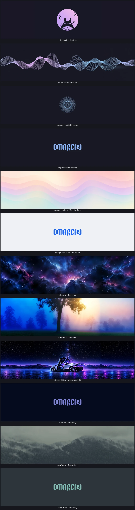
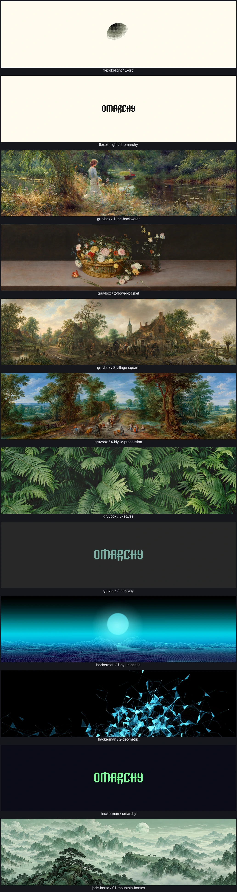
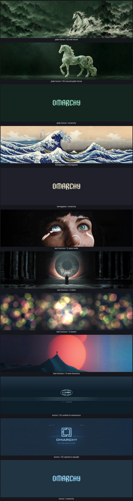
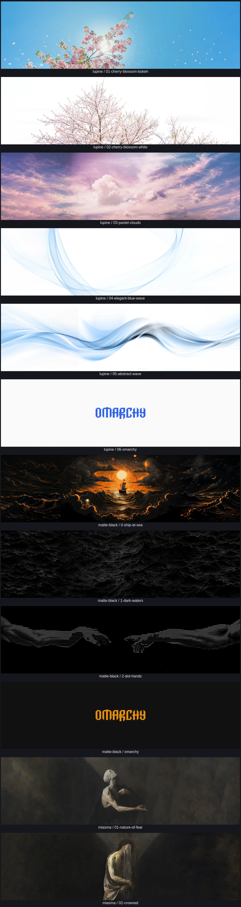
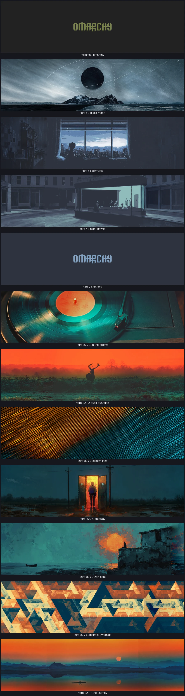
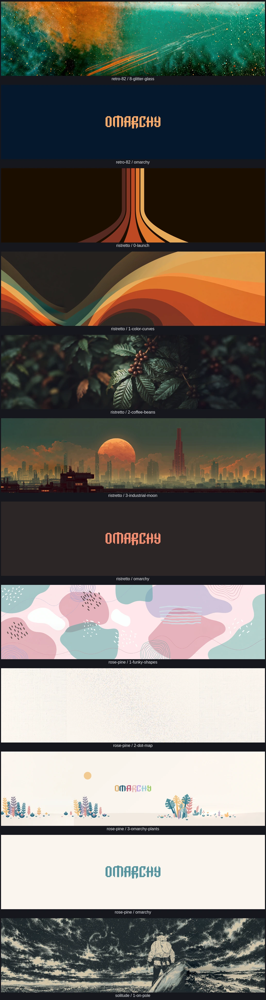
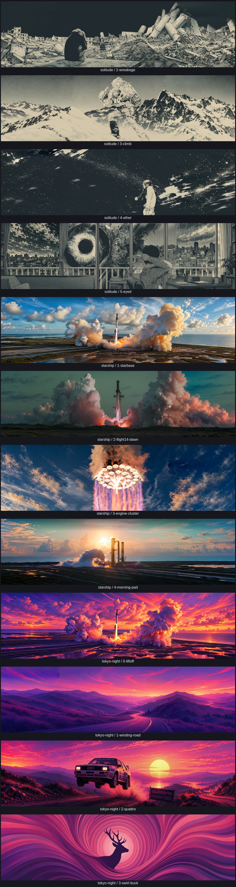
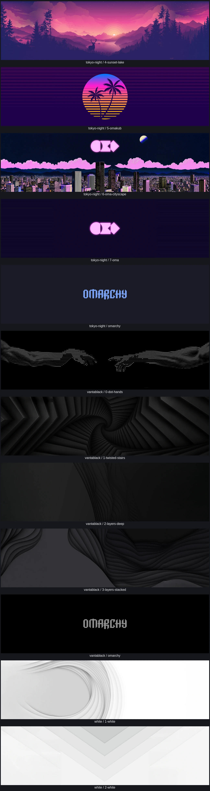
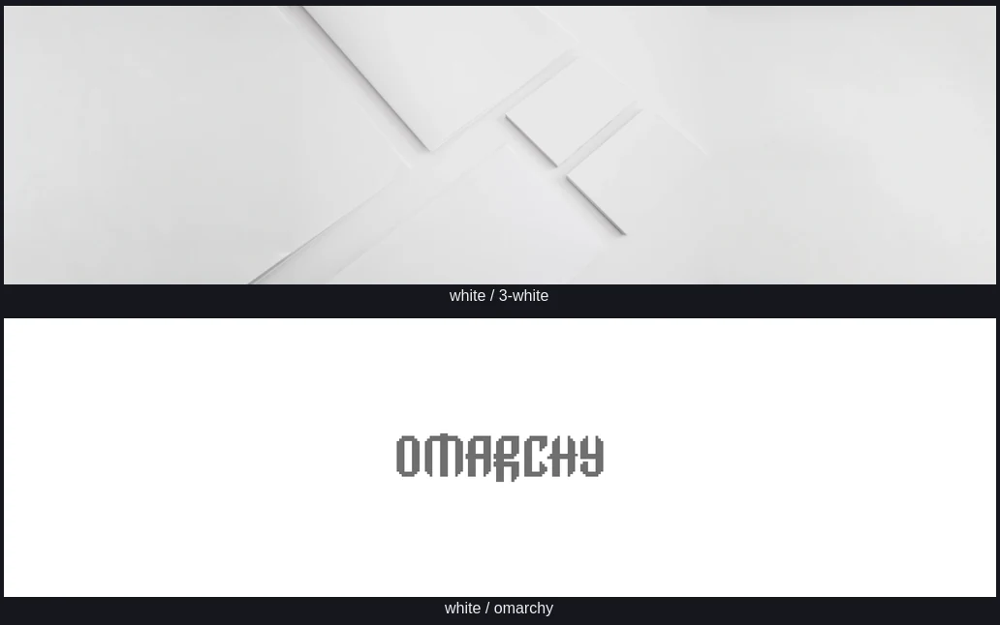

# 32:9 background gallery

All 98 compositions, rendered at 5120×1440 and reduced for this gallery. Reviewed composition source files are byte unchanged. Six photographic variants blend only documented edge strips: 256 display pixels for Last Horizon 2/3, 64 for Gruvbox 1/2, Ristretto 2 and the right edge of Last Horizon 4. Protected centers remain pixel-exact after normal display scaling. The dotted-hand variants complete boundary circles over at most 4 pixels of empty black source edge, preserving every original foreground pixel.

[Current before/after: Matte Black 2 and Vantablack 0 far-left contour cleanup](revision-comparison.webp). All photographic compositions and both accepted wrist joins retain the preceding revisions.

[Native-resolution Last Horizon edge details](seam-details.webp) · [Far-left contour at native display resolution](left-edge-details.webp) · [Accepted wrist joins at native display resolution](dot-details.webp) · [Vantablack full composition comparison](vantablack-arms.webp).

## catppuccin, catppuccin-latte, ethereal, everforest

## flexoki-light, gruvbox, hackerman, jade-horse

## jade-horse, kanagawa, last-horizon, lumon

## lupine, matte-black, miasma

## miasma, nord, retro-82

## retro-82, ristretto, rose-pine, solitude

## solitude, starship, tokyo-night

## tokyo-night, vantablack, white

## white

