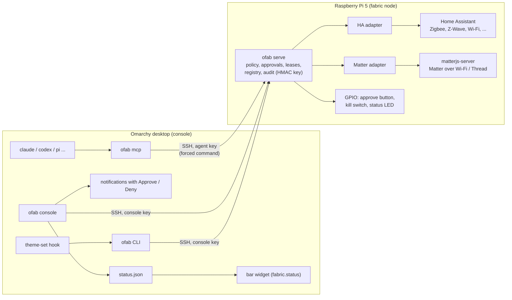

# Architecture

omarchy-fabric is a broker. Agents never talk to devices; every physical action takes the same path through one daemon, `ofab serve`, which decides, asks a person when it should, acts through a backend, and writes down what happened.

```
resolve -> validate -> policy -> (approval) -> execute -> confirm -> audit
```

## Topology

The recommended setup splits the roles across two machines, because the machine that holds the radios, the approve button and the audit key should not be the one running the agents.



Single-machine mode runs the daemon on the laptop with the built-in simulator. It is how you develop and how the test suite runs; it is not where a real lock should live (see the threat model).

## Code map

| Module | Role |
|---|---|
| `model.py` | Tiers, effects, assurance levels, specs, `Thing`, requests and decisions |
| `catalog.py` | Capability catalog aligned with Matter clusters; kind profiles; effective tier; predictions |
| `registry.py` | Things, state, availability, origin attribution, event fan-out |
| `policy.py` | The decision engine (pure: a `Context` in, a `Decision` out) |
| `limits.py` | Sliding-window rate limits, denial circuit breaker, leases |
| `approvals.py` | Approvals bound to exact requests, assurance checks, expiry |
| `audit.py` | Append-only JSONL with a SHA-256 / HMAC hash chain and `verify` |
| `fabric.py` | The pipeline that wires all of the above to the adapters |
| `adapters/` | `simulator`, `homeassistant`, `matter`, `gpio` |
| `api.py` | One method table with roles, shared by every transport |
| `rpc.py` | JSON-lines RPC over a unix socket, token TCP, and the SSH stdio bridge |
| `mcp_server.py` | MCP tools for agents (official SDK 2.3, `MCPServer`) |
| `console.py` | Desktop notifications and the bar's status file |
| `cli.py` | `ofab` |

## Capabilities

A capability is a small typed contract. Ids are ours; the Matter cluster is recorded so Matter maps one to one and so things can later be exported as W3C WoT Thing Descriptions.

| Capability | Matter cluster | Attributes | Commands (default tier) |
|---|---|---|---|
| `on_off` | 0x0006 | `on` | `turn_on` T1, `turn_off` T1 safer, `toggle` T1 |
| `level` | 0x0008 | `level` % | `set_level` T1 |
| `color` | 0x0300 | `color_temp_kelvin`, `rgb` | `set_color_temp` T1, `set_color` T1 |
| `door_lock` | 0x0101 | `lock_state` | `lock` T1 safer, `unlock` **T3** |
| `cover` | 0x0102 | `position` (100 = open), `cover_state` | `open`, `close`, `set_position` T1, `stop` T1 safer |
| `thermostat` | 0x0201 | `current_temperature`, `target_temperature`, `mode` | `set_target_temperature` T1, `set_mode` T2 |
| `valve` | 0x0081 | `open` | `open` T2, `close` T1 safer |
| `alarm_panel` | (HA) | `alarm_state` | `arm_away`, `arm_home` T1 safer, `disarm` **T3** |
| `scene` | (HA) | | `activate` T2 (its contents are opaque) |
| `temperature`, `humidity`, `occupancy`, `contact`, `leak`, `power`, `button` | 0x0402, 0x0405, 0x0406, 0x0045, 0x0090/0x0091, 0x003B | measurements | none |

## Risk tiers and kinds

| Tier | Meaning | Default effect | Default approval needs |
|---|---|---|---|
| T0 | Observe | allow | |
| T1 | Comfort, reversible, low consequence | allow | (desktop, if escalated) |
| T2 | Consequential, costly, hard to notice, or an unknown load | confirm | desktop |
| T3 | Safety or security critical | confirm | **presence** |

The same command means different things on different devices, so a thing's **kind** adjusts the tiers:

| Kind | Effect |
|---|---|
| `heater` | `turn_on` T3; `turn_off` stays T1 and safer |
| `appliance` | `turn_on` T2 (kettle, coffee machine, washer) |
| `plug`, `relay` | on and off both T2, and off is **not** "safer": a plug may power a fridge |
| `critical_load` | `turn_off` T3 (freezer, medical device, network gear) |
| `garage_door`, `gate` | `open` and `set_position` T3, `close` T2 |
| `water_main` | `open` T3; `close` is safer |
| `irrigation` | `open` T2 |

Defaults err on the safe side: an HA `switch` is a `plug` until you say what it powers, and an HA cover with no device class is treated as a `garage_door`. Config reclassifies per thing (`[things."ha:switch.bedroom_heater"] kind = "heater"`) or per command (`tiers = { "on_off.turn_on" = "T3" }`).

**Safer** commands move a device toward its fail-safe state (lock, heater off, valve closed, stop). They stay available while the fabric is frozen and during a human hold: agents can always make things safer. `toggle` takes the tier of the direction it would actually go.

## Policy evaluation

`policy.py` evaluates in a fixed order. The guards come first and no rule can override them.

1. **Guards**, each of which can only deny:
   - frozen (unless the command is safer)
   - the agent's scope (`things` / `deny` patterns: ids, `area:`, `kind:`, `tag:`) and tier ceiling (`max_tier`)
   - thing offline, or its backend disconnected
   - bounds (`thermostat.temperature` between 16 and 24, say)
   - human hold (unless safer)
   - another agent's lease (unless safer)
   - rate limits and the denial circuit breaker
2. **Base**: the tier maps to an effect (allow / confirm / deny) and, for confirm, the required assurance.
3. **Rules**: the first matching `[[policy.rules]]` entry may set the effect (allow, confirm or deny) and the assurance.
4. **Escalation**: an allowed T2+ action on a device whose current state is unknown becomes confirm; quiet hours turn allowed actions at or above a tier into confirm.
5. **Re-check on approval**: when a person approves, the whole evaluation runs again with the approval's assurance. If anything changed (frozen since, a person touched the device, it went offline), the approved request is cancelled instead of executed.

## Approvals and assurance

An approval binds a person's "yes" to one exact request: agent, thing, command and arguments. It expires (120 s by default). Agents can read the status of their own approvals and nothing else; approving is only reachable from console roles, so an agent cannot approve itself through the fabric's own interfaces.

Each channel carries an **assurance level**, and an approval needs at least the level its tier requires:

| Level | Comes from | Proves |
|---|---|---|
| `cli` | a same-user local process | very little: it cannot tell a person from an agent |
| `desktop` | a console session: the unix socket, or a console SSH key or token | a console credential was used, usually by a person clicking a notification |
| `presence` | the physical approve button on the node | someone is standing at the node |

The approve button approves only when exactly one request is waiting, so one press can never approve the wrong thing; with several waiting the status LED blinks fast and nothing happens. Holding it for two seconds denies everything pending. The kill switch freezes the fabric; only a console can resume.

## Who changed it: origin and human hold

Every attribute change carries an origin: `fabric`, `human`, `external`, `automation`, `device` or `initial`. When a person changes a device (`human`, or an unexplained `external` change such as a wall switch), agents leave that device alone for `human_hold_s` (600 s by default). That is the "don't fight the human" rule.

- **Home Assistant** tells us directly through the event context: our own call's context id, or our dedicated HA user, means `fabric`; any other `user_id` is `human`; a `parent_id` is an `automation`; no user and no parent is a device or a wall switch.
- **Matter and the simulator** do not say who did it, so the registry infers it. When the fabric executes a command it records the predicted effect. Inside a short window a change counts as the fabric's only if it reaches the predicted value or is moving toward it. Anything else is `external`. This matters: the first design attributed every change in the window to the fabric, which meant a person flipping a light straight back off after an agent turned it on, exactly when yielding matters most, got no protection. Scenario S07 guards that.
- Sensor readings never trigger a hold, and neither do automations or device-side changes (a kettle switching itself off), unless `human_hold_origins` says so.

## Leases, rate limits, circuit breaker, freeze

- **Leases** give one agent exclusive agent control of a thing for a while (`acquire_lease`, at most an hour). Other agents are refused except for safer actions; people are never locked out.
- **Rate limits**: 30 actions per agent per minute and 6 per agent per thing per minute by default.
- **Circuit breaker**: an agent refused 10 times in a minute (a loop, or a prompt-injected agent probing) is suspended for 5 minutes, and the console says so.
- **Freeze** (emergency stop) is available to everyone, agents included, from MCP, the CLI, the bar, the menu and the kill switch. It cancels pending approvals. Only a console can thaw.

## Audit log

Append-only JSONL. Every record carries `seq`, a UTC timestamp, its kind (`executed`, `denied`, `approval_requested`, `approval_resolved`, `cancelled`, `freeze`, `lease`, `adapter`, ...), the agent, thing, command, arguments, the agent's stated reason, the tier, the decision and its reasons, plus `prev` and `hash`. Each hash covers the previous hash and the canonical record, so editing or deleting a record breaks the chain from that point (`ofab audit verify`, scenario S14). On the node the chain is keyed with an HMAC key that only the fabric user can read, so rewriting the whole file is detectable too. A missing configured key stops the daemon rather than silently dropping to an unkeyed log.

## Roles and transports

| Role | Can |
|---|---|
| `agent` | observe, invoke through policy, simulate, its own approvals, leases, emergency stop |
| `console` | everything an agent can, plus list / approve / deny approvals, thaw, audit, simulator controls |
| `admin` | everything a console can, plus Matter commissioning |

| Transport | Identity comes from |
|---|---|
| Unix socket (0600) | the peer declares it; protect the socket with file permissions |
| TCP (optional) | bearer tokens in `[[rpc.tokens]]`; prefer SSH or Tailscale |
| SSH | an `authorized_keys` forced command runs `ofab rpc-stdio --role R --agent A`, which pins the identity whatever the client claims (tested in `tests/test_bridge.py`). One key per identity: the console's key and each agent's key are different files with different host aliases. |

## MCP surface

`ofab mcp --agent NAME` is a stateless proxy: no device state, no decisions, the same daemon for every agent, so leases, rate limits and approvals are shared. Tools, with MCP annotations:

| Tool | Annotations |
|---|---|
| `fabric_status`, `list_things`, `get_state`, `describe_thing`, `recent_events`, `approval_status`, `simulate` | read-only |
| `invoke` | destructive, open-world |
| `acquire_lease`, `release_lease`, `emergency_stop` | not destructive, idempotent |

There is deliberately no approve or thaw tool. Errors come back as structured results (`{"error": {"code", "message"}}`) so the model can read them. The server instructions tell agents how tiers and approvals work and that device text is untrusted. Device names and string values are stripped of control and bidirectional characters, capped in length, and flagged (`name_flagged`) when they look like instructions (scenario S13). Policy never reads an agent's stated reason, so no device text can talk its way past a guard.

## Backward compatibility

### Home Assistant

The HA adapter speaks HA's WebSocket API: auth handshake, `get_config` (unit system), `auth/current_user`, the entity, area and device registries (optional; needs an admin token, used for areas and device info), `subscribe_events` for `state_changed`, `get_states`, and `call_service`. HA keeps doing what it is good at and the fabric adds the agent layer on top.

| HA domain | Capabilities | Kind |
|---|---|---|
| `light` | `on_off`, plus `level` and `color` by supported color modes | light |
| `switch`, `input_boolean` | `on_off` | plug, indicator |
| `fan` | `on_off`, `level` (percentage) | fan |
| `lock` | `door_lock` | lock |
| `cover` | `cover` | blind for blind, shade, curtain..., gate for gate, otherwise garage_door |
| `climate` | `thermostat` (°F converted) | thermostat |
| `sensor` | temperature, humidity, power, energy by device class | sensor |
| `binary_sensor` | contact, occupancy, leak by device class | sensor |
| `valve`, `alarm_control_panel`, `scene`, `script` | `valve`, `alarm_panel`, `scene` | |

Give the fabric a dedicated HA user and token, and do not also give agents HA's own MCP server (see the prior art).

### Matter

The Matter adapter speaks the OHF Matter Server WebSocket API (`ws://127.0.0.1:5580/ws`), the protocol shared by the archived python-matter-server and its matter.js successor. Each endpoint with a supported server cluster becomes `matter:<node>/<endpoint>`. Units are converted: 0.01 °C temperatures and setpoints, levels 0–254, mireds to kelvin, Window Covering lift percent inverted (Matter's 0 is open), milliwatts and milliwatt-hours. Door Lock commands are sent as timed invokes, as the spec requires.

### One path per device

If HA uses the same Matter Server, every Matter device would appear twice (`ha:light.x` and `matter:5/1`), and a lease or human hold on one id would not cover its alias. The node config sets `exclude_integrations = ["matter"]` on the HA adapter so Matter devices come only through the Matter adapter.

## Threat model

Assets: the physical state of the home (locks, heat, water, doors), people's safety, the audit trail.

| Threat | Defence |
|---|---|
| A prompt-injected or confused agent asks for something dangerous | Tiers and kinds, T3 needs physical presence, bounds, the circuit breaker, emergency stop |
| Text inside device names or attributes tries to steer the agent | Sanitising and flagging; policy is independent of anything the agent says |
| An agent tries to approve its own request | No approve tool; console roles only; SSH keys pinned to roles; T3 needs the button |
| Two agents fight over a device | Leases |
| An agent fights a person | Human hold from origin attribution |
| An approval goes stale | Expiry, plus a full re-check at execution |
| Someone edits the history | Hash chain, HMAC key on the node |
| The LAN | Matter Server and Mosquitto on localhost only; RPC over SSH; TCP is off by default and token-gated |

Known limits, stated plainly:

- **On a single machine, an agent with shell access is the same user as you.** It can run `ofab approve`, read the console token, or edit the config, so `desktop` assurance there proves little. That is why the laptop config warns when T3 does not require presence, and why the Pi node exists. OS re-authentication (polkit, fingerprint) as a desktop presence channel is on the roadmap.
- Physical access to the Pi defeats it: it holds the button and the key.
- An HA admin token on the node is powerful. It never leaves the node, and agents reach the node only through forced commands.
- The fabric governs agents. It does not replace HA's own security, and it cannot stop someone using the HA app directly. That is intended: people stay in charge.

## Roadmap

- Matter 1.5 closures (garage doors and gates natively), more clusters, Matter commissioning from the desktop console.
- An MQTT / Zigbee2MQTT adapter, and publishing fabric status back into HA over MQTT discovery.
- W3C WoT Thing Description export (`ofab describe --wot`).
- Desktop presence through polkit / fingerprint re-authentication.
- MCP Multi Round-Trip Requests as an in-band channel at the lowest assurance level; lease handles as server-minted tool arguments (MCP 2026-07-28).
- Interop with ha-mcp's approval queue; Cedar or OPA as an optional policy language.
- Energy-budget and presence-aware policies; signed audit checkpoints mirrored to the desktop.
- An HA app (add-on) package for people who run Home Assistant OS.
