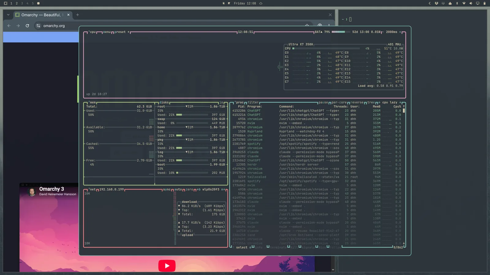

# Navigation

Everything in Omarchy happens via the keyboard — _EVERYTHING!_ When the system first starts, you literally can't do a thing with the mouse alone. But you can hit `Super + Space` to reveal the Omarchy Menu and from here you can do just about everything.

But the Omarchy menu is not even intended to be the main way to operate the system most of the time. We can get faster than that! All the most important applications are bound directly to individual hotkeys. You start the terminal with `Super + Return` and a browser with `Super + Shift + Return`. Try doing one after the other, and you'll see the magic of Hyprland's tiling in action:

 

You can then hit `Super + J` to stack them on top of each other instead of side by side:

 

Hit `Super + J` again to return them to their side-by-side positions. Then try `Super + Shift + Arrow Right` while on the browser to swap the windows.

Now try `Super + Shift + T` to start the Activity monitor. That'll appear as a floating window. You can tile it using `Super + T` (and hit that again to make it floating again). Now press `Super + Shift + F` to open the files manager. You'll have a neat four-way setup:

 

You navigate between the window you want to be active with `Super + Arrow`. This will switch focus and move the cursor to the center of the new application. At the edge of a screen, it carries on to the monitor on that side.

If you hit `Super + Shift + 2`, you'll move the current focused application onto the second workspace. `Super + Shift + 1` moves it back. (And `Super + Shift + Alt + 2` will move the current focused application onto the second workspace without switching to it).

With more than one monitor, every monitor has workspaces 1 through 10 of its own. `Super + 2` goes to the second workspace of the monitor you're on, and each monitor's top bar shows its own workspaces and the one it's showing. `Super + Tab` cycles through the workspaces on the monitor you're on. `Super + Shift + Ctrl + Arrows` moves the window you're on to the monitor in that direction, onto the workspace it's showing, and `Super + Shift + Alt + Arrows` moves the workspace you're on over to the monitor in that direction, where it takes the same number if it's free. A monitor keeps its workspaces when you unplug it: they join another screen's, numbered after the ones it already has, and go back under their old numbers when the monitor returns.

If you hold down `Super` and use the mouse to click on a window, you'll be able to rearrange where it sits. If you hold `Super` and use the right button on the mouse, you can freely resize the window.

You close a window on `Super + W` or `Super + Q` (and close all windows on `Ctrl + Alt + Delete`).

You can also go full screen with `Super + F` or even just full-width (keeping the top bar) with `Super + Alt + F` or full-screen within a window with `Super + Ctrl + F` (good for YouTube!).

### Dwindle vs scrolling layout

Omarchy's default layout is called dwindle. It keeps all the windows you open on a single workspace visible at all time, even if it has to shrink them down.

 

But you can also choose to turn a workspace into the scrolling layout where windows are lined up side-by-side, beyond the visible edge of the display. You turn a single workspace into this layout via `Super + L`.

Pressing `Super + L` again turns the workspace floating, where windows overlap freely and you place them yourself, and a third press returns it to dwindle. `Super + Alt + L` goes through them the other way. A window that floats anyway — one you popped out with `Super + T`, or an app that always opens floating — keeps floating when the workspace goes back to tiling. The top bar marks the workspace you're on with its layout: a square for dwindle, a circle for scrolling, and a triangle for floating. Clicking that mark cycles the layout too.

 

The choice is per workspace, and it sticks. So you can keep workspace 1 on dwindle for browsing and workspace 2 on scrolling for code, and they'll come back that way after a restart.

If you wish to use the scrolling layout as the default, you can set that in `~/.config/hypr/looknfeel.lua`:

```lua
hl.config({
  general = {
    layout = "scrolling",
  },
})
```

### Floating workspaces

A floating workspace works like a traditional desktop: windows overlap, and you move and size them yourself. Each window gets a titlebar in your theme's colors, with buttons to minimize, maximize, and close. `Super + M` minimizes the focused window too. A minimized window waits in the dock; click its app to bring it back. Click a window to bring it forward. Resize it from any edge or corner. Double-click a titlebar to maximize the window while keeping the top bar in view, and again to get its old size back.

A floating workspace also shows a dock, with your pinned apps, everything that's running, and a grid of every app behind the apps button, which `Super + Alt + Space` and _Apps_ in the Omarchy menu open too. Right-click an app on the grid, or press `Delete`, to uninstall it. Click an app to open it, or to bring its window forward; click again to cycle through its windows. Middle-click opens a new window. Drag an icon along the dock to move it; dragging a running app in among the others keeps it there. Right-click to keep an app in the dock, take it out, or quit it. The dock gets out of the way of a fullscreen window. Right-click the apps button to move the dock to another edge or have it hide until the pointer reaches its edge. The position is also under _Appearance > Dock > Dock Position_, and `omarchy dock position left` and `omarchy dock autohide on` set both from a terminal. Apps you keep in the dock are faded while they aren't running.

New workspaces, and any you haven't given a layout of their own with `Super + L`, use the default layout. Changing the default resets every workspace without windows to it, while one with windows on it keeps the layout it has. A window minimized to the dock still counts as a window on the workspace it left. Pick it under _Appearance > Workspace Layout_: Tiling, Scrolling, or Floating. `omarchy-hyprland-workspace-layout-default scrolling` sets it from a terminal.

### Grouping windows

Windows can be grouped using `Super + G`. Once you're in a group, every window you start while that's active will belong to the group. You can move between these grouped windows using `Super + Ctrl + Arrow Left/Right` or `Super + Alt + 1/2/3/4` to go directly to grouped window in order.

You can move a window out of the grouping with `Super + Alt + G` or disassemble the entire group by hitting `Super + G` again. Finally, you can move windows outside the group into it with `Super + Alt + Arrows`.

### Popping windows

You can pop a window out of its workspace allocation with `Super + O`. That'll pin it as a floating window that follows you on whatever workspace you go to. Great for video players and the like.

 

### Scratchpad workspace

Finally, there's a special scratchpad workspace that drops down over whatever workspace you're currently on, much like a Quake console. Toggle it with `Super + Grave` or `Super + S`, and place a window there using `Super + Shift + Grave` or `Super + Alt + S`.

It works especially well for a terminal running an agent, or for controls you want to interact with quickly without leaving the current workspace. To move a window off the scratchpad, send it directly to another workspace with something like `Super + Shift + 1`.

While the scratchpad holds a single window, it drops down as a centered panel rather than spanning the screen. Put a second app on it and it goes back to the full width, so the two have room to sit side by side.

### It takes some getting used to!

It takes a little while to get used to navigating your desktop like this, but once you do, it'll be hard to go back to a traditional mouse-driven desktop experience!
