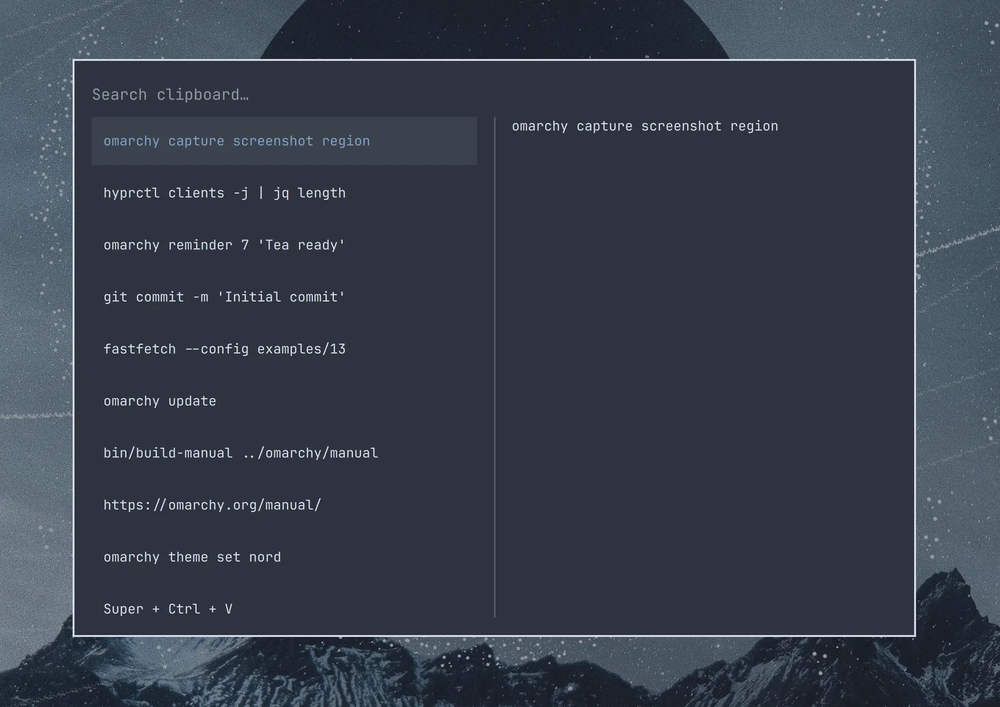
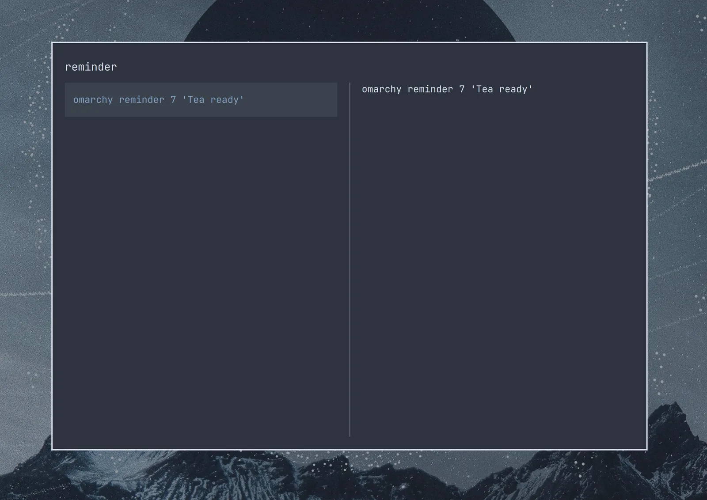

# Unified Clipboard & History

Usually on Linux, you need `Ctrl + Shift + C/V` to copy'n'paste in the terminal and `Ctrl + C/V` to do it everywhere else. That's hard to get used to for anyone who hasn't been born and bred on Linux! So too is the switch from super to ctrl, if you're coming from the Mac.

Omarchy tackles both problems with unified clipboard hotkeys that work (almost) everywhere. They are:

| Hotkey | Command |
| ------- | ----------- |
| Super + C | Copy |
| Super + X | Cut |
| Super + V | Paste |
| Super + Ctrl + V | Clipboard history |

_Note that most agent harnesses will use `Ctrl + V` for pasting images, but `Super + V` for pasting text._

### Clipboard history

The clipboard history is provided by the Omarchy shell and works for both text and images. You trigger it by `Super + Ctrl + V`, select your entry with return, and then that'll be placed on the clipboard ready to paste on `Super + V`.

 

You can also search the history just by starting to type:

 

### Pinned clipboard entries

Keep up to **10 pinned entries** by selecting an entry in clipboard history and pressing `Ctrl + P`, or clicking **Pin** beside it. Pins appear at the top, remain searchable, and survive logout, restart, and power off. Both text and images can be pinned.

Press `Ctrl + P` again or click **Unpin** to release a slot. At the limit, unpin an entry before adding another; existing pins are never replaced automatically.

Press `Delete` to remove the selected entry, including a pinned entry. Press `Shift + Delete` to clear the entire history, including pins, after confirmation.

Pin whatever is currently on the clipboard from a terminal:

```bash
omarchy clipboard pin
```

Or copy and pin text from a command in one step:

```bash
printf '%s' 'Keep this text' | omarchy clipboard pin --copy
```

Pins are stored with clipboard history in `$XDG_STATE_HOME/omarchy/clipboard-history.json` (by default `~/.local/state/omarchy/clipboard-history.json`). Pinning an image retains its captured image; pinning a file link retains the link, so the original file still needs to exist. Clipboard content marked sensitive by an application is excluded when pinning the current clipboard, as it is from history. The `--copy` option uses the text provided on stdin independently of the current clipboard.
