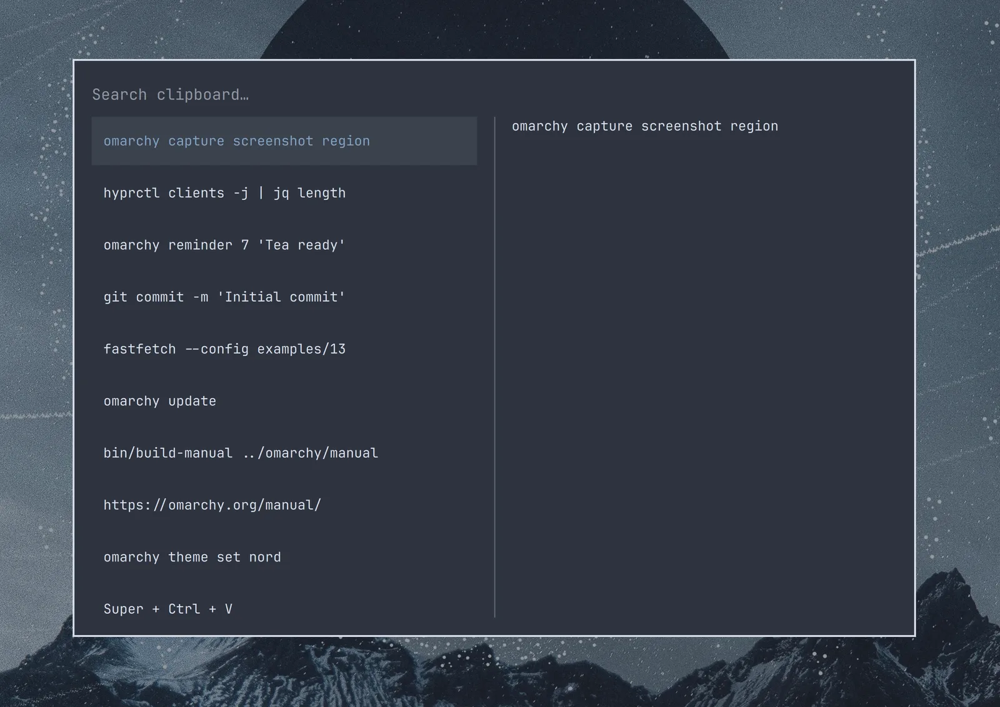
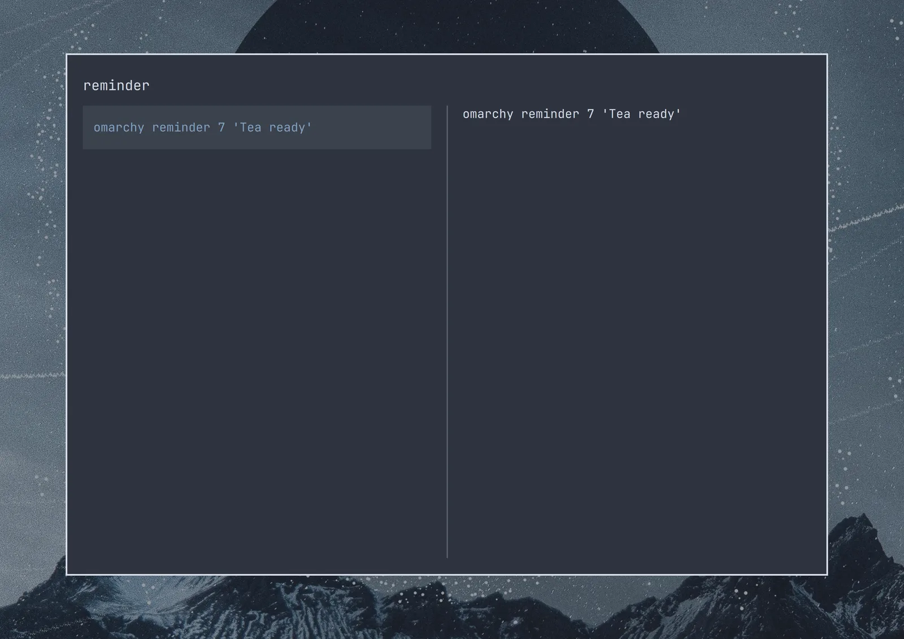

# Unified Clipboard & History

Usually on Linux, you need `Ctrl + Shift + C/V` to copy'n'paste in the terminal and `Ctrl + C/V` to do it everywhere else. That's hard to get used to for anyone who hasn't been born and bred on Linux! So too is the switch from super to ctrl, if you're coming from the Mac.

Omarchy tackles both problems with unified clipboard hotkeys that work (almost) everywhere. They are:

| Hotkey | Command |
| ------- | ----------- |
| Super + A | Select all |
| Super + C | Copy |
| Super + X | Cut |
| Super + V | Paste |
| Super + Ctrl + V | Clipboard history |

_Note that most agent harnesses will use `Ctrl + V` for pasting images, but `Super + V` for pasting text._

Use `Super + A`, then `Super + C` to copy everything in a focused text field or other app that supports `Ctrl + A`. In a terminal, `Ctrl + A` moves to the start of the command line instead of selecting its text.

### Clipboard history

The clipboard history is provided by the Omarchy shell and works for both text and images. You trigger it by `Super + Ctrl + V` and select your entry with return, which pastes it straight into the app you were in. Use `Shift + Return` to only copy it to the clipboard, `Alt + Return` to open it, `Delete` to remove it from the history, and `Shift + Delete` to clear the whole history.

 

You can also search the history just by starting to type:

 
