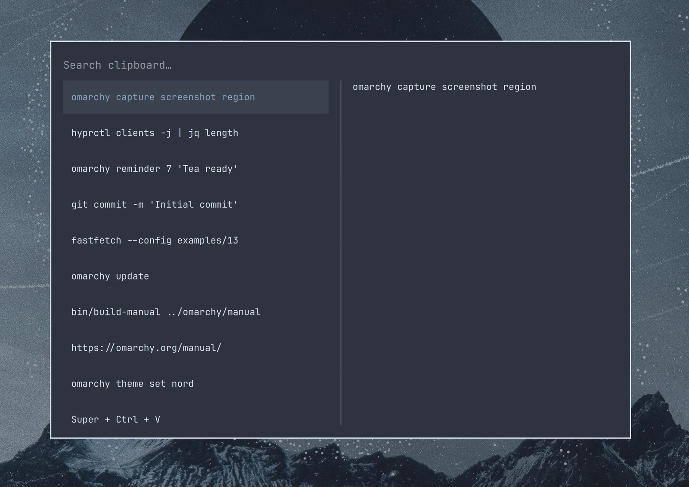
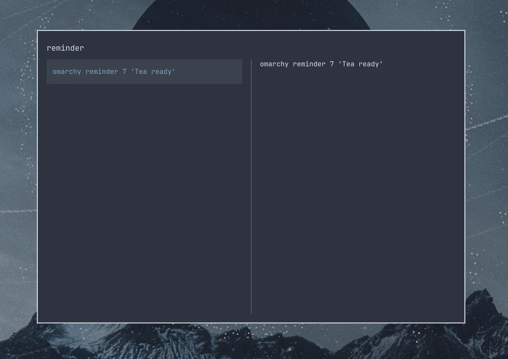

# Unified Clipboard & History

Usually on Linux, you need `Ctrl + Shift + C/V` to copy'n'paste in the terminal and `Ctrl + C/V` to do it everywhere else. That's hard to get used to for anyone who hasn't been born and bred on Linux! So too is the switch from super to ctrl, if you're coming from the Mac.

Omarchy tackles both problems with unified clipboard hotkeys that work (almost) everywhere. They are:

| Hotkey | Command |
| ------- | ----------- |
| Super + A | Select all |
| Super + C | Copy |
| Super + X | Cut |
| Super + V | Paste |
| Super + Ctrl + V | Clipboard history |

_Note that most agent harnesses will use `Ctrl + V` for pasting images, but `Super + V` for pasting text._

Use `Super + A`, then `Super + C` to copy everything in a focused text field or other app that supports `Ctrl + A`. In a terminal, `Ctrl + A` moves to the start of the command line instead of selecting its text.

### Clipboard history

The clipboard history is provided by the Omarchy shell and works for both text and images. You trigger it by `Super + Ctrl + V`, select your entry with return, and then that'll be placed on the clipboard ready to paste on `Super + V`.

 

When the highlighted entry is a path to an image (like `~/Pictures/photo.png`) or a link to one (like `https://example.com/photo.png`), the preview shows the image itself. A link is only fetched once you highlight it.

Copied or cut files show up in the history as their path. Picking one closes the history and leaves the clipboard alone, so the file manager can still paste or move the file itself.

If you rebind the clipboard history to `Ctrl + V` or `Super + V`, file managers will no longer receive the paste, so cut and copied files can't be pasted into them. Have your binding send the key straight through when a file manager is focused, in `~/.config/hypr/bindings.lua`:

```lua
local function clipboard_or_native_paste()
  local window = hl.get_active_window()
  local class = window and window.class or ""
  if class:lower():find("nautilus", 1, true) then
    hl.dispatch(hl.dsp.send_key_state({ mods = "CTRL", key = "V", state = "down" }))
    hl.timer(function()
      hl.dispatch(hl.dsp.send_key_state({ mods = "CTRL", key = "V", state = "up" }))
    end, { timeout = 50, type = "oneshot" })
  else
    hl.exec_cmd("omarchy-shell shell toggle omarchy.clipboard")
  end
end
o.rebind("SUPER + CTRL + V", "Clipboard history", clipboard_or_native_paste)
```

You can also search the history just by starting to type:

 
