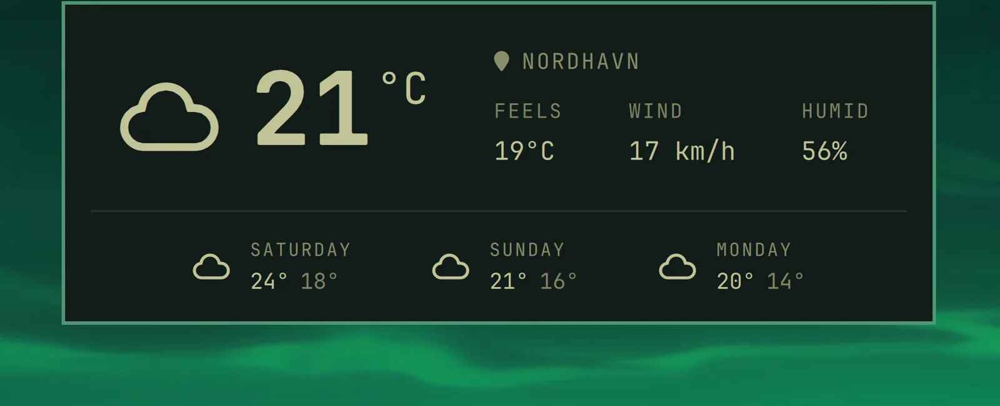

# Notices

Notifications land in the top-right corner of the focused display. You can move them to any other corner by setting `notifications.position` in `~/.config/omarchy/shell.json` to `top-left`, `bottom-right`, or `bottom-left`. You can also quickly access the date and time, battery status, and current weather using the hotkey notices.

## Notifications

Notifications from the same app or site stack into a deck, so a chatty Slack channel doesn't push your build failure off the screen. Hover a deck to fan it out; nothing new slides in under your pointer while you're reading. Click a card to jump to where it came from, right-click, middle-click, or hit the ✕ to dismiss it.

Cards offer what they carry: _Copy code_ for verification codes (kept out of [clipboard history](08-unified-clipboard-history.md) and cleared after a minute), plus any buttons the app provides. Links in a notification's text open when clicked.

Silencing notifications holds them back, except Omarchy's own confirmations, emergency alerts, and verification codes, which you asked for a moment ago. Put the last few back on screen, held back or not, with `Super + Shift + Alt + ,`. History is kept for a day.

## Hotkey notices

### Date & Time

`Super + Ctrl + Alt + T`

 

### Weather

`Super + Ctrl + Alt + W`

 

The location is detected from your IP address, which is usually close enough, but not always. You can pin it down with `omarchy weather location --set Malibu`, or be exact about it by adding coordinates: `omarchy weather location --set Malibu 34.0259,-118.7798`. Run `omarchy weather location` on its own to see where it thinks you are, and `--clear` to go back to auto-detection.

### Battery

`Super + Ctrl + Alt + B`

 
