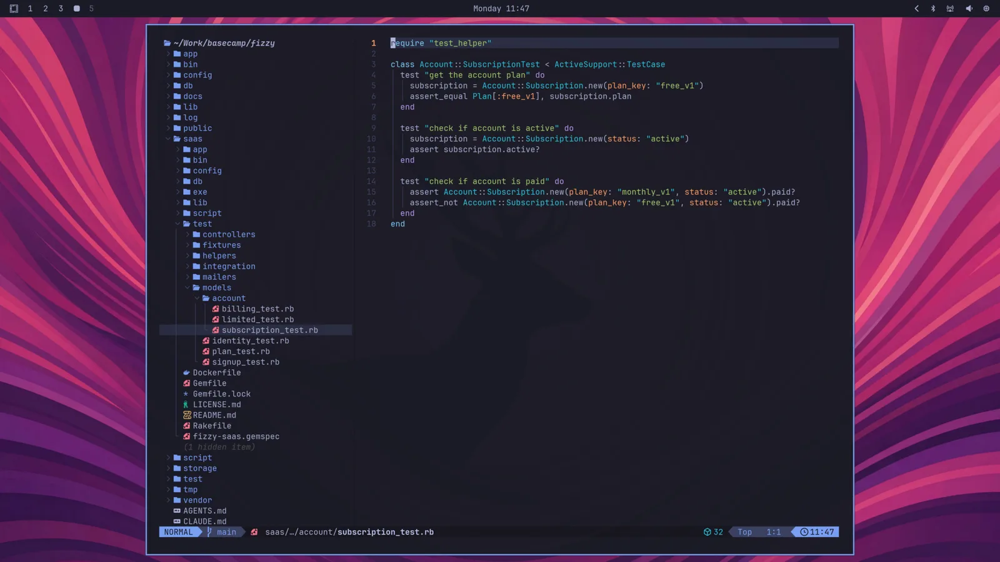

# Fonts

Omarchy uses JetBrainsMono Nerd Font as both the terminal and system font by default.

 

You can change this through the _Appearance > Font_ menu in the Omarchy menu (`Super + Space`). That sets the monospace font everywhere: the terminal, the bar, and anything else that asks for it.

You can install other popular programming fonts via _Install > Style > Font_ in the Omarchy menu: Cascadia Mono, Meslo LG Mono, Fira Code, Victor Code, Bitstream Vera Mono, and Iosevka are all one click away, in their Nerd Font versions so the glyphs in the bar and terminal keep working. Installing one also switches the whole system to it, and you can switch back any time under _Appearance > Font_.

## Persian

Text marked as Persian uses [Vazirmatn](https://github.com/rastikerdar/vazirmatn), a free and open source Persian/Arabic typeface. The Non-Latin variant keeps English letters and Western digits in your chosen interface and terminal fonts. It also covers Arabic-script fallback when an app supplies no language. Text explicitly marked as Arabic or Urdu keeps its existing fonts.

On an English desktop, many apps can't tell Persian from Arabic, because both use the same script. Folio, the Omarchy shell and other Qt and GTK apps then show Persian in the Arabic font. Picking Persian under _Setup > Region > Language_, or adding the Persian keyboard layout, makes Vazirmatn your font for all Arabic-script text, Persian and Arabic alike. Run `omarchy font persian on` to set it yourself, or `omarchy font persian default` to go back. Urdu keeps its own font either way.

## Chinese, Japanese, and Korean

Chinese, Japanese, and Korean share many characters but draw some of them differently, so the same character looks right to one reader and foreign to another. Picking one of these languages under _Setup > Region > Language_, or its input method, sets the matching forms. To choose them yourself, run `omarchy font cjk jp`, `kr`, `sc`, `tc` (Taiwan), or `hk` (Hong Kong) in a terminal; `omarchy font cjk default` goes back to the system's choice, which is Japanese forms. Text a web page or document marks with its own language, and the whole desktop while it is in one of these languages, keeps that language's forms.
