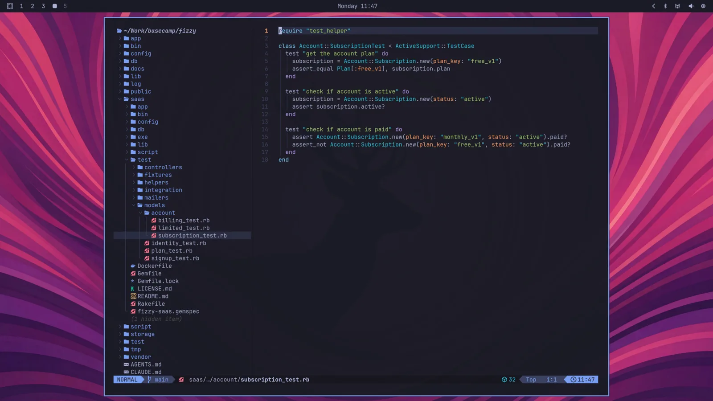

# Fonts

Omarchy uses JetBrainsMono Nerd Font as both the terminal and system font by default.

 

You can change this through the _Appearance > Font_ menu in the Omarchy menu (`Super + Space`). That sets the monospace font everywhere: the terminal, the bar, and anything else that asks for it.

You can install other popular programming fonts via _Install > Style > Font_ in the Omarchy menu: Cascadia Mono, Meslo LG Mono, Fira Code, Victor Code, Bitstream Vera Mono, and Iosevka are all one click away, in their Nerd Font versions so the glyphs in the bar and terminal keep working. After installing one, pick it under _Appearance > Font_.

## Hinting

Hinting nudges the shapes of letters onto whole pixels. Stronger hinting gives crisper text on a regular 1x display, especially at small sizes, at the cost of bending the letters and their spacing away from how the font was drawn. On a 2x retina-class display there are enough pixels that it makes little difference.

Omarchy leaves this at the standard _Slight_ setting. If text looks soft on your display, pick _Full_ under _Appearance > Font Hinting_, or run `omarchy font hinting full`. The other choices are _None_ and _Medium_, and `omarchy font hinting reset` returns to the default. Apps that are already open pick up the change when you restart them.

## Chinese, Japanese, and Korean

Chinese, Japanese, and Korean share many characters but draw some of them differently, so the same character looks right to one reader and foreign to another. Picking one of these languages under _Setup > Language_, or its input method, sets the matching forms. To choose them yourself, run `omarchy font cjk jp`, `kr`, `sc`, `tc` (Taiwan), or `hk` (Hong Kong) in a terminal; `omarchy font cjk default` goes back to the system's choice, which is Japanese forms. Text a web page or document marks with its own language, and the whole desktop while it is in one of these languages, keeps that language's forms.
