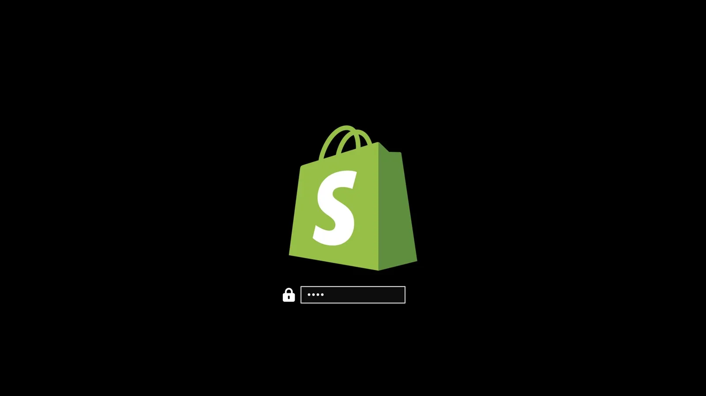
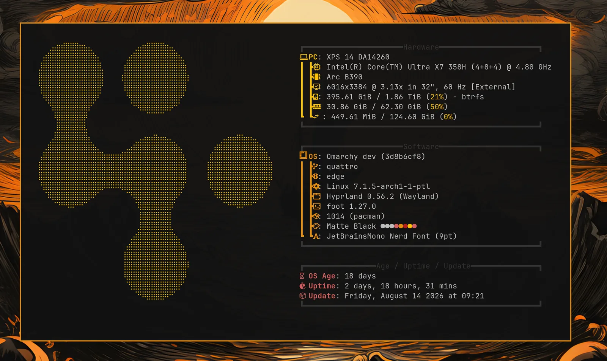

# Branding

Omarchy allows you to set your company logo or personal image for both the boot unlock, the screensaver, and the about screen.

### Boot unlock

You can use `omarchy plymouth preview` to see what your custom logo and colors would look like. It takes a background color, a text color, a logo png, and a path for the preview image:

```
omarchy plymouth preview '#1d2021' '#ebdbb2' logo.png preview.png
```

Then apply the setup with `omarchy plymouth set '#1d2021' '#ebdbb2' logo.png`, which will also give the SDDM login screen the same colors and logo. If you want to revert, you can use `omarchy plymouth reset`.

You can also put your screensaver art there instead, under _Appearance > Branding > Unlock > Use Screensaver Art_, or with `omarchy branding unlock screensaver`. Whatever the screensaver shows, be it words from `omarchy ascii` or a logo from _Set From Image_, gets drawn the way the Omarchy wordmark is drawn on that screen, in the current theme's accent color on its background, and the SDDM login screen gets it too. It asks for your password, since the boot screen lives outside your home. _Restore Default_ puts the Omarchy logo back.

The art has to be made of block characters or braille, which is what `omarchy ascii` and _Set From Image_ write. Letters you typed in yourself have no pixels to draw, so the command names them and leaves the boot screen alone.

 

### Screensaver

You can change the logo used for the screensaver under _Appearance > Branding > Screensaver_. It's an ASCII logo, so you can edit the text directly, but you can also hand it a png or svg image, and we'll convert that to ASCII. It looks pretty cool.

 

There are three entries in that menu:

- **Edit Text** opens `~/.config/omarchy/branding/screensaver.txt` in your editor. Type or paste whatever you like — ASCII art, your name, a rude word. Save and quit, and the screensaver fires up immediately so you can see it.
- **Set From Image** opens a file picker for a png or svg, converts it to ASCII, and shows you the result. Logos with a clear silhouette work far better than photos.
- **Restore Default** puts the Omarchy logo back.

### About screen

The same three options are under _Appearance > Branding > About_ for the _About_ screen you get from the Omarchy menu, and they work identically — the file is `~/.config/omarchy/branding/about.txt`, and the About window pops up after each change. The About art is converted to a smaller size than the screensaver's, since it has to fit in a window rather than fill your display.

While the window is open a glint of green leans across the art every few seconds and then leaves it still again. Your own art gets it too, as long as every character in it is one column wide — anything _Set From Image_ produces is. Art built from emoji or double-width characters stays still instead, and so does the screen if you keep a fastfetch config of your own: a still logo in those cases is the animation keeping out of the way rather than failing, since sliding a glint across them would land the rest of the line in the wrong place.

 

### Converting images yourself

Both of the _Set From Image_ options are just calling `omarchy transcode ascii`, which you can run directly if you want control over the conversion:

```
omarchy transcode ascii ~/logo.svg ~/.config/omarchy/branding/screensaver.txt --width 100
```

It takes `--width` and `--height` in terminal columns and rows, a `--mode` of either `braille` (the default, and much finer) or `block`, a `--threshold` percentage for deciding which pixels count as part of the logo, and `--invert` for when your logo is light on a dark background. If a conversion comes out as a blob, the threshold is usually the knob to turn.

Going the other way, `omarchy transcode logo` draws block or braille art as a png at the size the unlock screen uses, which you can hand to `omarchy plymouth set` with colors of your own:

```
omarchy transcode logo ~/.config/omarchy/branding/screensaver.txt ~/logo.png --color '#7aa2f7'
```

### Words instead of a logo

`omarchy ascii` draws text in Delta Corps Priest 1, the FIGlet font the Omarchy wordmark itself is drawn in, so a screensaver can say something rather than show a picture:

```
omarchy ascii "Back in five" > ~/.config/omarchy/branding/screensaver.txt
```

It takes the text as arguments, or reads it from a pipe when given none. The font carries letters and spaces only — it was drawn without digits or punctuation — so anything else is dropped and named on stderr rather than quietly swallowed.
