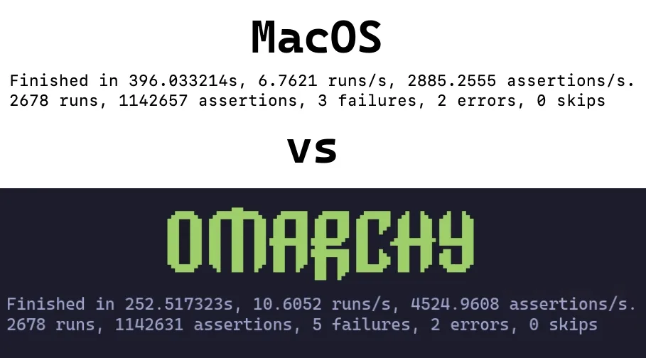

# Mac support

## Omarchy for Apple Silicon

Omarchy for Apple Silicon is an official Omacom solution, first released with Omarchy 4.5. It installs next to macOS, and you choose between the two when your Mac starts.

Got a notice about Omarchy Mac? Go to [Coming from Omarchy Mac](#coming-from-omarchy-mac).

It runs on these Macs:

| Mac | Chips |
| --- | --- |
| MacBook Air | M1, M2, M3 |
| MacBook Pro | M1, M1 Pro, M1 Max, M2, M2 Pro, M2 Max, M3, M3 Pro, M3 Max |
| MacBook Neo | A18 Pro |
| Mac mini | M1, M2, M2 Pro |
| Mac Studio | M1 Max, M1 Ultra, M2 Max, M2 Ultra |
| iMac | M1, M3 |
| Mac Pro | M2 Ultra |

M4 and newer Macs aren't supported yet. M4 support is in testing on the edge channel and comes next. The installer checks your Mac before it changes anything.

On any Apple Silicon Mac, including M4 and newer, you can run Omarchy in a virtual machine with [Try Omarchy](https://github.com/omacom/try-omarchy).

### What you need

- macOS 15 Sequoia or later, and an administrator account
- Free disk space for Omarchy. The installer suggests a size and lets you change it.
- A backup of your Mac, power, and an internet connection. The install downloads several gigabytes.

### Installing

You install from macOS. Install the Omarchy Installer with [Homebrew](https://brew.sh):

```sh
brew install omacom/mac/omarchy
```

Or download the newest Omarchy Installer from its [releases page](https://github.com/omacom/omarchy-mac-installer/releases) and open it.

The installer checks your Mac, shows you the plan, and makes room for Omarchy by shrinking the macOS partition. macOS stays on the disk and no USB drive is needed. When the first stage is done, it walks you through finishing setup in macOS Recovery: shut down, hold the power button until "Loading startup options" appears, choose Omarchy, and follow the steps.

On first boot, Omarchy asks for a password that encrypts its disk. There's no recovery key: if you forget the password, your Omarchy files can't be recovered.

To switch between Omarchy and macOS later, shut down, then hold the power button until the startup options appear and choose one.

### Coming from Omarchy Mac

Omarchy Mac is now part of Omarchy for Apple Silicon, and every Mac that ran it is supported. Your current install keeps running, and its system packages still update, but it gets no more Omarchy updates. There's no deadline and no in-place upgrade: you back up, remove the old install, install fresh, and restore. Steps 2 to 5 happen in macOS, so open this page on your phone before you restart.

1. **Back up from Omarchy, off the Mac.** Removing the old install erases it, and macOS can't read the Omarchy disk. Copy your home folder to an external drive or another computer, including SSH and GPG keys, browser profiles and unpushed work. Save your package list with `pacman -Qqe > ~/packages.txt`. Back up macOS too, since removing and installing both resize its disk.
2. **Start your Mac in macOS.** Shut down, hold the power button until the startup options appear, and choose macOS.
3. **Install the Omarchy Installer** as shown in [Installing](#installing).
4. **Remove the old install.** Open the Omarchy Installer and choose Installation > Remove Omarchy. It shows what it will delete and returns the space to macOS. If it doesn't recognize your install, it stops without changing the disk. Ask for help in [Discord](https://discord.gg/tXFUdasqhY) rather than deleting partitions by hand, which can erase macOS.
5. **Install Omarchy for Apple Silicon** with the installer.
6. **Restore your files.** Bring your settings back a piece at a time rather than copying all of `~/.config` over the new defaults, since old settings can override them.

### Good to know

- On M1 and M2 MacBooks, wake from sleep by opening the lid or pressing the power button.
- Questions or problems: ask in our [Discord](https://discord.gg/tXFUdasqhY).

The [installer's README](https://github.com/omacom/omarchy-mac-installer#readme) covers release channels, updating the installer and removing Omarchy.

## Intel Macs

In a simple test, we were able to achieve 36% performance gains on a 2019 MacBook Pro just by installing Omarchy.

 

### Installing Omarchy on Mac

Omarchy only supports being the **only** OS installed at the moment. During the installation, the drive will be wiped and MacOS will no longer be bootable.

You can still restore it later via Internet Recovery if you'd like.

For the sake of this part, we'll assume you've already reviewed [Getting Started](02-getting-started.md) and have your USB drive ready. If you don't go ahead and do that now.

#### Disable Secure Boot

It is necessary to disable Apple's Secure Boot in order to boot the bootable USB, as well as the OS. To disable it, perform the following:

1. Turn off your Mac
2. Turn it on and _immediately_ press and hold Command-R until you see the loading screen appear
3. Select your user and enter your password if prompted
4. Once in the recovery screen, choose **Utilities > Startup Security Utility** from the menubar
5. Enter your password when prompted to authenticate
6. Choose "No Security" from the Secure Boot options
7. Choose "Allow booting from external or removable media" from the External Boot options

#### Start the Installation

1. Insert the USB drive
2. Restart your Mac and _immediately_ press and hold Option until you see a screen of boot devices
3. Select the orange EFI Boot device
4. Proceed with the [install as normal](02-getting-started.md)

The installer detects Mac hardware and applies the needed fixes automatically: Broadcom Wi-Fi drivers and firmware, the SPI keyboard driver on the MacBook models that need it, and an NVMe suspend fix for those same models.

Keep an ethernet cable handy on the older models. The ISO carries no `b43` firmware, so the pre-2012 Macs have no wireless until the Broadcom driver is installed — see [Pre-2012 Intel Macs](#pre-2012-intel-macs) below.

### Known Limitations

Members of the community are constantly working on solutions to these challenges so if these are problematic for you, join #omarchy-on-other in our [Discord](https://discord.gg/tXFUdasqhY) and see if there's any up-to-date methods for resolving these.

#### Pre-2012 Intel Macs

The 2006–2011 Intel Macs run Omarchy, but their graphics sit exactly at the edge of what Hyprland supports rather than comfortably inside it. Verified end to end on an iMac7,1 (2007, Core 2 Duo, Radeon HD 2400 XT), where Hyprland, Quickshell and the Omarchy shell all come up.

- **Graphics work, with little headroom.** These machines have pre-GCN AMD GPUs (TeraScale and older) on the `radeon` driver, which tops out at OpenGL ES 3.0 — precisely Hyprland's floor since it dropped the legacy renderer in 0.50. Hyprland fails to create a GLES 3.2 context, falls back to 3.0, and runs normally from there. Blur, shadows and animations cost roughly 28% of GPU throughput on that iMac and it still holds 60 Hz at 1680x1050, so the shipped defaults are usable.
- **No atomic modesetting.** The `radeon` driver has no atomic KMS. Aquamarine detects this and falls back to the legacy DRM interface on its own — no environment variables needed — and hardware cursors still work.
- **No Vulkan.** RADV only drives GPUs bound to `amdgpu`. On these machines `vulkan-radeon` installs an ICD that never enumerates a device, so treat anything gated on Vulkan as unavailable.
- **Night light does nothing.** `hyprsunset` applies its temperature as a colour transform matrix, and aquamarine submits a CTM only on the atomic path. The request is accepted and silently dropped: `hyprctl` reports success, the temperature reads back, and the panel never changes.
- **Wi-Fi needs the Broadcom driver.** These models ship a BCM4321 (`14e4:4328`), which `broadcom-wl-dkms` covers. Install over ethernet, since the ISO has no `b43` firmware.
- **RAM is the real ceiling, not the GPU.** The compositor and shell together sit at roughly 400 MB. On a 3 GB machine that leaves plenty for the desktop and not much for a modern browser.
- **Chromium flickers under native Wayland.** Without explicit sync or framebuffer modifiers there is no way to know when a shared buffer is finished, so Chromium's zero-copy compositing draws half-written frames. Put `--ozone-platform=x11` and `--ozone-platform-hint=x11` in `~/.config/chromium-flags.conf` to run it through XWayland. `--disable-gpu-compositing` also cures the flicker but moves compositing onto the CPU, which measured about 20% more expensive on a Core 2 Duo — on these machines the CPU is scarcer than the GPU.
- **Check your scaling after that.** Omarchy defaults `omarchy_gdk_scale = 2` while the monitor scale is `"auto"`. On a low-DPI panel `auto` resolves to 1, and the mismatch only becomes visible once something runs under XWayland, which then draws at double size. `omarchy hyprland monitor scaling 1` sets both consistently; the change reaches apps at the next login.
- **Most coding agents will not start.** `pi`, `opencode` and Claude Code now ship as Bun-compiled binaries, and Bun has no build target below x86-64-v2 — even its "baseline" variant. On a pre-2008 Core 2 they die instantly with `SIGILL`. `codex` works. `pi` also works when installed from its npm package, which is still plain JavaScript on Node: `mise use -g npm:@earendil-works/pi-coding-agent`. Prefer the npm backend over mise's default for any agent that offers one.

Full-disk encryption is worth a thought on these too: you cannot type the passphrase on a Bluetooth keyboard at boot, and Apple shipped one with most of these machines.

#### Devices with T1 Chip

The Apple T1 chip was introduced in late 2016 and used exclusively in the first-generation MacBook Pro models with Touch Bar.
- MacBook Pro 13-inch (2016, two Thunderbolt 3 ports) – Model: A1706
- MacBook Pro 13-inch (2016, four Thunderbolt 3 ports) – Model: A1708
- MacBook Pro 15-inch (2016) – Model: A1707

#### Known Issues

- Touch Bar is non-functional
- Sound is not functioning

#### Devices with T2 Chip

The Apple T2 Security Chip was introduced in 2017. The T2 chip was discontinued with the transition to Apple silicon (M-series chips) starting in 2020.

- iMac Pro (2017) – Model: A1862
- MacBook Pro 13-inch (2018, four Thunderbolt 3 ports) – Model: A1989
- MacBook Pro 15-inch (2018) – Model: A1990
- MacBook Air (Retina, 13-inch, 2018) – Model: A1932
- Mac mini (2018) – Model: A1998
- MacBook Pro 13-inch (2019, two Thunderbolt 3 ports) – Model: A2159
- MacBook Pro 13-inch (2019, four Thunderbolt 3 ports) – Model: A2178
- MacBook Pro 15-inch (2019) – Model: A1990
- iMac (Retina 5K, 27-inch, 2020) – Model: A2115 (iMac20,1 and iMac20,2)
- MacBook Pro 13-inch (2020, two Thunderbolt 3 ports) – Model: A2265
- MacBook Pro 15-inch (2020) – Model: A1990

On these models, the installer automatically sets up the patched `linux-t2` kernel, the T2 audio configuration, Apple's Broadcom Wi-Fi/Bluetooth firmware, and fan control via `t2fanrd`. The Touch Bar runs on the kernel's built-in Boot Camp-style support.

#### iMac Retina 5K (2017)

The 2017 27-inch iMac has no T2 chip, so the installer sets it up like the other Intel Macs.

- iMac (Retina 5K, 27-inch, 2017) – Model: A1419

#### Known Issues

- The display doesn't run at its native 5120×2880: the panel is two tiles, and the stock driver lights only one
- Sound is not functioning
- The brightness control has no effect
- Sleep hangs the machine; only a power cycle recovers it

A community patcher for this model fixes the display, sound and brightness: [omarchy-imac18-3](https://github.com/ahmadtv/omarchy-imac18-3).
