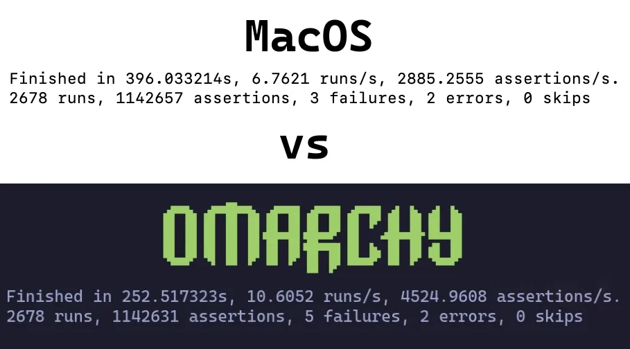

# Mac support

## Apple Silicon Macs

Omarchy installs on M1, M2 and M3 MacBooks, both Air and Pro, and on the MacBook Neo. It goes next to macOS rather than replacing it, so you keep macOS and choose between the two when your Mac starts. Support for M4 and newer Macs is being worked on.

### What you need

- macOS 15 Sequoia or later
- Free disk space for Omarchy. The installer suggests a size and lets you change it.
- A backup of your Mac, power, and an internet connection. The install downloads several gigabytes.

### Installing

Download the [Omarchy M Installer](https://github.com/omacom/omarchy-mac-installer/releases) and open it, or install it with [Homebrew](https://brew.sh):

```sh
brew install omacom/mac/omarchy
```

The installer checks your Mac, shows you the plan, and makes room for Omarchy by shrinking the macOS partition. No USB drive is needed and macOS isn't wiped. When the first stage is done, it walks you through finishing setup in macOS Recovery: shut down, hold the power button until "Loading startup options" appears, choose Omarchy, and follow the steps.

### Switching between Omarchy and macOS

Shut down your Mac, then press and hold the power button until the startup options appear. Choose Omarchy or macOS.

### More details

The [installer's README](https://github.com/omacom/omarchy-mac-installer#readme) covers requirements, release channels, updating the installer and removing Omarchy.

## Intel Macs

Omarchy has built-in support for **Intel Macs**. There are a couple of known limitations at the moment, but as long as you're aware and OK with those; you can breathe some new life into your old Macs by loading Omarchy.

In a simple test, we were able to achieve 36% performance gains on a 2019 MacBook Pro just by installing Omarchy.

 

### Installing Omarchy on Mac

Omarchy only supports being the **only** OS installed at the moment. During the installation, the drive will be wiped and MacOS will no longer be bootable.

You can still restore it later via Internet Recovery if you'd like.

For the sake of this part, we'll assume you've already reviewed [Getting Started](02-getting-started.md) and have your USB drive ready. If you don't go ahead and do that now.

#### Disable Secure Boot

It is necessary to disable Apple's Secure Boot in order to boot the bootable USB, as well as the OS. To disable it, perform the following:

1. Turn off your Mac
2. Turn it on and _immediately_ press and hold Command-R until you see the loading screen appear
3. Select your user and enter your password if prompted
4. Once in the recovery screen, choose **Utilities > Startup Security Utility** from the menubar
5. Enter your password when prompted to authenticate
6. Choose "No Security" from the Secure Boot options
7. Choose "Allow booting from external or removable media" from the External Boot options

#### Start the Installation

1. Insert the USB drive
2. Restart your Mac and _immediately_ press and hold Option until you see a screen of boot devices
3. Select the orange EFI Boot device
4. Proceed with the [install as normal](02-getting-started.md)

The installer detects Mac hardware and applies the needed fixes automatically: Broadcom Wi-Fi drivers and firmware, the SPI keyboard driver on the MacBook models that need it, and an NVMe suspend fix for those same models.

### Known Limitations

Members of the community are constantly working on solutions to these challenges so if these are problematic for you, join #omarchy-on-other in our [Discord](https://discord.gg/tXFUdasqhY) and see if there's any up-to-date methods for resolving these.

#### Devices with T1 Chip

The Apple T1 chip was introduced in late 2016 and used exclusively in the first-generation MacBook Pro models with Touch Bar.
- MacBook Pro 13-inch (2016, two Thunderbolt 3 ports) – Model: A1706
- MacBook Pro 13-inch (2016, four Thunderbolt 3 ports) – Model: A1708
- MacBook Pro 15-inch (2016) – Model: A1707

#### Known Issues

- Touch Bar is non-functional
- Sound is not functioning

#### Devices with T2 Chip

The Apple T2 Security Chip was introduced in 2017. The T2 chip was discontinued with the transition to Apple silicon (M-series chips) starting in 2020.

- iMac Pro (2017) – Model: A1862
- MacBook Pro 13-inch (2018, four Thunderbolt 3 ports) – Model: A1989
- MacBook Pro 15-inch (2018) – Model: A1990
- MacBook Air (Retina, 13-inch, 2018) – Model: A1932
- Mac mini (2018) – Model: A1998
- MacBook Pro 13-inch (2019, two Thunderbolt 3 ports) – Model: A2159
- MacBook Pro 13-inch (2019, four Thunderbolt 3 ports) – Model: A2178
- MacBook Pro 15-inch (2019) – Model: A1990
- iMac (Retina 5K, 27-inch, 2020) – Model: A2115 (iMac20,1 and iMac20,2)
- MacBook Pro 13-inch (2020, two Thunderbolt 3 ports) – Model: A2265
- MacBook Pro 15-inch (2020) – Model: A1990

On these models, the installer automatically sets up the patched `linux-t2` kernel, the T2 audio configuration, Apple's Broadcom Wi-Fi/Bluetooth firmware, and fan control via `t2fanrd`. The Touch Bar runs on the kernel's built-in Boot Camp-style support.

#### iMac Retina 5K (2017)

The 2017 27-inch iMac has no T2 chip, so the installer sets it up like the other Intel Macs.

- iMac (Retina 5K, 27-inch, 2017) – Model: A1419

#### Known Issues

- The display doesn't run at its native 5120×2880: the panel is two tiles, and the stock driver lights only one
- Sound is not functioning
- The brightness control has no effect
- Sleep hangs the machine; only a power cycle recovers it

A community patcher for this model fixes the display, sound and brightness: [omarchy-imac18-3](https://github.com/ahmadtv/omarchy-imac18-3).
