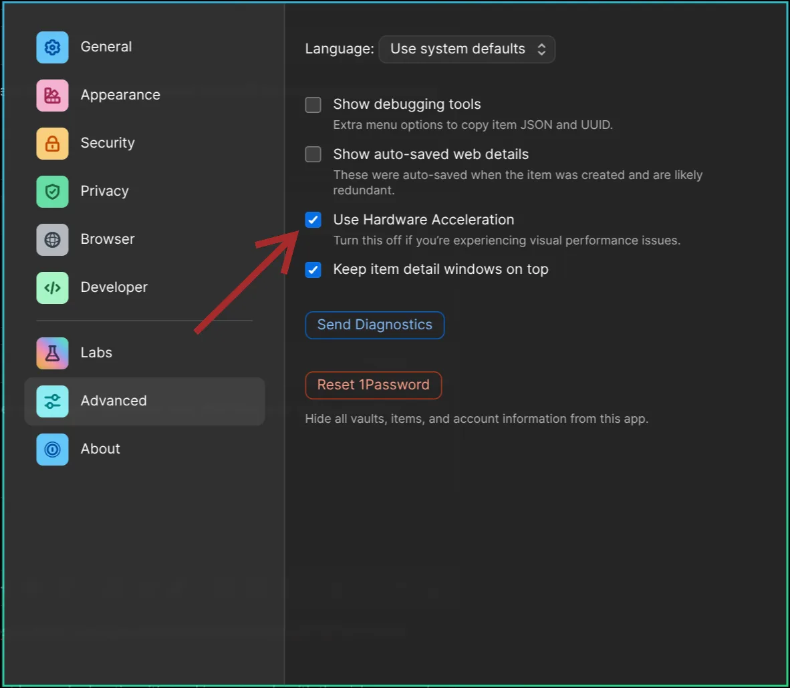

# Troubleshooting

### I broke my system with an update!

First try to [rollback your system](47-system-snapshots.md) the version before your recent update. If that doesn't work, use `omarchy-debug` to share with your problem on #omarchy-help in the Discord. And if all that fails, you can reinstall the defaults configs and packages using `omarchy-reinstall`.

### Why are some apps so large on my display?

Omarchy assumes a 2x high-resolution display, so it sets `GDK_SCALE` to 2 until you choose a scale in the monitor panel. If you're on a 1x display and GTK or X11 apps come out oversized, pick 1x for it in the monitor panel, or add `hl.env("GDK_SCALE", "1")` to `~/.config/hypr/monitors.lua` (and then restart any app that's oversized). See [the manual on monitors](33-monitors.md).

For Spotify, you can use `Ctrl + Minus` to shrink the UI (and `Ctrl + Plus` to make it bigger).

### Why did all my Super key binds stop working?

On some ASUS ROG and TUF laptops, `Fn + Super` is an easy-to-miss chord that toggles a firmware Windows-key lock (meant for gaming so you don't leave a game by accident). Nothing on screen tells you it happened. While the lock is on, Super emits nothing at all — so every Omarchy bind that uses Super just stops, and it looks like Hyprland broke.

Press `Fn + Super` once before you dig into `~/.config/hypr/`, and if that doesn't bring Super back, press it again so you don't leave the lock on. This is not Fn-lock, which only changes what the F-key row does.

### The bar and launcher stopped responding after unlocking

If the pointer moves and `Super + Return` still opens a terminal, but bar clicks and `Super + Space` do nothing, the Omarchy shell may have stopped responding while Hyprland is still running. This can happen after a suspend and successful unlock; it does not necessarily mean your keyboard or mouse failed.

From the terminal, check the shell and save the current boot's user logs before restarting it:

```bash
omarchy-shell shell ping
journalctl --user -b --no-pager > ~/omarchy-shell-journal.txt
omarchy restart shell
omarchy-shell shell ping
```

A healthy shell answers `ok`. Restarting the shell restores its bar and launcher without logging out of your applications. If the restart refuses because the session is locked, do not bypass that refusal: the shell also owns the lock screen.

If the shell remains hung and the restart cannot finish, collect the process list for support:

```bash
ps -C quickshell -o pid,stat,wchan:30,pcpu,args
omarchy-hyprland-session-locked
echo $?
```

The last command prints `0` if the compositor is locked, `1` if it is unlocked, or `2` if the state could not be determined. Only after confirming `1`, an advanced recovery is to terminate the specific hung Quickshell PID whose command points at the active Omarchy shell configuration (`kill -KILL PID`), then run `omarchy restart shell` and check `omarchy-shell shell ping` again. Do not kill every Quickshell process or terminate a locker when the result is `0` or `2`.

Forcefully stopping the shell discards its transient UI state and notifications. It is a recovery measure, not a fix for the cause of a hang. If the problem returns, share the saved journal through Omarchy support after reviewing it for personal information, together with your GPU and driver version, connected monitors, custom shell plugins, and whether password entry succeeded before the desktop became unresponsive.

### My Wi-Fi, Bluetooth, audio, or trackpad just stopped working

Before you reboot, try restarting the offending subsystem on its own. _Update > Hardware_ in the Omarchy menu has Wi-Fi, Bluetooth, Audio, and Trackpad, and reloading one of those clears up the majority of "it worked five minutes ago" situations — a Bluetooth headset that won't reconnect, a trackpad that went dead after a suspend, sound that vanished when you unplugged a monitor.

### Why are my external speakers not playing?

Probably because they're not set as the primary output. Click on the speaker icon on the right side of the bar, and it'll open the volume popup where you can pick the output device (and mix per-app volumes too).

### My laptop speakers sound off

On some laptops, Omarchy automatically applies a speaker tuning that corrects the built-in speakers' frequency response. `omarchy audio tuning status` tells you whether one is active on your machine, and `omarchy audio tuning off` turns it off if you'd rather hear the speakers raw.

### Why can't I login or sudo with my password?

You probably typed it wrong too many times and got locked out. If this is happening on the lock screen, you can hit `CTRL + ALT + F2` to start a new TTY where you can login as root, then run `faillock --reset --user [your-username]`. That'll reset the lockout, and you're good to go.

### My password is accepted, but I return to the login screen

A broken session environment file can prevent the desktop from starting even when your password is correct. This is especially worth checking after editing `~/.config/uwsm/env.d/`.

Press `Ctrl + Alt + F2`, log in with your normal username and password, and inspect the current boot's user journal:

```bash
journalctl --user -b -t uwsm_env-preloader --no-pager
```

Look for an error naming one of your environment files, such as `bad substitution`, just before a message that the env output mark was not found. Move that file out of `env.d` before trying to log in again. For example, if the error names `99-custom`:

```bash
mkdir -p ~/.config/uwsm/disabled
mv -i ~/.config/uwsm/env.d/99-custom ~/.config/uwsm/disabled/
```

UWSM skips a file with a syntax error, but a fatal error that only shows up while the file runs, like `bad substitution`, can still prevent the desktop from starting. A system snapshot rollback does not repair these files, because `/home` is not rolled back.

Once you can log in, fix the saved copy before moving it back. `sh -n` catches syntax errors without running the file, but cannot catch every error that occurs when it is sourced. Keep a working terminal open while testing changes.

### Why isn't my 1Password authorization prompts for 1Password SSH Agent / CLI appearing?

This can happen for 2 reasons:

In order for the rich approval prompt to appear, Settings > Advanced > Use Hardware Acceleration must be turned on. _Note: This requires a reboot to begin working._

 

Or if you haven't launched 1Password since booting up, the prompt will not appear.
