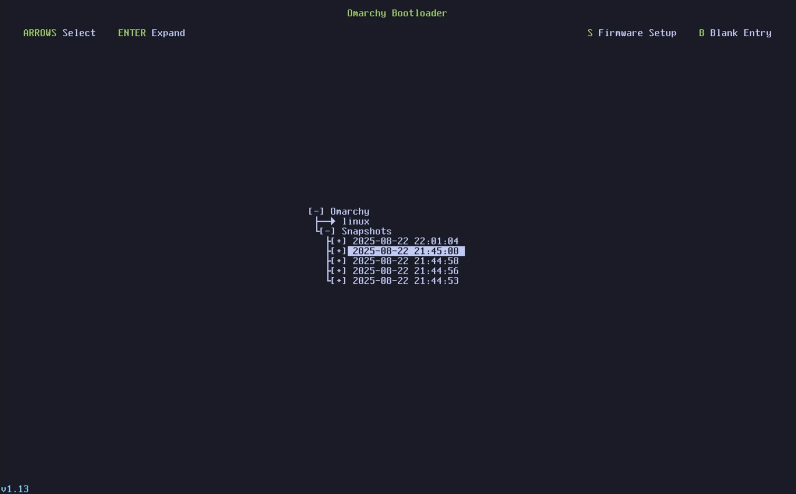
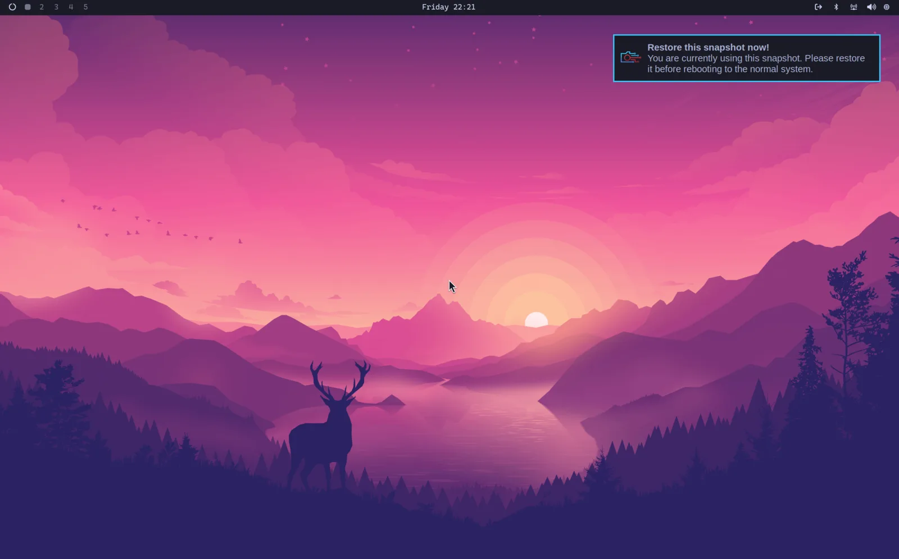

# System snapshots

We create snapshots automatically on every Omarchy update, but should you want to create your own, you can use `omarchy-snapshot create`.

How you boot and restore a snapshot depends on the boot loader your machine starts with. New UEFI installs use systemd-boot; older installs and BIOS machines use Limine. `omarchy-boot-backend` tells you which one you have.

## With systemd-boot

Pick _System > Snapshots_ in the Omarchy menu and choose the snapshot you'd like to boot into. The machine restarts into it once. Or hold Space while the machine starts to see the boot menu, where every snapshot is listed newest first with its Omarchy version and date.

A snapshot boots with a temporary layer on top, so you can use it as normal, but anything you change is gone at the next reboot. To keep it, make it your system: click the notification that appears when you log in, pick _System > Snapshots > Restore This Snapshot_, or run `omarchy-snapshot restore`. The restore happens while the machine restarts. The system as it was before stays in the boot menu as _Before restore_, and `omarchy-snapshot restore backup` puts it back.

From the terminal:

- `omarchy-snapshot list` lists the snapshots you can boot;
- `omarchy-snapshot boot 12` restarts into snapshot 12 once;
- `omarchy-snapshot restore 12` makes snapshot 12 the system at the next restart, and `omarchy-snapshot restore --cancel` changes your mind before that restart.

## With Limine

To boot and restore a snapshot, you select it from the Limine boot loader. The boot menu stays hidden by default, so press any key as soon as Limine starts to bring it up.

From that screen, choose the snapshot you'd like to boot into based on the date and version. The version of Omarchy at the time of the snapshot can be seen at the bottom left corner.

 

When you arrive inside, a notification will popup notifying you that you're in a bootable snapshot and if you click it, will start the restoration process. Alternatively, you can utilize `omarchy-snapshot restore`.

 

## What a restore covers

A restore brings back your root filesystem, but not your `/home`. So it works for reverting a broken system update, but not for recovering lost personal files.

This also means that your `~/.config` directory is kept as-is. So if you're rolling back to an earlier version of a library or application that stores configuration files in a new format, you'll have to sort that out manually.

The same goes for Omarchy's own record of which migrations have already run: it lives in your home directory, so it survives the restore. Migrations that ran after the snapshot was taken stay marked as done, even though the changes they made to the root filesystem have been rolled back, and the next `omarchy update` won't run them again. So if you update again after a restore and something an earlier update had set up is still missing, that's the likely reason.
