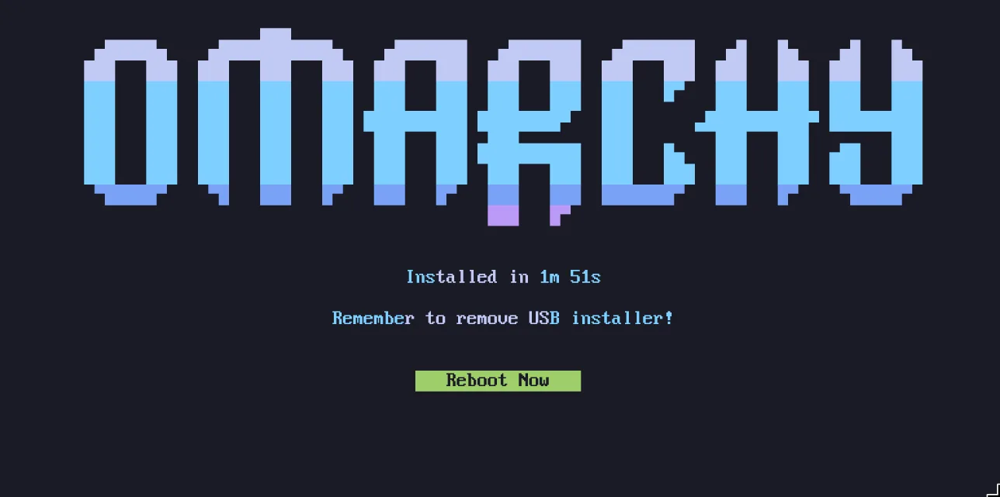

# Начало работы

Omarchy устанавливается с помощью ISO. Вы можете выбрать между установкой на весь диск, которая займёт весь накопитель целиком, или установкой в свободное место, которая размещает Omarchy в нераспределённом пространстве на диске — именно так вы получаете двойную загрузку рядом с Windows или другой ОС (см. [установка с двойной загрузкой](50-dual-boot-install.md) — обратите внимание, что сначала вам нужно будет отключить BitLocker в Windows). В любом случае по умолчанию установка выполняется с полным шифрованием, а вариант на весь диск сотрёт выбранный диск, поэтому обязательно сделайте резервную копию, прежде чем использовать существующий диск!

Сначала [скачайте ISO Omarchy](https://omarchy.org/), запишите его на USB-накопитель (используйте [balenaEtcher](https://etcher.balena.io/) на Mac/Windows или [caligula](https://github.com/ifd3f/caligula) на Linux) и загрузитесь с этого накопителя.

_Вы должны отключить Secure Boot и/или TPM в BIOS. Вы должны отключить их, чтобы иметь возможность установить Omarchy. Это схемы безопасности Microsoft, предназначенные для Windows и связанных с Microsoft дистрибутивов Linux._

Затем ответьте на вопросы настройки и подтвердите их вот так:

 

Затем выберите диск для установки, откиньтесь назад и смотрите шоу установки. На самых быстрых современных машинах это можно сделать менее чем за минуту, но даже на более старом компьютере это не должно занять больше 5 минут.

 

Теперь вы готовы к Omarchy!

### Используйте проводную клавиатуру или клавиатуру на 2.4ghz!

Полное шифрование диска не позволит вам ввести пароль с Bluetooth-клавиатуры при запуске. Точно так же, как вы не можете использовать Bluetooth-клавиатуру, чтобы войти в BIOS на ПК. Вам понадобится клавиатура, которая либо использует USB-приёмник на 2.4ghz, либо кабель (что в любом случае гораздо приятнее с точки зрения задержки!). Мне лично очень нравится [Lofree Flow84](https://www.lofree.co/products/lofree-flow-the-smoothest-mechanical-keyboard)!

### Установка для другого владельца

Если вы настраиваете машину для кого-то другого — члена семьи, нового сотрудника, покупателя — вы не должны отвечать на личные вопросы от их имени. Нажмите `Ctrl + C` на самом первом экране установщика (выбор клавиатуры), и Omarchy вместо этого предложит подготовить машину для другого владельца. Система установится сразу же, но вся личная настройка — раскладка клавиатуры, имя пользователя, пароль — откладывается до первой загрузки машины. Диск по-прежнему шифруется по умолчанию, а пароль, который новый владелец выберет при этой первой загрузке, также станет паролем шифрования. (Машину, которой вы уже пользовались, тоже можно передать без переустановки — см. [сброс компьютера](48-security.md).)

### Установки без участия пользователя

ISO также может выполнить установку полностью самостоятельно — без клавиатуры, без мастера — когда ему передают его конфигурацию на втором диске. Именно так следует использовать Omarchy в качестве базового образа для VM и машин в парке устройств. См. [установки без участия пользователя](51-unattended-installs.md).

### Установки без шифрования

По умолчанию Omarchy устанавливается с шифрованием. Это безопасный и ответственный выбор для любого компьютера, который теоретически можно потерять или который могут украсть. Вы же не хотите, чтобы кто-либо, получивший доступ к вашему оборудованию, мог добраться до ваших данных!

Но в особых обстоятельствах, например при удалённых установках Omarchy на защищённые компьютеры или для одноразовых установок без конфиденциальных данных, вы можете захотеть установить систему без шифрования. Вы можете нажать `Ctrl + C` при подтверждении форматирования диска, чтобы переключиться на установку без шифрования.

### Язык

Omarchy говорит на 50 языках — тот же набор, что и на omarchy.org, — а по умолчанию используется английский. Чтобы переключиться, откройте меню Omarchy и перейдите в _Настройка > Язык_ или выполните `omarchy language <code>` в терминале (`omarchy language list` покажет коды). Меню, рабочий стол и собственные уведомления Omarchy сразу же сменят язык, а каждое приложение, которое вы откроете после этого, тоже последует за ними. Приложения, которые уже были открыты, переключатся после того, как вы их перезапустите.

### Помощь, если вы застряли

Если вы застряли, вы обычно можете найти кого-нибудь, кто готов помочь, в канале _#omarchy-help_ на [Discord сообщества](https://omarchy.org/discord).
