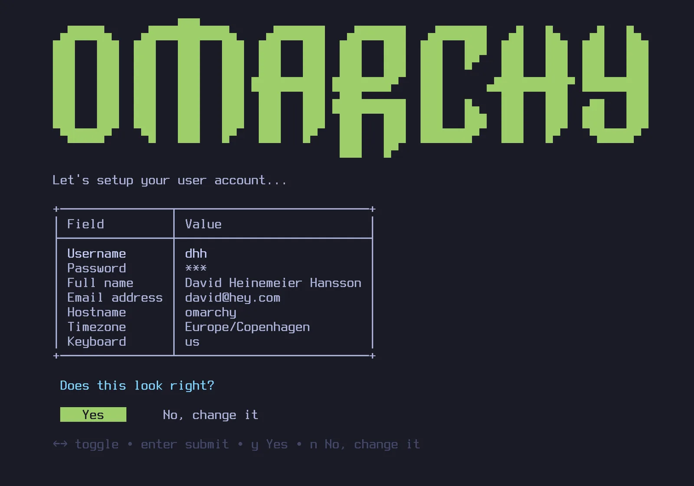
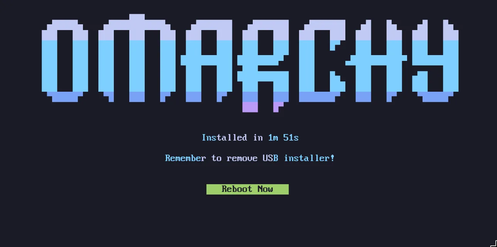

# Начало работы

Omarchy устанавливается с помощью ISO. Вы можете выбрать между установкой на весь диск, которая занимает весь накопитель целиком, или установкой в свободное место, которая помещает Omarchy в нераспределённое пространство на диске — именно так выполняется двойная загрузка рядом с Windows или другой ОС (см. [установку с двойной загрузкой](50-dual-boot-install.md) — обратите внимание, что сначала вам потребуется отключить BitLocker в Windows). В любом случае установка по умолчанию выполняется с полным шифрованием, а вариант с использованием всего диска сотрёт выбранный накопитель, поэтому обязательно сделайте резервную копию, прежде чем использовать существующий диск!

На Mac с Apple Silicon установка вместо этого выполняется из macOS, без ISO или USB-накопителя. См. [Omarchy для Apple Silicon](44-mac-support.md#omarchy-for-apple-silicon).

Сначала [скачайте ISO-образ Omarchy](https://omarchy.org/), запишите его на USB-накопитель (используйте [Rufus](https://rufus.ie/) в Windows, [balenaEtcher](https://etcher.balena.io/) на Mac или [caligula](https://github.com/ifd3f/caligula) в Linux) и загрузитесь с этого накопителя.

_Вы должны отключить Secure Boot и/или TPM в BIOS. Вы должны отключить их, чтобы иметь возможность установить Omarchy. Это схемы безопасности Microsoft, предназначенные для Windows и аффилированных с Microsoft дистрибутивов Linux._

Затем ответьте на вопросы по настройке и подтвердите их следующим образом:

 

Затем выберите диск для установки, откиньтесь на спинку кресла и наблюдайте за шоу установки. На самых быстрых современных машинах это может занять меньше минуты, но даже на старом компьютере это не должно занять больше 5 минут.

 

Теперь вы готовы к Omarchy!

### Используйте проводную клавиатуру или клавиатуру с подключением 2.4ghz!

Полное шифрование диска не позволит вам ввести пароль с Bluetooth-клавиатуры при запуске. Точно так же, как вы не можете использовать Bluetooth-клавиатуру для входа в BIOS на PC. Вам понадобится клавиатура, которая либо использует приёмник 2.4ghz, либо подключается кабелем (что в любом случае гораздо приятнее с точки зрения задержки!). Лично я обожаю [Lofree Flow84](https://www.lofree.co/products/lofree-flow-the-smoothest-mechanical-keyboard)!

### Установка для другого владельца

Если вы настраиваете машину для кого-то другого — члена семьи, нового сотрудника, покупателя — вам не следует отвечать на личные вопросы от их имени. Нажмите `Ctrl + C` на самом первом экране установщика (выбор клавиатуры), и Omarchy вместо этого предложит подготовить машину для другого владельца. Система установится сразу, но вся личная настройка — раскладка клавиатуры, имя пользователя, пароль — будет отложена до первой загрузки машины. Диск по-прежнему шифруется по умолчанию, а пароль, который новый владелец выберет при этой первой загрузке, также станет паролем шифрования. (Машину, которой вы уже пользовались, тоже можно передать без переустановки — см. [сброс компьютера](48-security.md).)

### Установки без участия пользователя

ISO также может выполнить установку полностью самостоятельно — без клавиатуры, без мастера — когда ему передают его конфигурацию на втором диске. Именно так следует относиться к Omarchy как к базовому образу для VM и парка машин. См. [установки без участия пользователя](51-unattended-installs.md).

### Установки без шифрования

Omarchy по умолчанию устанавливается с шифрованием. Это безопасный, ответственный выбор для любого компьютера, который потенциально может быть потерян или украден. Вы не хотите, чтобы кто-либо, получивший доступ к вашему оборудованию, мог получить ваши данные!

Но в особых обстоятельствах, например при удалённых установках Omarchy на защищённых компьютерах или для одноразовых установок без конфиденциальных данных, вы можете захотеть выполнить установку без шифрования. Вы можете нажать `Ctrl + C` на экране подтверждения форматирования диска, чтобы переключиться на установку без шифрования.

### Язык

Omarchy говорит на 50 языках — тот же набор, что и на omarchy.org, — а по умолчанию используется английский. Чтобы переключиться, откройте меню Omarchy и перейдите в _Setup > Region > Language_ или запустите `omarchy language <code>` в терминале (`omarchy language list` показывает коды). Меню, рабочий стол и собственные уведомления Omarchy немедленно сменят язык, и каждое приложение, которое вы откроете после этого, также последует за ними. Приложения, которые уже были открыты, переключатся, как только вы их перезапустите.

Чтобы сохранить язык, но записывать даты, время, числа, деньги, единицы измерения и размеры бумаги так, как это делает другой регион (например, английский с европейскими датами и 24-часовым форматом времени), выберите регион в _Setup > Region > Formats_, где каждый вариант показывает образец, или запустите `omarchy region formats <code>` (`omarchy region formats list` показывает коды). _Same as language_ возвращает к форматам, собственным для языка. Как и переключение языка, это распространяется на приложения, которые вы открываете после этого.

### Помощь, если вы застряли

Если вы застряли, вы обычно можете найти кого-нибудь, готового помочь, в канале _#omarchy-help_ на [Discord сообщества](https://omarchy.org/discord).
