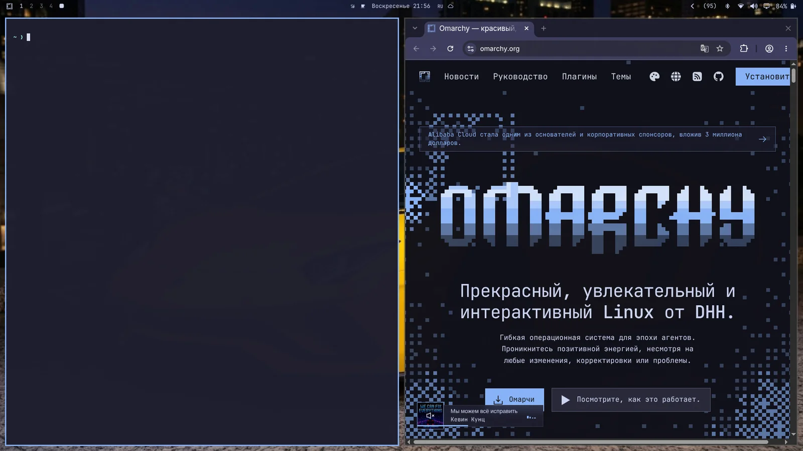
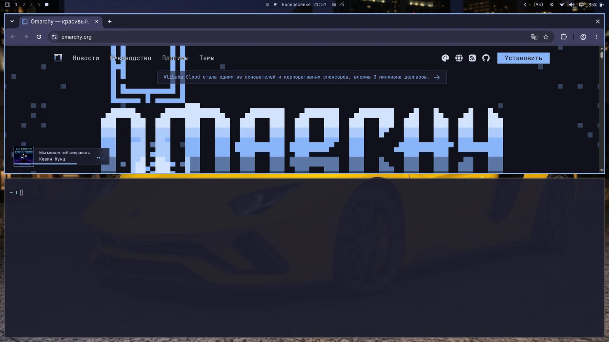
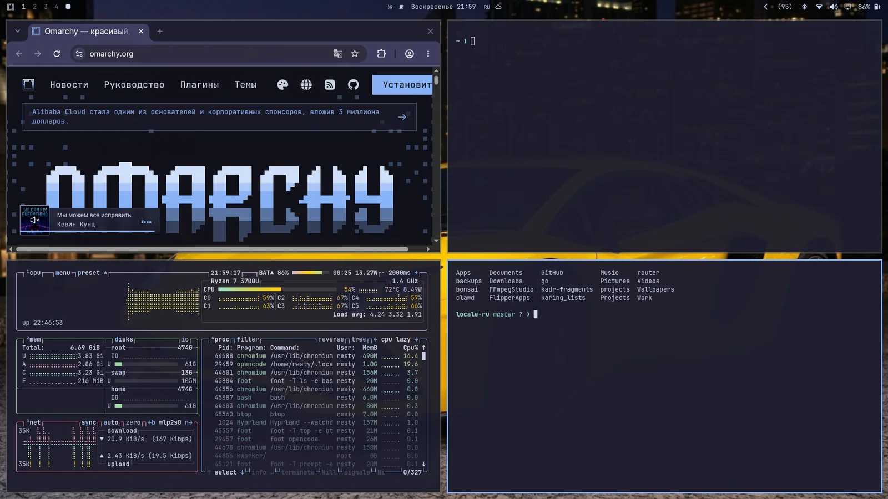
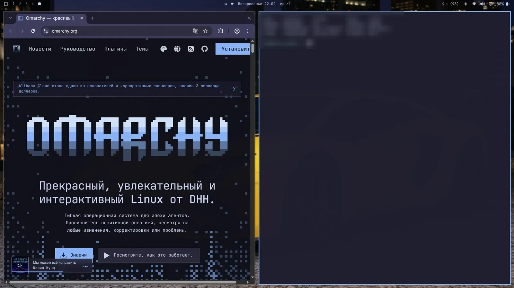
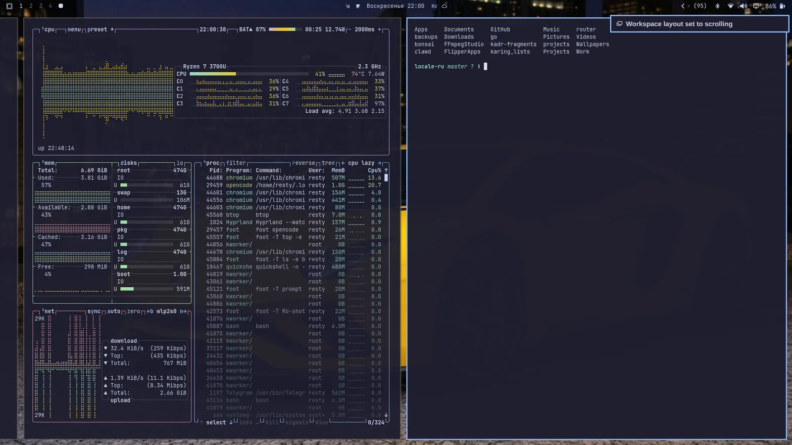
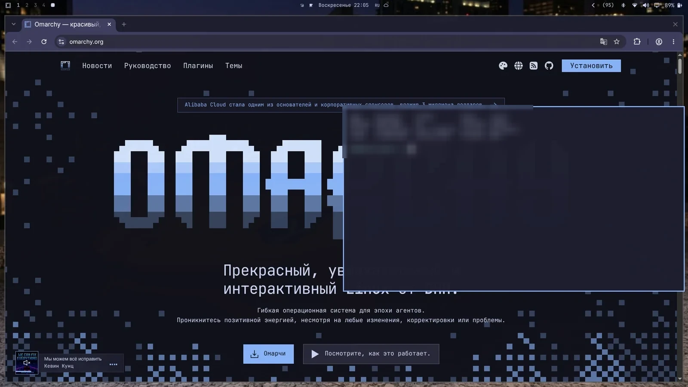

# Навигация

Всё в Omarchy происходит с клавиатуры — _ВСЁ!_ Когда система только запускается, одной мышью вы буквально ничего не сможете сделать. Но вы можете нажать `Super + Space`, чтобы открыть меню Omarchy, а уже оттуда делать практически всё.

Но меню Omarchy даже не задумывалось как основной способ работы с системой в большинстве случаев. Можно быстрее! Все самые важные приложения привязаны прямо к отдельным горячим клавишам. Терминал запускается по `Super + Return`, а браузер — по `Super + Shift + Return`. Попробуйте сделать одно за другим, и вы увидите волшебство плиточной раскладки Hyprland в действии:

 

Затем вы можете нажать `Super + J`, чтобы расположить их друг над другом, а не рядом:

 

Нажмите `Super + J` ещё раз, чтобы вернуть их в положение рядом друг с другом. Затем попробуйте `Super + Shift + Arrow Right`, находясь в браузере, чтобы поменять окна местами.

Теперь попробуйте `Super + Ctrl + T`, чтобы запустить монитор активности. Он появится как плавающее окно. Вы можете сделать его плиточным с помощью `Super + T` (и нажать это ещё раз, чтобы снова сделать его плавающим). Теперь нажмите `Super + Shift + F`, чтобы открыть файловый менеджер. У вас получится аккуратная раскладка на четыре окна:

 

Между окнами вы переключаетесь на то, которое хотите сделать активным, с помощью `Super + Arrow`. Это переключит фокус и переместит курсор в центр нового приложения.

Если вы нажмёте `Super + Shift + 2`, вы переместите текущее приложение в фокусе на второе рабочее пространство. `Super + Shift + 1` вернёт его обратно. (А `Super + Shift + Alt + 2` переместит текущее приложение в фокусе на второе рабочее пространство, не переключаясь на него).

Если вы удерживаете `Super` и щёлкаете мышью по окну, вы сможете переставить его туда, где оно должно находиться. Если вы удерживаете `Super` и используете правую кнопку мыши, вы можете свободно менять размер окна.

Окно закрывается по `Super + W` или `Super + Q` (а все окна — по `Ctrl + Alt + Delete`).

Вы также можете развернуться на весь экран с помощью `Super + F` или даже просто на всю ширину (сохранив верхнюю панель) с помощью `Super + Alt + F`, или на весь экран внутри окна с помощью `Super + Ctrl + F` (хорошо для YouTube!).

### Раскладка dwindle против прокручиваемой раскладки

Раскладка Omarchy по умолчанию называется dwindle. Она держит все окна, которые вы открываете на одном рабочем пространстве, видимыми всё время, даже если для этого их приходится уменьшать.

 

Но вы также можете превратить рабочее пространство в прокручиваемую раскладку, где окна выстроены рядом друг с другом за видимым краем дисплея. Одно рабочее пространство превращается в эту раскладку с помощью `Super + L`.

Повторное нажатие `Super + L` делает рабочее пространство плавающим, где окна свободно перекрываются и вы размещаете их сами, а третье нажатие возвращает его к dwindle. `Super + Alt + L` проходит по ним в обратную сторону. Окно, которое и так плавает — то, которое вы вынули с помощью `Super + T`, или приложение, которое всегда открывается плавающим, — продолжает плавать, когда рабочее пространство возвращается к плиточной раскладке. Верхняя панель отмечает рабочее пространство, на котором вы находитесь, его раскладкой: квадрат для dwindle, круг для прокручиваемой и треугольник для плавающей. Щелчок по этой отметке тоже переключает раскладку по кругу.

 

Выбор делается для каждого рабочего пространства отдельно, и он сохраняется. Так что вы можете держать рабочее пространство 1 на dwindle для браузера, а рабочее пространство 2 на прокручиваемой раскладке для кода, и после перезапуска они вернутся именно такими.

Если вы хотите использовать прокручиваемую раскладку по умолчанию, вы можете задать это в `~/.config/hypr/looknfeel.lua`:

```lua
hl.config({
  general = {
    layout = "scrolling",
  },
})
```

### Плавающие рабочие пространства

Плавающее рабочее пространство работает как традиционный рабочий стол: окна перекрываются, а вы сами перемещаете их и меняете их размер. Каждое окно получает заголовок в цветах вашей темы, с кнопками свернуть, развернуть и закрыть. `Super + M` тоже сворачивает окно в фокусе. Свёрнутое окно ждёт в доке; щёлкните по его приложению, чтобы вернуть его. Щёлкните по окну, чтобы вынести его вперёд. Меняйте его размер с любого края или угла. Дважды щёлкните по заголовку, чтобы развернуть окно, оставив верхнюю панель на виду, и ещё раз, чтобы вернуть его прежний размер.

Плавающее рабочее пространство также показывает док с вашими закреплёнными приложениями, всем, что запущено, и сеткой всех приложений за кнопкой приложений, которую также открывают `Super + Alt + Space` и _Приложения_ в меню Omarchy. Щёлкните правой кнопкой по приложению в сетке или нажмите `Delete`, чтобы удалить его. Щёлкните по приложению, чтобы открыть его или вынести его окно вперёд; щёлкните ещё раз, чтобы перебирать его окна по кругу. Щелчок средней кнопкой открывает новое окно. Перетащите значок вдоль дока, чтобы переместить его; перетаскивание запущенного приложения в ряд к остальным оставит его там. Щёлкните правой кнопкой, чтобы оставить приложение в доке, убрать его оттуда или завершить его работу. Док уходит с пути полноэкранного окна. Щёлкните правой кнопкой по кнопке приложений, чтобы переместить док к другому краю или заставить его прятаться, пока указатель не дойдёт до его края. Положение также находится в _Trigger > Внешний вид > Док > Положение дока_, а `omarchy dock position left` и `omarchy dock autohide on` устанавливают и то, и другое из терминала. Приложения, которые вы держите в доке, выглядят приглушёнными, пока они не запущены.

Новые рабочие пространства и любые, которым вы не дали собственной раскладки с помощью `Super + L`, используют раскладку по умолчанию. Изменение раскладки по умолчанию сбрасывает к ней каждое рабочее пространство без окон, а то, на котором окна есть, сохраняет ту раскладку, которая у него есть. Окно, свёрнутое в док, по-прежнему считается окном рабочего пространства, которое оно покинуло. Выберите её в _Trigger > Внешний вид > Раскладка рабочего пространства_: Плиточная, Прокручиваемая или Плавающая. `omarchy-hyprland-workspace-layout-default scrolling` устанавливает её из терминала.

### Группировка окон

Окна можно группировать с помощью `Super + G`. Когда вы находитесь в группе, каждое окно, которое вы запустите, пока она активна, будет принадлежать к группе. Вы можете перемещаться между этими сгруппированными окнами с помощью `Super + Ctrl + Arrow Left/Right` или `Super + Alt + 1/2/3/4`, чтобы перейти прямо к сгруппированному окну по порядку.

Вы можете переместить окно из группировки с помощью `Super + Alt + G` или разобрать всю группу, снова нажав `Super + G`. Наконец, вы можете перемещать окна снаружи группы в неё с помощью `Super + Alt + Arrows`.

### Вынос окон

Вы можете вынуть окно из его распределения по рабочему пространству с помощью `Super + O`. Это закрепит его как плавающее окно, которое следует за вами на любое рабочее пространство, куда вы перейдёте. Отлично подходит для видеоплееров и тому подобного.

 

### Рабочее пространство scratchpad

Наконец, есть специальное рабочее пространство scratchpad, которое опускается поверх любого рабочего пространства, на котором вы сейчас находитесь, очень похоже на консоль Quake. Переключайте его с помощью `Super + Grave` или `Super + S`, а окно туда помещайте с помощью `Super + Shift + Grave` или `Super + Alt + S`.

Оно особенно хорошо подходит для терминала с работающим агентом или для элементов управления, с которыми вы хотите быстро взаимодействовать, не покидая текущее рабочее пространство. Чтобы убрать окно со scratchpad, отправьте его прямо на другое рабочее пространство чем-то вроде `Super + Shift + 1`.

Пока на scratchpad находится одно окно, он опускается как панель по центру, а не растягивается на весь экран. Поместите на него второе приложение, и он вернётся к полной ширине, чтобы у двоих было место сидеть рядом.

### К этому нужно немного привыкнуть!

Нужно немного времени, чтобы привыкнуть так перемещаться по рабочему столу, но как только вы привыкнете, вернуться к традиционному опыту рабочего стола, управляемого мышью, будет трудно!
