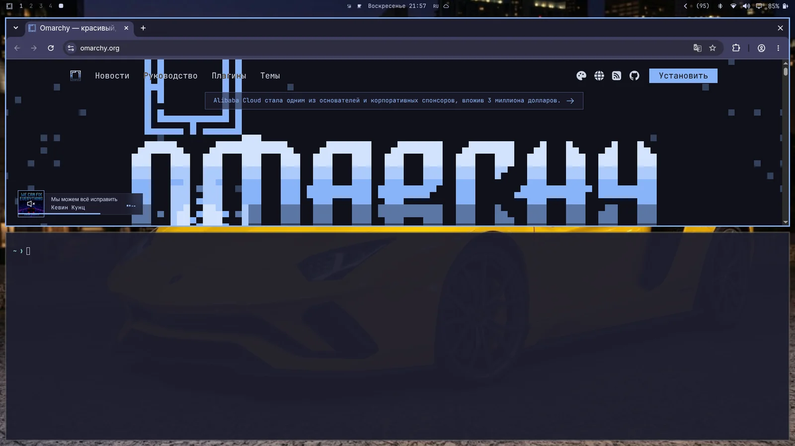
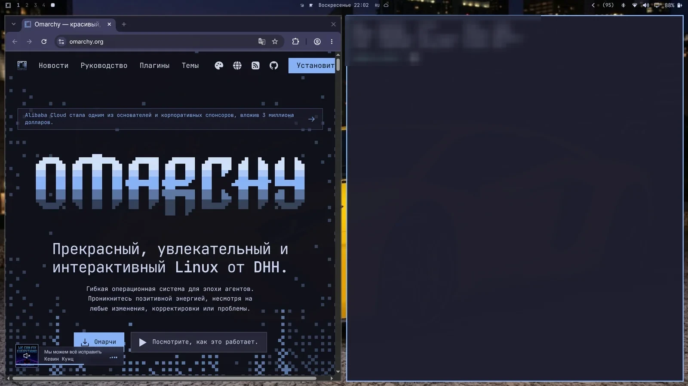

# Навигация

Всё в Omarchy делается с клавиатуры — ВСЁ! Когда система только запускается, одной мышью буквально ничего не сделаешь. Но можно нажать `Super + Space`, чтобы открыть меню Omarchy, и оттуда можно сделать практически всё.

Но меню Omarchy даже не задумано как основной способ работы с системой большую часть времени. Можно быстрее! Все самые важные приложения привязаны напрямую к отдельным горячим клавишам. Терминал запускается нажатием `Super + Return`, а браузер — `Super + Shift + Return`. Попробуйте сделать одно за другим, и вы увидите магию тайлинга Hyprland в действии:

 

Затем можно нажать `Super + J`, чтобы расположить их друг над другом, а не бок о бок:

 

Нажмите `Super + J` ещё раз, чтобы вернуть их в положение бок о бок. Затем попробуйте нажать `Super + Shift + Arrow Right`, находясь в браузере, чтобы поменять окна местами.

Теперь попробуйте `Super + Shift + T`, чтобы запустить монитор активности. Он появится как плавающее окно, с заголовком, за который его можно перетаскивать, и кнопками свернуть, развернуть и закрыть. Такое получает каждое плавающее окно, где бы оно ни находилось. Его можно сделать тайлинговым с помощью `Super + T` (и нажать это ещё раз, чтобы снова сделать его плавающим). Теперь нажмите `Super + Shift + F`, чтобы открыть файловый менеджер. У вас получится аккуратная схема из четырёх окон:

 

Между окнами, одно из которых вы хотите сделать активным, вы перемещаетесь с помощью `Super + Arrow`. Это переключает фокус и перемещает курсор в центр нового приложения. У края экрана переход продолжается на монитор с той стороны.

Если нажать `Super + Shift + 2`, текущее сфокусированное приложение переместится на второе рабочее пространство. `Super + Shift + 1` перемещает его обратно. (А `Super + Shift + Alt + 2` переместит текущее сфокусированное приложение на второе рабочее пространство, не переключаясь на него).

При нескольких мониторах у каждого монитора есть свои рабочие пространства с 1 по 10. `Super + 2` переходит на второе рабочее пространство того монитора, на котором вы находитесь, а верхняя панель каждого монитора показывает его собственные рабочие пространства и то, которое он отображает. `Super + Tab` циклически переключает рабочие пространства на мониторе, на котором вы находитесь. `Super + Shift + Ctrl + Arrows` перемещает окно, на котором вы находитесь, на монитор в этом направлении, на рабочее пространство, которое он отображает, а `Super + Shift + Alt + Arrows` перемещает рабочее пространство, на котором вы находитесь, на монитор в этом направлении, где оно получает тот же номер, если он свободен. Монитор сохраняет свои рабочие пространства при отключении: они присоединяются к другому экрану, нумеруясь после тех, что у него уже есть, и возвращаются под своими старыми номерами, когда монитор возвращается.

Если удерживать `Super` и щёлкнуть мышью по окну, вы сможете изменить, где оно расположено. Если удерживать `Super` и использовать правую кнопку мыши, вы сможете свободно изменять размер окна.

Окно закрывается нажатием `Super + W` или `Super + Q` (а все окна закрываются нажатием `Ctrl + Alt + Delete`).

Также можно перейти в полноэкранный режим нажатием `Super + F` или даже просто на всю ширину (сохраняя верхнюю панель) нажатием `Super + Alt + F`, или в полноэкранный режим внутри окна нажатием `Super + Ctrl + F` (хорошо для YouTube!).

### Раскладка dwindle и прокручиваемая раскладка

Раскладка Omarchy по умолчанию называется dwindle. Она сохраняет все окна, открытые на одном рабочем пространстве, видимыми всегда, даже если для этого их приходится уменьшать.

 

Но вы также можете превратить рабочее пространство в прокручиваемую раскладку, где окна выстраиваются бок о бок за видимым краем дисплея. Одно рабочее пространство превращается в эту раскладку с помощью `Super + L`.

Повторное нажатие `Super + L` делает рабочее пространство плавающим, где окна свободно перекрываются и вы размещаете их сами, а третье нажатие возвращает его к dwindle. `Super + Alt + L` проходит по ним в обратном порядке. Окно, которое и так плавает — то, которое вы вытащили с помощью `Super + T`, или приложение, которое всегда открывается плавающим, — остаётся плавающим, когда рабочее пространство возвращается к тайлингу. Верхняя панель отмечает рабочее пространство, на котором вы находитесь, его раскладкой: квадрат для dwindle, круг для прокручиваемой и треугольник для плавающей. Щелчок по этой отметке также циклически переключает раскладку, как и клавиша дисплея на ноутбуках, у которых она есть.

 

Выбор действует для каждого рабочего пространства отдельно и сохраняется. Так что вы можете держать рабочее пространство 1 на dwindle для просмотра веб-страниц, а рабочее пространство 2 на прокручиваемой для кода, и они вернутся такими после перезапуска.

Если вы хотите использовать прокручиваемую раскладку по умолчанию, вы можете задать это в `~/.config/hypr/looknfeel.lua`:

```lua
hl.config({
  general = {
    layout = "scrolling",
  },
})
```

### Плавающие рабочие пространства

Плавающее рабочее пространство работает как традиционный рабочий стол: окна перекрываются, а вы перемещаете и изменяете их размер сами. Каждое окно получает заголовок в цветах вашей темы, с кнопками свернуть, развернуть и закрыть. `Super + M` также сворачивает сфокусированное окно. Свёрнутое окно ждёт в доке; щёлкните по его приложению, чтобы вернуть его. Щёлкните по окну, чтобы вынести его вперёд. Изменяйте его размер с любого края или угла. Дважды щёлкните по заголовку, чтобы развернуть окно, сохраняя верхнюю панель видимой, и ещё раз, чтобы вернуть его старый размер. Chrome и другие браузеры на основе Chromium, Disks и Document Viewer пропускают заголовок и вместо него используют свой собственный заголовок; `Super + Alt + F` разворачивает их, а `Super + M` сворачивает их.

У каждого рабочего пространства есть док, с вашими закреплёнными приложениями, всем, что запущено, и сеткой всех приложений за кнопкой приложений, которую также открывают `Super + Alt + Space` и _Приложения_ в меню Omarchy. Щёлкните правой кнопкой по приложению в сетке или нажмите `Delete`, чтобы удалить его. Щёлкните по приложению, чтобы открыть его или вынести его окно вперёд; щёлкните ещё раз, чтобы циклически переключаться между его окнами. Files возвращает только окно с рабочего пространства, на котором вы находитесь, а в остальных случаях открывает новое, а Terminal и Agent всегда запускают ещё одно, хотя свёрнутое окно возвращается первым. Средний щелчок открывает новое окно. Перетащите значок вдоль дока, чтобы переместить его; перетаскивание запущенного приложения между остальными оставляет его там. Щёлкните правой кнопкой, чтобы оставить приложение в доке, убрать его оттуда или завершить его. Док остаётся видимым, пока рабочее пространство пусто, а как только на рабочем пространстве появляется окно, он скрывается, пока указатель не достигнет его края. Полноэкранное окно скрывает его полностью. Перетащите кнопку приложений к другому краю экрана, чтобы переместить док туда. Щёлкните по ней правой кнопкой для _Положение_, чтобы выбрать край, _Раскладка_, чтобы задать раскладку по умолчанию, как это делает _Внешний вид > Раскладка рабочего пространства_, и _Видимость_, чтобы держать док всегда включённым, чтобы первое приложение скрывало его, или держать его всегда скрытым. `omarchy dock visibility always` задаёт это из терминала. Положение также находится в _Внешний вид > Док > Положение дока_, а `omarchy dock position left` задаёт его из терминала. Приложения, которые вы держите в доке, выглядят блеклыми, пока они не запущены. Чтобы оставить док только для плавающих рабочих пространств, используйте _Внешний вид > Док > Док только на плавающих_ или `omarchy dock tiling off`.

Новые рабочие пространства, и любые, которым вы не дали собственную раскладку с помощью `Super + L`, используют раскладку по умолчанию. Изменение раскладки по умолчанию сбрасывает к ней каждое рабочее пространство без окон, а то, на котором есть окна, сохраняет свою раскладку. Окно, свёрнутое в док, по-прежнему считается окном на рабочем пространстве, которое оно покинуло. Выберите её в _Внешний вид > Раскладка рабочего пространства_: Тайлинг, Прокручиваемая или Плавающая. `omarchy hyprland workspace layout default scrolling` задаёт её из терминала.

### Группировка окон

Окна можно группировать с помощью `Super + G`. Как только вы окажетесь в группе, каждое окно, которое вы запустите, пока она активна, будет принадлежать группе. Перемещаться между этими сгруппированными окнами можно с помощью `Super + Ctrl + Arrow Left/Right` или `Super + Alt + 1/2/3/4`, чтобы перейти напрямую к сгруппированным окнам по порядку.

Вывести окно из группировки можно с помощью `Super + Alt + G` или разобрать всю группу, нажав `Super + G` ещё раз. Наконец, окна вне группы можно переместить в неё с помощью `Super + Alt + Arrows`.

### Вытаскивание окон

Окно можно вытащить из его распределения по рабочему пространству с помощью `Super + O`. Это закрепит его как плавающее окно, которое следует за вами на любое рабочее пространство, на которое вы перейдёте. Отлично для видеоплееров и тому подобного.

 

### Рабочее пространство-черновик

Есть специальное полноразмерное рабочее пространство-черновик, которое накладывается поверх того рабочего пространства, на котором вы сейчас находитесь. Вы получаете доступ к тому, что на нём, с помощью `Super + S`, а размещаете окна там с помощью `Super + Alt + S`.

Оно хорошо работает для элементов управления или терминала, с которым вы хотите быстро взаимодействовать, не покидая текущее рабочее пространство.

### Консоль Quake

Наконец, есть консоль Quake в полвысоты, которая опускается поверх того рабочего пространства, на котором вы сейчас находитесь. Переключайте её с помощью `Super + the key above Tab` (grave на раскладках US), а размещайте окно там с помощью `Super + Shift + the key above Tab`.

В первый раз, когда она открывается, она запускает вашего агента по умолчанию или просит вас выбрать одного, если вы ещё не выбрали. Пока консоль содержит одно окно, она опускается как центрированная панель, а не на весь экран. Поставьте на неё второе приложение, и она вернётся на всю ширину, чтобы у обоих было место расположиться бок о бок.

Чтобы убрать окно с черновика или с консоли, отправьте его напрямую на другое рабочее пространство с помощью чего-то вроде `Super + Shift + 1`.

### К этому нужно привыкнуть!

Нужно некоторое время, чтобы привыкнуть к такой навигации по рабочему столу, но как только вы привыкнете, вернуться к традиционному опыту рабочего стола, управляемого мышью, будет трудно!
