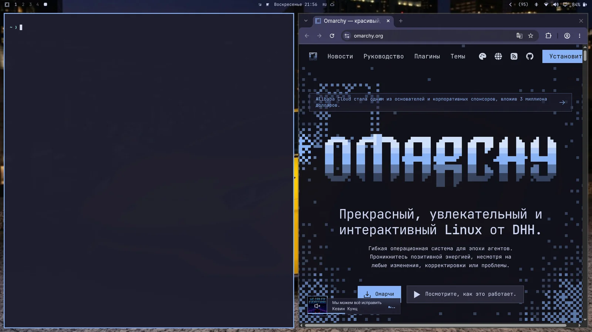
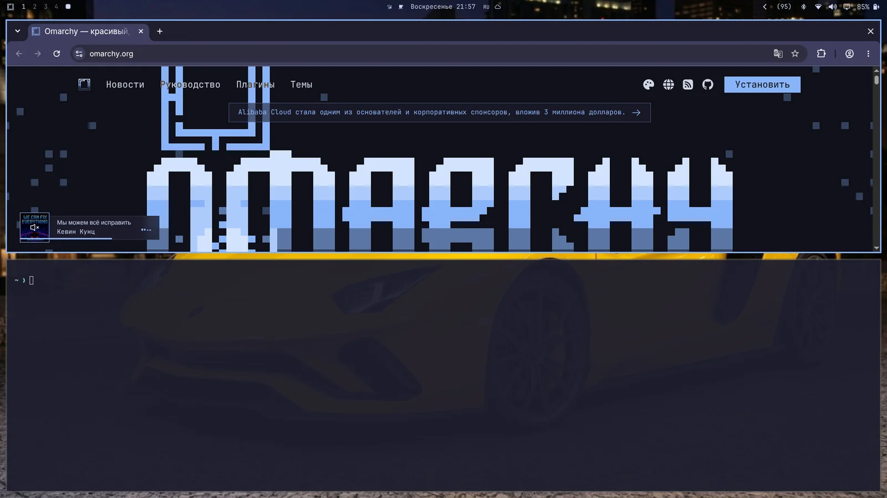
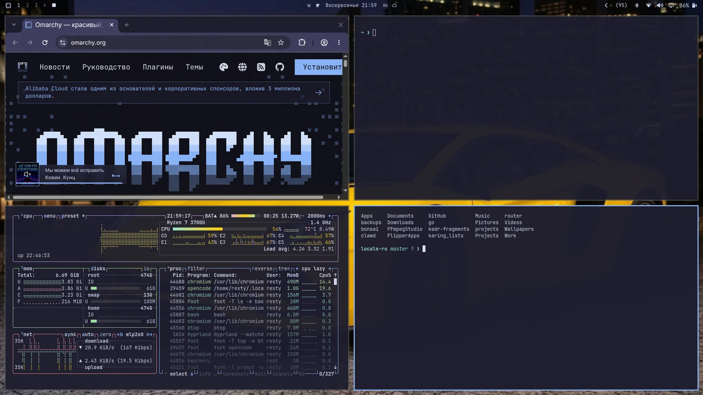
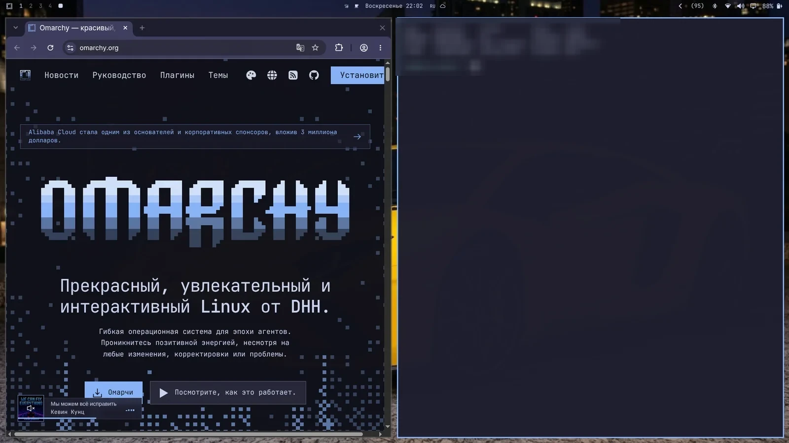
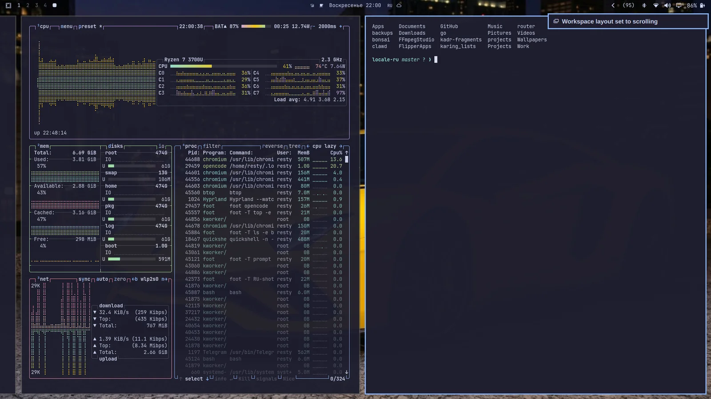
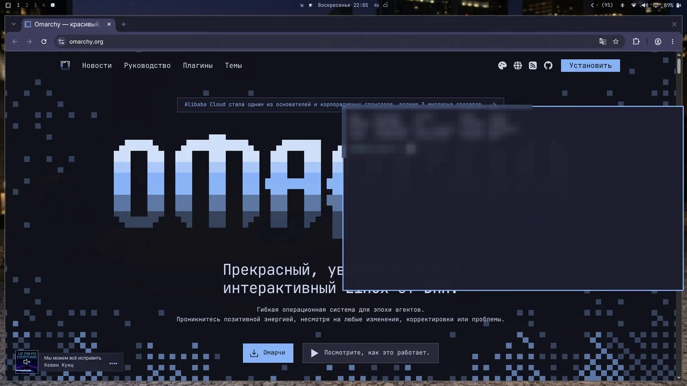

# Навигация

Всё в Omarchy делается с клавиатуры — _ВСЁ!_ Когда система только запускается, одной мышью буквально ничего нельзя сделать. Но можно нажать `Super + Space`, чтобы открыть меню Omarchy, и оттуда можно делать практически всё.

Но меню Omarchy даже не задумано как основной способ управления системой большую часть времени. Можно быстрее! Все самые важные приложения привязаны напрямую к отдельным горячим клавишам. Терминал запускается нажатием `Super + Return`, а браузер — `Super + Shift + Return`. Попробуйте сделать одно за другим, и вы увидите магию тайлинга Hyprland в действии:

 

Затем можно нажать `Super + J`, чтобы сложить их друг над другом, а не бок о бок:

 

Нажмите `Super + J` ещё раз, чтобы вернуть их в положение бок о бок. Затем, находясь в браузере, попробуйте нажать `Super + Shift + Arrow Right`, чтобы поменять окна местами.

Теперь попробуйте `Super + Shift + T`, чтобы запустить монитор Activity. Он появится как плавающее окно. Его можно сделать тайловым нажатием `Super + T` (и нажать ещё раз, чтобы снова сделать его плавающим). Теперь нажмите `Super + Shift + F`, чтобы открыть файловый менеджер. Получится аккуратная конфигурация из четырёх частей:

 

Перемещение между окнами, чтобы выбрать активное, выполняется нажатием `Super + Arrow`. Это переключит фокус и переместит курсор в центр нового приложения. У края экрана переход продолжится на монитор с той стороны.

Если нажать `Super + Shift + 2`, текущее приложение в фокусе переместится на второе рабочее пространство. `Super + Shift + 1` вернёт его обратно. (А `Super + Shift + Alt + 2` переместит текущее приложение в фокусе на второе рабочее пространство, не переключаясь на него).

При нескольких мониторах у каждого монитора есть свои рабочие пространства с 1 по 10. `Super + 2` переходит ко второму рабочему пространству монитора, на котором вы находитесь, а верхняя панель каждого монитора показывает его собственные рабочие пространства и то, которое он отображает. `Super + Tab` перебирает рабочие пространства монитора, на котором вы находитесь. `Super + Shift + Ctrl + Arrows` перемещает окно, на котором вы находитесь, на монитор в этом направлении, на рабочее пространство, которое он показывает, а `Super + Shift + Alt + Arrows` перемещает рабочее пространство, на котором вы находитесь, на монитор в этом направлении, где оно принимает тот же номер, если он свободен. Монитор сохраняет свои рабочие пространства при отключении: они присоединяются к другому экрану, нумеруясь после тех, что у него уже есть, и возвращаются под своими старыми номерами, когда монитор возвращается.

Если удерживать `Super` и щёлкнуть мышью по окну, можно изменить его расположение. Если удерживать `Super` и использовать правую кнопку мыши, можно свободно изменять размер окна.

Окно закрывается нажатием `Super + W` или `Super + Q` (а все окна — нажатием `Ctrl + Alt + Delete`).

Также можно перейти в полноэкранный режим нажатием `Super + F` или даже просто на всю ширину (сохранив верхнюю панель) нажатием `Super + Alt + F`, или в полноэкранный режим внутри окна нажатием `Super + Ctrl + F` (удобно для YouTube!).

### Раскладка dwindle против scrolling

Раскладка Omarchy по умолчанию называется dwindle. Она сохраняет все окна, открытые на одном рабочем пространстве, видимыми в любое время, даже если для этого их приходится уменьшать.

 

Но можно также превратить рабочее пространство в прокручиваемую раскладку, где окна выстроены бок о бок за видимым краем экрана. Отдельное рабочее пространство превращается в эту раскладку нажатием `Super + L`.

Повторное нажатие `Super + L` превращает рабочее пространство в плавающее, где окна свободно перекрываются и вы размещаете их сами, а третье нажатие возвращает его к dwindle. `Super + Alt + L` проходит по ним в обратном направлении. Окно, которое и так плавает — то, которое вы вынесли нажатием `Super + T`, или приложение, которое всегда открывается плавающим, — сохраняет плавающее состояние, когда рабочее пространство возвращается к тайлингу. Верхняя панель отмечает рабочее пространство, на котором вы находитесь, значком его раскладки: квадрат для dwindle, круг для scrolling и треугольник для floating. Щелчок по этому значку также перебирает раскладки.

 

Выбор делается для каждого рабочего пространства отдельно и сохраняется. Так можно держать рабочее пространство 1 на dwindle для браузинга, а рабочее пространство 2 на scrolling для кода, и после перезапуска они вернутся в таком же виде.

Если хотите использовать прокручиваемую раскладку по умолчанию, это можно задать в `~/.config/hypr/looknfeel.lua`:

```lua
hl.config({
  general = {
    layout = "scrolling",
  },
})
```

### Плавающие рабочие пространства

Плавающее рабочее пространство работает как традиционный рабочий стол: окна перекрываются, а вы сами перемещаете их и изменяете размер. Каждое окно получает строку заголовка в цветах вашей темы с кнопками свернуть, развернуть и закрыть. `Super + M` также сворачивает окно в фокусе. Свёрнутое окно ждёт в доке; щёлкните по его приложению, чтобы вернуть его. Щёлкните по окну, чтобы вынести его на передний план. Изменяйте его размер с любого края или угла. Дважды щёлкните по строке заголовка, чтобы развернуть окно, сохранив верхнюю панель видимой, и ещё раз, чтобы вернуть его прежний размер. Chrome и другие браузеры на основе Chromium, Disks и Document Viewer пропускают строку заголовка и вместо неё используют собственный заголовок; `Super + Alt + F` разворачивает их, а `Super + M` сворачивает их.

Плавающее рабочее пространство также показывает док с закреплёнными приложениями, всем, что запущено, и сеткой всех приложений за кнопкой приложений, которую также открывают `Super + Alt + Space` и _Apps_ в меню Omarchy. Щёлкните правой кнопкой мыши по приложению в сетке или нажмите `Delete`, чтобы удалить его. Щёлкните по приложению, чтобы открыть его или вынести его окно на передний план; щёлкните ещё раз, чтобы перебрать его окна. Щелчок средней кнопкой открывает новое окно. Перетащите значок вдоль дока, чтобы переместить его; перетаскивание запущенного приложения к остальным сохранит его там. Щёлкните правой кнопкой, чтобы сохранить приложение в доке, убрать его оттуда или выйти из него. Док уступает место полноэкранному окну. Щёлкните правой кнопкой по кнопке приложений, чтобы переместить док к другому краю или заставить его скрываться, пока указатель не достигнет его края. Положение также находится в _Appearance > Dock > Dock Position_, а `omarchy dock position left` и `omarchy dock autohide on` задают оба параметра из терминала. Приложения, сохранённые в доке, затемнены, пока не запущены.

Новые рабочие пространства, а также те, которым вы не задали собственную раскладку нажатием `Super + L`, используют раскладку по умолчанию. Изменение значения по умолчанию сбрасывает на него каждое рабочее пространство без окон, а пространство с окнами сохраняет свою текущую раскладку. Окно, свёрнутое в док, по-прежнему считается окном на рабочем пространстве, которое оно покинуло. Выберите её в _Appearance > Workspace Layout_: Tiling, Scrolling или Floating. `omarchy-hyprland-workspace-layout-default scrolling` задаёт её из терминала.

### Группировка окон

Окна можно группировать нажатием `Super + G`. Оказавшись в группе, каждое окно, запущенное при активной группе, будет принадлежать группе. Между сгруппированными окнами можно перемещаться нажатием `Super + Ctrl + Arrow Left/Right` или `Super + Alt + 1/2/3/4`, чтобы переходить непосредственно к сгруппированным окнам по порядку.

Окно можно вывести из группировки нажатием `Super + Alt + G` или разобрать всю группу, нажав `Super + G` ещё раз. Наконец, окна вне группы можно переместить в неё нажатием `Super + Alt + Arrows`.

### Вынесение окон

Окно можно вынести за пределы его рабочего пространства нажатием `Super + O`. Это закрепит его как плавающее окно, которое следует за вами на любое рабочее пространство, куда вы перейдёте. Отлично подходит для видеоплееров и тому подобного.

 

### Рабочее пространство Scratchpad

Существует специальное полноразмерное рабочее пространство-черновик (scratchpad), которое накладывается поверх текущего рабочего пространства. Доступ к тому, что на нём находится, осуществляется нажатием `Super + S`, а окна туда помещаются нажатием `Super + Alt + S`.

Оно хорошо подходит для элементов управления или терминала, с которым нужно быстро взаимодействовать, не покидая текущее рабочее пространство.

### Консоль Quake

Наконец, есть консоль Quake на полвысоты, которая выпадает поверх текущего рабочего пространства. Она переключается нажатием `Super + Grave`, а окно туда помещается нажатием `Super + Shift + Grave`.

Она открывается с вашим агентом по умолчанию, готовым к работе. Пока в консоли одно окно, она выпадает как центрированная панель, а не на всю ширину экрана. Поместите на неё второе приложение, и она вернётся к полной ширине, чтобы у них было место расположиться бок о бок.

Чтобы убрать окно с черновика или из консоли, отправьте его напрямую на другое рабочее пространство, например нажатием `Super + Shift + 1`.

### К этому нужно привыкнуть!

Потребуется немного времени, чтобы привыкнуть к такой навигации по рабочему столу, но как только привыкнете, вернуться к традиционному рабочему столу, управляемому мышью, будет трудно!
