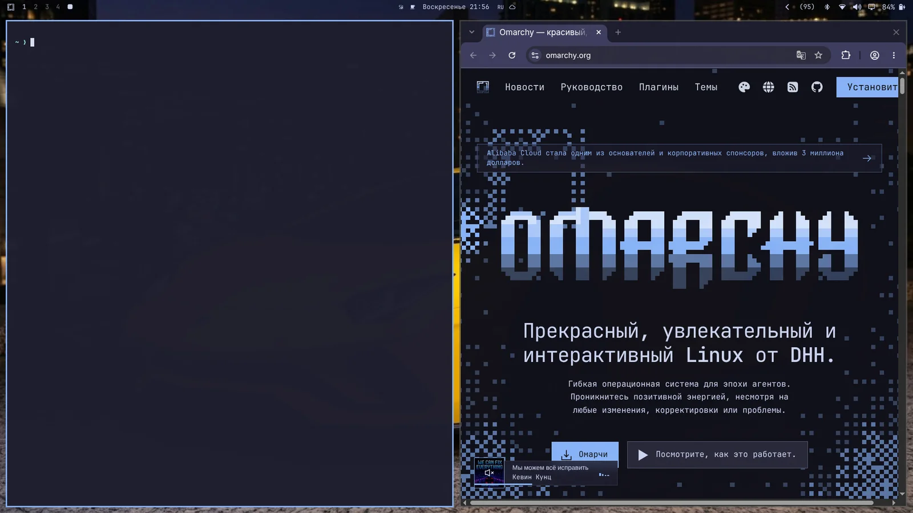

# Навигация

Всё в Omarchy делается с клавиатуры — _ВСЁ!_ Когда система только запускается, одной мышью буквально ничего не сделаешь. Но можно нажать `Super + Space`, чтобы открыть меню Omarchy, а оттуда можно сделать почти всё.

Но меню Omarchy даже не задумано как основной способ управления системой большую часть времени. Мы можем быстрее! Все самые важные приложения привязаны напрямую к отдельным горячим клавишам. Терминал запускается по `Super + Return`, а браузер — по `Super + Shift + Return`. Попробуйте сделать одно за другим, и вы увидите магию тайлинга Hyprland в действии:

 

Затем можно нажать `Super + J`, чтобы сложить их друг над другом, а не рядом:

 

Нажмите `Super + J` ещё раз, чтобы вернуть их в положение рядом друг с другом. Затем попробуйте `Super + Shift + Arrow Right`, находясь в браузере, чтобы поменять окна местами.

Теперь попробуйте `Super + Shift + T`, чтобы запустить монитор активности. Он появится как плавающее окно со строкой заголовка, за которую его можно перетаскивать, и кнопками свернуть, развернуть и закрыть. Такая строка достаётся каждому плавающему окну, где бы оно ни было. Его можно сделать тайлинговым с помощью `Super + T` (и нажать это ещё раз, чтобы снова сделать его плавающим). Теперь нажмите `Super + Shift + F`, чтобы открыть файловый менеджер. У вас получится аккуратная схема из четырёх окон:

 

Между окнами вы перемещаетесь к тому, которое должно стать активным, с помощью `Super + Arrow`. Это переключит фокус и переместит курсор в центр нового приложения. У края экрана переход продолжится на монитор с той стороны.

Если нажать `Super + Shift + 2`, текущее сфокусированное приложение переместится на второе рабочее пространство. `Super + Shift + 1` перемещает его обратно. (А `Super + Shift + Alt + 2` переместит текущее сфокусированное приложение на второе рабочее пространство, не переключаясь на него).

При нескольких мониторах у каждого монитора есть свои собственные рабочие пространства с 1 по 10. `Super + 2` переходит на второе рабочее пространство того монитора, на котором вы находитесь, а верхняя панель каждого монитора показывает его собственные рабочие пространства и то, которое он отображает. `Super + Tab` циклически переключает рабочие пространства на мониторе, на котором вы находитесь. `Super + Shift + Ctrl + Arrows` перемещает окно, на котором вы находитесь, на монитор в том направлении, на рабочее пространство, которое тот показывает, а `Super + Shift + Alt + Arrows` перемещает рабочее пространство, на котором вы находитесь, на монитор в том направлении, где оно получает тот же номер, если он свободен. Монитор сохраняет свои рабочие пространства, когда вы его отключаете: они присоединяются к другому экрану, нумеруясь после тех, что у него уже есть, и возвращаются под своими старыми номерами, когда монитор вернётся.

Если удерживать `Super` и щёлкать мышью по окну, можно будет изменить его расположение. Если удерживать `Super` и использовать правую кнопку мыши, можно свободно менять размер окна.

Окно закрывается по `Super + W` или `Super + Q` (а все окна закрываются по `Ctrl + Alt + Delete`).

Также можно перейти в полноэкранный режим по `Super + F` или даже просто на всю ширину (сохранив верхнюю панель) по `Super + Alt + F`, или в полноэкранный режим внутри окна по `Super + Ctrl + F` (отлично для YouTube!).

### Раскладка dwindle против прокручиваемой раскладки

Раскладка Omarchy по умолчанию называется dwindle. Она сохраняет все окна, которые вы открываете на одном рабочем пространстве, видимыми в любое время, даже если для этого их приходится уменьшать.

 

Но можно также превратить рабочее пространство в прокручиваемую раскладку, где окна выстраиваются рядом друг с другом за видимым краем дисплея. Одно рабочее пространство превращается в эту раскладку по `Super + L`.

Повторное нажатие `Super + L` делает рабочее пространство плавающим, где окна свободно перекрываются и вы размещаете их сами, а третье нажатие возвращает его к dwindle. `Super + Alt + L` проходит по ним в обратном порядке. Окно, которое и так плавает — то, которое вы вынесли по `Super + T`, или приложение, которое всегда открывается плавающим, — останется плавающим, когда рабочее пространство вернётся к тайлингу. Верхняя панель отмечает рабочее пространство, на котором вы находитесь, его раскладкой: квадрат для dwindle, круг для scrolling и треугольник для floating. Щелчок по этой метке тоже циклически меняет раскладку, как и клавиша дисплея на ноутбуках, где она есть.

 

Выбор делается для каждого рабочего пространства отдельно и сохраняется. Так можно держать рабочее пространство 1 на dwindle для просмотра веб-страниц, а рабочее пространство 2 на scrolling для кода, и они вернутся в таком виде после перезапуска.

Если хотите использовать прокручиваемую раскладку по умолчанию, это можно задать в `~/.config/hypr/looknfeel.lua`:

```lua
hl.config({
  general = {
    layout = "scrolling",
  },
})
```

### Плавающие рабочие пространства

Плавающее рабочее пространство работает как традиционный рабочий стол: окна перекрываются, а вы сами перемещаете их и меняете их размер. Каждое окно получает строку заголовка в цветах вашей темы с кнопками свернуть, развернуть и закрыть. `Super + M` тоже сворачивает сфокусированное окно. Свёрнутое окно ждёт в доке; щёлкните по его приложению, чтобы вернуть его. Щёлкните по окну, чтобы вынести его на передний план. Меняйте его размер с любого края или угла. Дважды щёлкните по строке заголовка, чтобы развернуть окно, сохранив верхнюю панель на виду, и ещё раз — чтобы вернуть его прежний размер. Chrome и другие браузеры на основе Chromium, Disks и Document Viewer пропускают строку заголовка и вместо неё используют собственный заголовок; `Super + Alt + F` разворачивает их, а `Super + M` сворачивает их.

У каждого рабочего пространства есть док с вашими закреплёнными приложениями, всем, что запущено, и сеткой всех приложений за кнопкой приложений, которую также открывают `Super + Alt + Space` и _Apps_ в меню Omarchy. Щёлкните правой кнопкой по приложению в сетке или нажмите `Delete`, чтобы удалить его. Щёлкните по приложению, чтобы открыть его или вынести его окно на передний план; щёлкните ещё раз, чтобы циклически переключаться между его окнами. Files только возвращает окно с рабочего пространства, на котором вы находитесь, а в остальных случаях открывает новое, а Terminal и Agent всегда запускают ещё одно, хотя свёрнутое окно вернётся первым. Щелчок средней кнопкой открывает новое окно. Перетащите значок вдоль дока, чтобы переместить его; перетаскивание запущенного приложения в ряд с остальными оставляет его там. Щёлкните правой кнопкой, чтобы оставить приложение в доке, убрать его оттуда или завершить его работу. Док остаётся на виду, пока рабочее пространство пусто, а как только на рабочем пространстве появляется окно, он скрывается, пока указатель не достигнет его края. Полноэкранное окно скрывает его полностью. Перетащите кнопку приложений к другому краю экрана, чтобы переместить док туда. Щёлкните по ней правой кнопкой для _Position_, чтобы выбрать край, и для _Layout_, чтобы задать раскладку по умолчанию так же, как это делает _Appearance > Workspace Layout_. Положение также находится в _Appearance > Dock > Dock Position_, а `omarchy dock position left` задаёт его из терминала. Приложения, которые вы держите в доке, выглядят блёклыми, пока не запущены. Чтобы оставить док только для плавающих рабочих пространств, используйте _Appearance > Dock > Dock Only on Floating_ или `omarchy dock tiling off`.

Новые рабочие пространства и любые, которым вы не задали собственную раскладку с помощью `Super + L`, используют раскладку по умолчанию. Изменение значения по умолчанию сбрасывает на неё каждое рабочее пространство без окон, а то, на котором есть окна, сохраняет имеющуюся у него раскладку. Окно, свёрнутое в док, по-прежнему считается окном на рабочем пространстве, которое оно покинуло. Выберите её в _Appearance > Workspace Layout_: Tiling, Scrolling или Floating. `omarchy hyprland workspace layout default scrolling` задаёт её из терминала.

### Группировка окон

Окна можно группировать с помощью `Super + G`. Как только вы окажетесь в группе, каждое окно, которое вы запустите, пока она активна, будет принадлежать группе. Между этими сгруппированными окнами можно перемещаться с помощью `Super + Ctrl + Arrow Left/Right` или `Super + Alt + 1/2/3/4`, чтобы напрямую переходить к сгруппированным окнам по порядку.

Окно можно вывести из группы с помощью `Super + Alt + G` или разобрать всю группу, нажав `Super + G` ещё раз. Наконец, окна вне группы можно переместить в неё с помощью `Super + Alt + Arrows`.

### Вынос окон

Окно можно вынести за пределы отведённого ему рабочего пространства с помощью `Super + O`. Это закрепит его как плавающее окно, которое следует за вами на любое рабочее пространство, куда вы перейдёте. Отлично подходит для видеоплееров и тому подобного.

 

### Рабочее пространство Scratchpad

Есть специальное полноразмерное рабочее пространство Scratchpad, которое накладывается поверх любого рабочего пространства, на котором вы сейчас находитесь. Доступ к тому, что на нём находится, вы получаете с помощью `Super + S`, а окна туда помещаете с помощью `Super + Alt + S`.

Оно хорошо подходит для элементов управления или терминала, с которыми нужно быстро взаимодействовать, не покидая текущее рабочее пространство.

### Консоль Quake

Наконец, есть консоль Quake высотой в половину экрана, которая опускается поверх любого рабочего пространства, на котором вы сейчас находитесь. Включайте и выключайте её по `Super + the key above Tab` (grave в раскладках US), а окно туда помещайте с помощью `Super + Shift + the key above Tab`.

При первом открытии она запускает вашего агента по умолчанию или просит вас выбрать одного, если вы ещё ни одного не выбрали. Пока в консоли находится одно окно, она опускается как панель по центру, а не на всю ширину экрана. Поместите на неё второе приложение, и она вернётся к полной ширине, чтобы у обоих было место расположиться рядом.

Чтобы убрать окно с Scratchpad или из консоли, отправьте его напрямую на другое рабочее пространство чем-нибудь вроде `Super + Shift + 1`.

### К этому нужно привыкнуть!

К навигации по рабочему столу таким способом нужно немного привыкнуть, но как только привыкнете, вернуться к традиционному рабочему столу, управляемому мышью, будет трудно!
