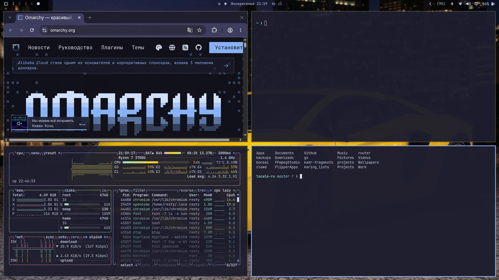

# Навигация

Всё в Omarchy происходит через клавиатуру — _ВСЁ!_ Когда система только запускается, одной мышью буквально ничего не сделаешь. Но можно нажать `Super + Space`, чтобы открыть меню Omarchy, а оттуда можно сделать практически всё.

Но меню Omarchy даже не задумывалось как основной способ управления системой большую часть времени. Можно быстрее! Все самые важные приложения привязаны напрямую к отдельным горячим клавишам. Терминал запускается с помощью `Super + Return`, а браузер — с помощью `Super + Shift + Return`. Попробуйте сделать одно за другим, и вы увидите магию тайлинга Hyprland в действии:

 

Затем можно нажать `Super + J`, чтобы сложить их друг на друга, а не рядом:

 

Нажмите `Super + J` ещё раз, чтобы вернуть их в положение рядом друг с другом. Затем попробуйте `Super + Shift + Arrow Right`, находясь в браузере, чтобы поменять окна местами.

Теперь попробуйте `Super + Shift + T`, чтобы запустить монитор Activity. Он появится как плавающее окно. Его можно сделать тайлинговым с помощью `Super + T` (и нажать ещё раз, чтобы снова сделать его плавающим). Теперь нажмите `Super + Shift + F`, чтобы открыть файловый менеджер. Получится аккуратная схема из четырёх окон:

 

Между окнами, одно из которых должно стать активным, вы перемещаетесь с помощью `Super + Arrow`. Это переключает фокус и перемещает курсор в центр нового приложения. У края экрана переход продолжается на монитор с той стороны.

Если нажать `Super + Shift + 2`, текущее приложение в фокусе переместится на второе рабочее пространство. `Super + Shift + 1` вернёт его обратно. (А `Super + Shift + Alt + 2` переместит текущее приложение в фокусе на второе рабочее пространство, не переключаясь на него).

При нескольких мониторах у каждого монитора есть собственные рабочие пространства с 1 по 10. `Super + 2` переходит на второе рабочее пространство монитора, на котором вы находитесь, а верхняя панель каждого монитора показывает его собственные рабочие пространства и то, которое он отображает. `Super + Tab` циклически переключает рабочие пространства на мониторе, на котором вы находитесь. `Super + Shift + Ctrl + Arrows` перемещает окно, на котором вы находитесь, на монитор в этом направлении, на рабочее пространство, которое он показывает, а `Super + Shift + Alt + Arrows` перемещает рабочее пространство, на котором вы находитесь, на монитор в этом направлении, где оно получает тот же номер, если он свободен. Монитор сохраняет свои рабочие пространства при отключении: они присоединяются к другому экрану, получают номера после тех, что у него уже есть, и возвращаются под своими старыми номерами, когда монитор возвращается.

Если удерживать `Super` и щёлкнуть мышью по окну, вы сможете изменить, где оно расположено. Если удерживать `Super` и использовать правую кнопку мыши, вы сможете свободно менять размер окна.

Окно закрывается с помощью `Super + W` или `Super + Q` (а все окна закрываются с помощью `Ctrl + Alt + Delete`).

Также можно перейти в полноэкранный режим с помощью `Super + F` или даже просто на всю ширину (с сохранением верхней панели) с помощью `Super + Alt + F`, или в полноэкранный режим внутри окна с помощью `Super + Ctrl + F` (отлично для YouTube!).

### Компоновка dwindle и прокручиваемая компоновка

Компоновка Omarchy по умолчанию называется dwindle. Она сохраняет все окна, открытые на одном рабочем пространстве, видимыми в любое время, даже если для этого их приходится уменьшать.

 

Но вы также можете превратить рабочее пространство в прокручиваемую компоновку, где окна выстраиваются рядом друг с другом, выходя за видимый край дисплея. Отдельное рабочее пространство превращается в эту компоновку с помощью `Super + L`.

Повторное нажатие `Super + L` делает рабочее пространство плавающим, где окна свободно перекрываются и вы размещаете их сами, а третье нажатие возвращает его к dwindle. `Super + Alt + L` проходит их в обратном направлении. Окно, которое и так плавает — то, которое вы вынесли с помощью `Super + T`, или приложение, которое всегда открывается плавающим — продолжает плавать, когда рабочее пространство возвращается к тайлингу. Верхняя панель отмечает рабочее пространство, на котором вы находитесь, его компоновкой: квадрат для dwindle, круг для прокручиваемой и треугольник для плавающей. Щелчок по этой отметке также циклически переключает компоновку, как и клавиша дисплея на ноутбуках, у которых она есть.

 

Выбор делается для каждого рабочего пространства отдельно и сохраняется. Так что вы можете оставить рабочее пространство 1 на dwindle для просмотра веб-страниц, а рабочее пространство 2 — на прокручиваемой компоновке для кода, и они вернутся в таком виде после перезапуска.

Если вы хотите использовать прокручиваемую компоновку по умолчанию, это можно задать в `~/.config/hypr/looknfeel.lua`:

```lua
hl.config({
  general = {
    layout = "scrolling",
  },
})
```

### Плавающие рабочие пространства

Плавающее рабочее пространство работает как традиционный рабочий стол: окна перекрываются, а вы сами перемещаете их и меняете их размер. Каждое окно получает строку заголовка в цветах вашей темы, с кнопками свернуть, развернуть и закрыть. `Super + M` также сворачивает окно в фокусе. Свёрнутое окно ждёт в доке; щёлкните по его приложению, чтобы вернуть его. Щёлкните по окну, чтобы вывести его вперёд. Меняйте его размер с любого края или угла. Дважды щёлкните по строке заголовка, чтобы развернуть окно, сохранив верхнюю панель в поле зрения, и ещё раз, чтобы вернуть его старый размер. Chrome и другие браузеры на основе Chromium, Disks и Document Viewer пропускают строку заголовка и вместо неё используют собственный заголовок; `Super + Alt + F` разворачивает их, а `Super + M` сворачивает их.

Плавающее рабочее пространство также показывает док, с вашими закреплёнными приложениями, всем, что запущено, и сеткой каждого приложения за кнопкой приложений, которую также открывают `Super + Alt + Space` и _Apps_ в меню Omarchy. Щёлкните правой кнопкой мыши по приложению в сетке или нажмите `Delete`, чтобы удалить его. Щёлкните по приложению, чтобы открыть его или вывести его окно вперёд; щёлкните ещё раз, чтобы циклически переключаться между его окнами. Files только возвращает окно с рабочего пространства, на котором вы находитесь, и в противном случае открывает новое, а Terminal и Agent всегда запускают ещё одно, хотя свёрнутое окно возвращается первым. Щелчок средней кнопкой открывает новое окно. Перетащите значок вдоль дока, чтобы переместить его; перетаскивание запущенного приложения в ряд с остальными оставляет его там. Щёлкните правой кнопкой мыши, чтобы оставить приложение в доке, убрать его оттуда или завершить его работу. Док уступает место полноэкранному окну. Щёлкните правой кнопкой мыши по кнопке приложений, чтобы переместить док к другому краю или заставить его скрываться, пока указатель не достигнет его края. Положение также находится в _Appearance > Dock > Dock Position_, а `omarchy dock position left` и `omarchy dock autohide on` задают оба параметра из терминала. Приложения, которые вы оставляете в доке, отображаются приглушёнными, пока они не запущены.

Новые рабочие пространства, и любые, которым вы не задали собственную компоновку с помощью `Super + L`, используют компоновку по умолчанию. Изменение значения по умолчанию сбрасывает на него каждое рабочее пространство без окон, тогда как пространство с окнами сохраняет имеющуюся у него компоновку. Окно, свёрнутое в док, по-прежнему считается окном на рабочем пространстве, которое оно покинуло. Выберите её в _Appearance > Workspace Layout_: Tiling, Scrolling или Floating. `omarchy hyprland workspace layout default scrolling` задаёт её из терминала.

### Группировка окон

Окна можно группировать с помощью `Super + G`. Как только вы окажетесь в группе, каждое окно, запущенное при активной группе, будет принадлежать к ней. Между этими сгруппированными окнами можно перемещаться с помощью `Super + Ctrl + Arrow Left/Right` или `Super + Alt + 1/2/3/4`, чтобы перейти напрямую к сгруппированным окнам по порядку.

Окно можно вынести из группировки с помощью `Super + Alt + G` или разобрать всю группу, нажав `Super + G` ещё раз. Наконец, окна за пределами группы можно переместить в неё с помощью `Super + Alt + Arrows`.

### Вынос окон

Окно можно вынести за пределы назначенного ему рабочего пространства с помощью `Super + O`. Это закрепит его как плавающее окно, которое следует за вами на любое рабочее пространство, куда вы перейдёте. Отлично подходит для видеоплееров и подобного.

 

### Рабочее пространство-блокнот

Есть специальное рабочее пространство-блокнот во весь размер, которое накладывается поверх того рабочего пространства, на котором вы сейчас находитесь. Доступ к тому, что на нём находится, вы получаете с помощью `Super + S`, а окна туда помещаете с помощью `Super + Alt + S`.

Оно хорошо подходит для элементов управления или терминала, с которым вы хотите быстро взаимодействовать, не покидая текущее рабочее пространство.

### Консоль Quake

Наконец, есть консоль Quake в полвысоты, которая опускается поверх того рабочего пространства, на котором вы сейчас находитесь. Переключайте её с помощью `Super + Grave`, а окно туда помещайте с помощью `Super + Shift + Grave`.

При первом открытии она запускает вашего агента по умолчанию или просит выбрать одного, если вы ещё не выбрали. Пока в консоли одно окно, она опускается как центрированная панель, а не растягивается на весь экран. Поместите на неё второе приложение, и она вернётся на всю ширину, чтобы у обоих было место расположиться рядом.

Чтобы убрать окно с блокнота или из консоли, отправьте его напрямую на другое рабочее пространство с помощью чего-то вроде `Super + Shift + 1`.

### К этому нужно привыкнуть!

Нужно немного времени, чтобы привыкнуть к такой навигации по рабочему столу, но как только вы привыкнете, вернуться к традиционному рабочему столу, управляемому мышью, будет трудно!
