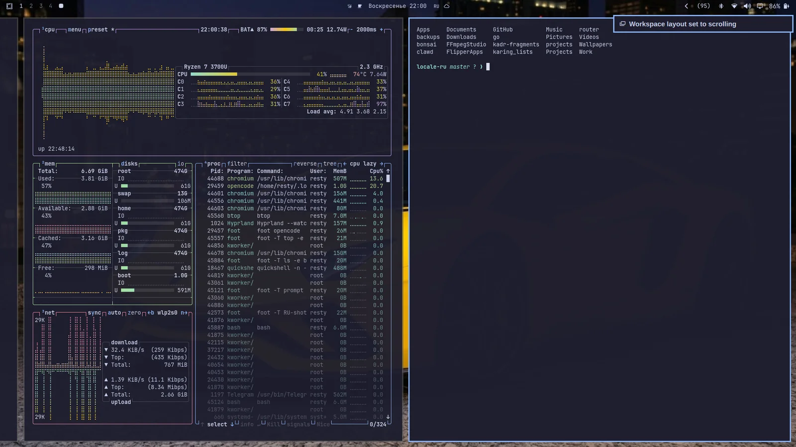
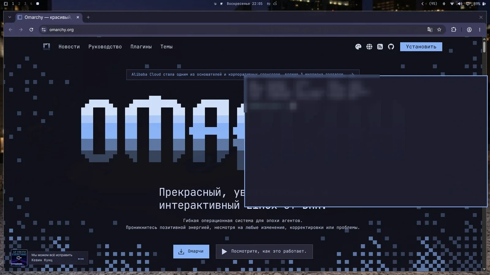

# Навигация

Всё в Omarchy делается с клавиатуры — _ВСЁ!_ Когда система только запускается, одной мышью вы буквально ничего не сможете сделать. Но вы можете нажать `Super + Space`, чтобы открыть меню Omarchy, а оттуда можно сделать практически всё.

Но меню Omarchy даже не задумано как основной способ работы с системой большую часть времени. Можно быстрее! Все самые важные приложения привязаны напрямую к отдельным горячим клавишам. Терминал запускается нажатием `Super + Return`, а браузер — `Super + Shift + Return`. Попробуйте сделать одно за другим, и вы увидите в действии магию тайлинга Hyprland:

 

Вы можете затем нажать `Super + J`, чтобы расположить их друг над другом, а не бок о бок:

 

Нажмите `Super + J` ещё раз, чтобы вернуть их в положение бок о бок. Затем попробуйте `Super + Shift + Arrow Right` в браузере, чтобы поменять окна местами.

Теперь попробуйте `Super + Shift + T`, чтобы запустить монитор активности Activity. Он появится как плавающее окно. Вы можете сделать его тайловым с помощью `Super + T` (и нажать то же сочетание ещё раз, чтобы снова сделать его плавающим). Теперь нажмите `Super + Shift + F`, чтобы открыть файловый менеджер. У вас получится аккуратная схема из четырёх окон:

 

Между окнами, одно из которых вы хотите сделать активным, вы перемещаетесь с помощью `Super + Arrow`. Это переключит фокус и переместит курсор в центр нового приложения. У края экрана переход продолжится на монитор с той стороны.

Если вы нажмёте `Super + Shift + 2`, текущее окно в фокусе переместится на второе рабочее пространство. `Super + Shift + 1` перемещает его обратно. (А `Super + Shift + Alt + 2` переместит текущее окно в фокусе на второе рабочее пространство, не переключаясь на него).

При наличии нескольких мониторов у каждого монитора есть свои рабочие пространства с 1 по 10. `Super + 2` переходит ко второму рабочему пространству того монитора, на котором вы находитесь, а верхняя панель каждого монитора показывает его собственные рабочие пространства и то, которое сейчас отображается. `Super + Tab` циклически переключает рабочие пространства на мониторе, на котором вы находитесь. `Super + Shift + Ctrl + Arrows` перемещает окно, на котором вы находитесь, на монитор в том направлении, на рабочее пространство, которое там отображается, а `Super + Shift + Alt + Arrows` перемещает рабочее пространство, на котором вы находитесь, на монитор в том направлении, где оно получает тот же номер, если он свободен. Монитор сохраняет свои рабочие пространства, когда вы его отключаете: они присоединяются к другому экрану, получая номера после тех, что у него уже есть, и возвращаются под своими прежними номерами, когда монитор возвращается.

Если вы удерживаете `Super` и щёлкаете мышью по окну, вы сможете изменить его место. Если вы удерживаете `Super` и используете правую кнопку мыши, вы можете свободно изменять размер окна.

Окно закрывается нажатием `Super + W` или `Super + Q` (а все окна закрываются нажатием `Ctrl + Alt + Delete`).

Вы также можете перейти в полноэкранный режим с помощью `Super + F` или даже просто на всю ширину (сохраняя верхнюю панель) с помощью `Super + Alt + F` или в полноэкранный режим внутри окна с помощью `Super + Ctrl + F` (отлично подходит для YouTube!).

### Раскладки dwindle и scrolling

Раскладка Omarchy по умолчанию называется dwindle. Она сохраняет все окна, открытые на одном рабочем пространстве, видимыми всегда, даже если для этого их приходится уменьшать.

 

Но вы также можете превратить рабочее пространство в раскладку scrolling, где окна выстраиваются бок о бок за видимым краем экрана. Одно рабочее пространство превращается в эту раскладку с помощью `Super + L`.

Повторное нажатие `Super + L` превращает рабочее пространство в плавающее, где окна свободно перекрываются и вы размещаете их сами, а третье нажатие возвращает его к dwindle. `Super + Alt + L` проходит по ним в обратном порядке. Окно, которое и так плавает — которое вы вынесли с помощью `Super + T`, или приложение, которое всегда открывается плавающим, — остаётся плавающим, когда рабочее пространство возвращается к тайлингу. Верхняя панель отмечает рабочее пространство, на котором вы находитесь, его раскладкой: квадрат для dwindle, круг для scrolling и треугольник для плавающей. Щелчок по этой отметке тоже циклически переключает раскладку, как и клавиша дисплея на ноутбуках, где она есть.

 

Выбор делается для каждого рабочего пространства и сохраняется. Так вы можете держать рабочее пространство 1 на dwindle для просмотра веб-страниц, а рабочее пространство 2 на scrolling для кода, и они вернутся в таком виде после перезапуска.

Если вы хотите использовать раскладку scrolling по умолчанию, вы можете задать это в `~/.config/hypr/looknfeel.lua`:

```lua
hl.config({
  general = {
    layout = "scrolling",
  },
})
```

### Плавающие рабочие пространства

Плавающее рабочее пространство работает как традиционный рабочий стол: окна перекрываются, а вы сами перемещаете их и меняете их размер. Каждое окно получает заголовок в цветах вашей темы с кнопками свернуть, развернуть и закрыть. `Super + M` тоже сворачивает окно в фокусе. Свёрнутое окно ждёт в доке; щёлкните по его приложению, чтобы вернуть его. Щёлкните по окну, чтобы вывести его на передний план. Изменяйте его размер с любого края или угла. Дважды щёлкните по заголовку, чтобы развернуть окно, сохранив верхнюю панель на виду, и ещё раз, чтобы вернуть его прежний размер. Chrome и другие браузеры на базе Chromium, Disks и Document Viewer пропускают заголовок и вместо него используют собственный заголовок; `Super + Alt + F` разворачивает их, а `Super + M` сворачивает их.

Плавающее рабочее пространство также показывает док с вашими закреплёнными приложениями, всем, что запущено, и сеткой всех приложений за кнопкой приложений, которую также открывают `Super + Alt + Space` и _Apps_ в меню Omarchy. Щёлкните правой кнопкой мыши по приложению в сетке или нажмите `Delete`, чтобы удалить его. Щёлкните по приложению, чтобы открыть его или вывести его окно на передний план; щёлкните ещё раз, чтобы циклически переключаться между его окнами. Files возвращает окно только с рабочего пространства, на котором вы находитесь, а в противном случае открывает новое, а Terminal и Agent всегда запускают ещё одно, хотя свёрнутое окно возвращается первым. Щелчок средней кнопкой открывает новое окно. Перетащите значок вдоль дока, чтобы переместить его; перетаскивание запущенного приложения между остальными оставляет его там. Щёлкните правой кнопкой мыши, чтобы оставить приложение в доке, убрать его оттуда или завершить его работу. Док уступает место полноэкранному окну. Щёлкните правой кнопкой мыши по кнопке приложений, чтобы переместить док к другому краю или сделать так, чтобы он скрывался, пока указатель не достигнет его края. Положение также находится в _Appearance > Dock > Dock Position_, а `omarchy dock position left` и `omarchy dock autohide on` задают и то и другое из терминала. Приложения, которые вы держите в доке, отображаются поблёкшими, пока они не запущены.

Новые рабочие пространства, и любые, которым вы не задали собственную раскладку с помощью `Super + L`, используют раскладку по умолчанию. Изменение раскладки по умолчанию сбрасывает к ней каждое рабочее пространство без окон, а рабочее пространство с окнами сохраняет ту раскладку, которая у него есть. Окно, свёрнутое в док, по-прежнему считается окном на рабочем пространстве, которое оно покинуло. Выберите её в _Appearance > Workspace Layout_: Tiling, Scrolling или Floating. `omarchy hyprland workspace layout default scrolling` задаёт её из терминала.

### Группировка окон

Окна можно группировать с помощью `Super + G`. Как только вы окажетесь в группе, каждое окно, запущенное при активной группе, будет принадлежать группе. Между этими сгруппированными окнами можно перемещаться с помощью `Super + Ctrl + Arrow Left/Right` или `Super + Alt + 1/2/3/4`, чтобы перейти непосредственно к сгруппированным окнам по порядку.

Вы можете вывести окно из группировки с помощью `Super + Alt + G` или разобрать всю группу, нажав `Super + G` ещё раз. Наконец, вы можете переместить окна извне группы в неё с помощью `Super + Alt + Arrows`.

### Открепление окон

Вы можете вынести окно за пределы его рабочего пространства с помощью `Super + O`. Это закрепит его как плавающее окно, которое следует за вами на любое рабочее пространство, куда вы перейдёте. Отлично подходит для видеоплееров и подобного.

 

### Рабочее пространство Scratchpad

Существует специальное полноразмерное рабочее пространство scratchpad, которое накладывается поверх того рабочего пространства, на котором вы сейчас находитесь. Вы получаете доступ к тому, что на нём, с помощью `Super + S`, а окна туда помещаете с помощью `Super + Alt + S`.

Оно хорошо подходит для элементов управления или терминала, с которым вы хотите быстро взаимодействовать, не покидая текущее рабочее пространство.

### Консоль Quake

Наконец, есть консоль Quake половинной высоты, которая выдвигается вниз поверх того рабочего пространства, на котором вы сейчас находитесь. Переключайте её с помощью `Super + the key above Tab` (grave на раскладках US), а окно туда помещайте с помощью `Super + Shift + the key above Tab`.

В первый раз, когда она открывается, она запускает вашего агента по умолчанию или просит вас выбрать одного, если вы ещё не выбрали. Пока в консоли одно окно, она выдвигается вниз как центрированная панель, а не на всю ширину экрана. Поместите на неё второе приложение, и она вернётся на всю ширину, чтобы у обоих было место расположиться бок о бок.

Чтобы убрать окно со scratchpad или из консоли, отправьте его напрямую на другое рабочее пространство с помощью чего-то вроде `Super + Shift + 1`.

### К этому нужно привыкнуть!

К такому способу навигации по рабочему столу нужно немного привыкнуть, но как только вы привыкнете, вернуться к традиционному рабочему столу, управляемому мышью, будет трудно!
