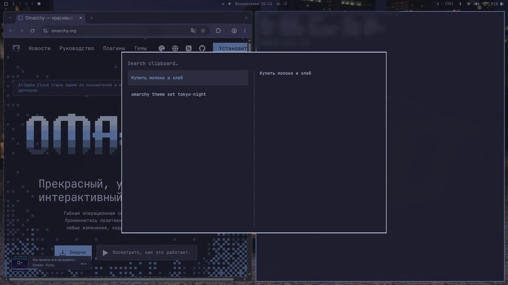
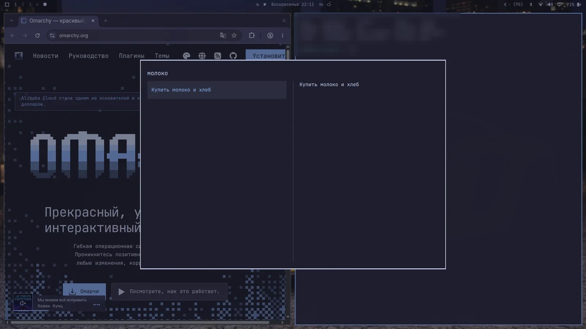

# Единый буфер обмена и история

Обычно в Linux для копирования и вставки в терминале нужно `Ctrl + Shift + C/V`, а везде в остальных местах — `Ctrl + C/V`. К этому трудно привыкнуть любому, кто не родился и не вырос на Linux! Так же трудно и переходить с Super на Ctrl, если вы пришли с Mac.

Omarchy решает обе проблемы едиными горячими клавишами буфера обмена, которые работают (почти) везде. Вот они:

| Hotkey | Command |
| ------- | ----------- |
| Super + A | Выделить всё |
| Super + C | Копировать |
| Super + X | Вырезать |
| Super + V | Вставить |
| Super + Ctrl + V | История буфера обмена |

_Обратите внимание, что большинство агентных оболочек будут использовать `Ctrl + V` для вставки изображений, а `Super + V` — для вставки текста._

Используйте `Super + A`, затем `Super + C`, чтобы скопировать всё в активном текстовом поле или другом приложении, которое поддерживает `Ctrl + A`. В терминале `Ctrl + A` перемещает в начало командной строки, а не выделяет её текст.

### История буфера обмена

Историю буфера обмена предоставляет оболочка Omarchy, и она работает и для текста, и для изображений. Вы вызываете её сочетанием `Super + Ctrl + V` и выбираете нужную запись клавишей Return, после чего она сразу вставляется в приложение, в котором вы были. Используйте `Shift + Return`, чтобы только скопировать её в буфер обмена, `Alt + Return`, чтобы открыть её, `Delete`, чтобы удалить её из истории, и `Shift + Delete`, чтобы очистить всю историю.

 

Вы также можете искать по истории, просто начав вводить текст:

 
