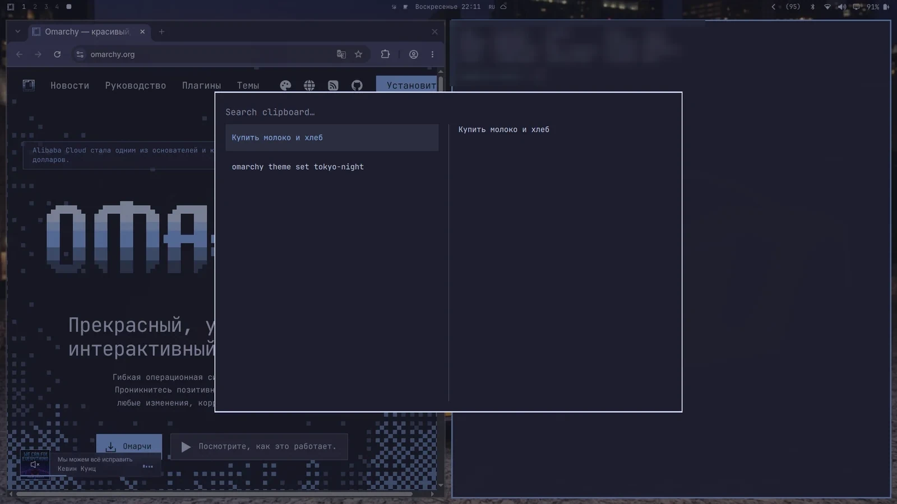
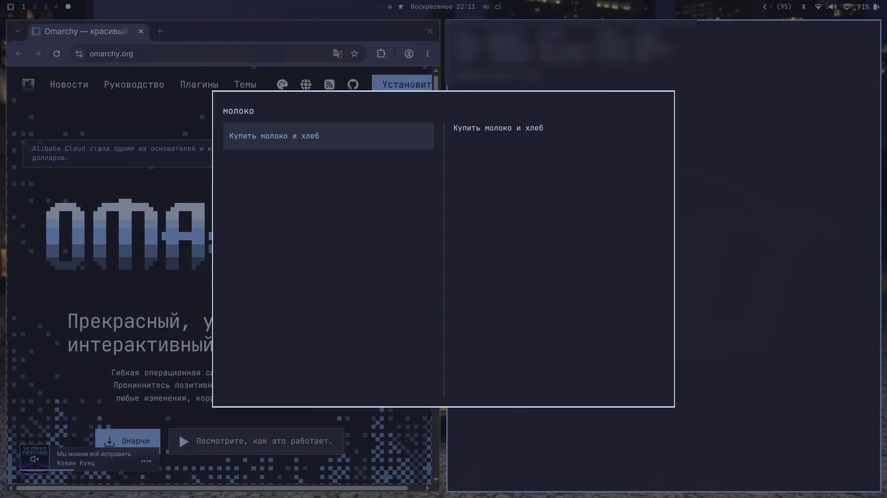

# Единый буфер обмена и история

Обычно в Linux для копирования и вставки в терминале нужно нажимать `Ctrl + Shift + C/V`, а везде в остальных местах — `Ctrl + C/V`. К этому трудно привыкнуть любому, кто не родился и не вырос на Linux! Как и к переходу с Super на Ctrl, если вы переходите с Mac.

Omarchy решает обе проблемы с помощью единых горячих клавиш буфера обмена, которые работают (почти) везде. Вот они:

| Hotkey | Command |
| ------- | ----------- |
| Super + A | Выделить всё |
| Super + C | Копировать |
| Super + X | Вырезать |
| Super + V | Вставить |
| Super + Ctrl + V | История буфера обмена |

_Обратите внимание: большинство агентных оболочек используют `Ctrl + V` для вставки изображений, а `Super + V` — для вставки текста._

Используйте `Super + A`, а затем `Super + C`, чтобы скопировать всё в активном текстовом поле или другом приложении, которое поддерживает `Ctrl + A`. В терминале `Ctrl + A` перемещает курсор в начало командной строки, а не выделяет её текст.

### История буфера обмена

Историю буфера обмена обеспечивает оболочка Omarchy, и она работает как для текста, так и для изображений. Вы вызываете её сочетанием `Super + Ctrl + V`, выбираете нужную запись нажатием Enter, и после этого она помещается в буфер обмена, готовая к вставке по `Super + V`.

 

Вы также можете искать по истории, просто начав печатать:

 
