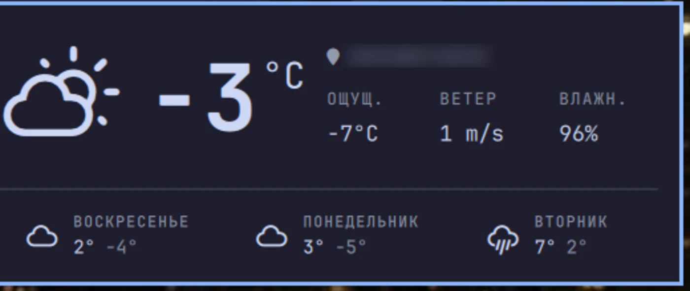
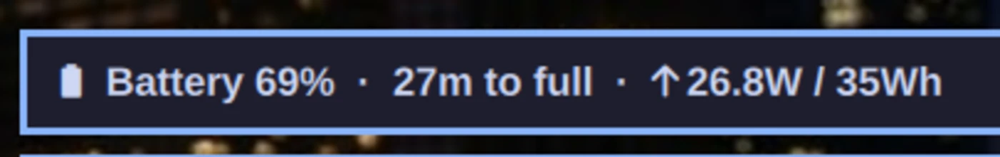

# Уведомления

Вы можете быстро получить доступ к дате и времени, статусу батареи и текущей погоде с помощью горячих клавиш уведомлений.

### Дата и время

`Super + Ctrl + Alt + T`

 

### Погода

`Super + Ctrl + Alt + W`

 

Местоположение определяется по вашему IP-адресу, что обычно достаточно точно, но не всегда. Его можно уточнить с помощью `omarchy weather location --set Malibu` или быть точным, добавив координаты: `omarchy weather location --set Malibu 34.0259,-118.7798`. Выполните `omarchy weather location` сам по себе, чтобы увидеть, где, по мнению системы, вы находитесь, и `--clear`, чтобы вернуться к автоопределению.

### Батарея

`Super + Ctrl + Alt + B`

 
