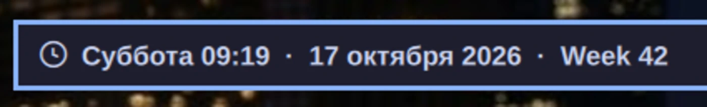
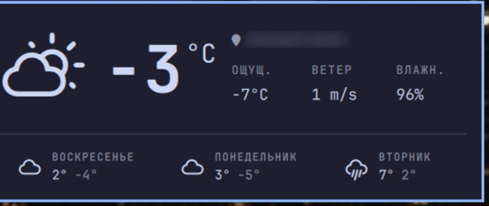
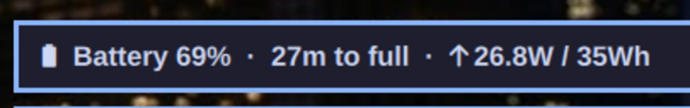

# Уведомления

Уведомления появляются в правом верхнем углу активного дисплея. Вы также можете быстро посмотреть дату и время, состояние батареи и текущую погоду с помощью уведомлений по горячим клавишам.

## Уведомления

Уведомления от одного и того же приложения или сайта складываются в стопку, поэтому болтливый канал Slack не вытеснит с экрана сообщение о проваленной сборке. Наведите курсор на стопку, чтобы развернуть её веером; пока вы читаете, ничто новое не подсунется под ваш указатель. Щёлкните карточку, чтобы перейти туда, откуда она пришла, щёлкните правой кнопкой мыши, средней кнопкой мыши или нажмите ✕, чтобы отклонить её.

Карточки предлагают то, что в них есть: _Скопировать код_ для кодов подтверждения (не попадают в [историю буфера обмена](08-unified-clipboard-history.md) и удаляются через минуту), плюс любые кнопки, которые предоставляет приложение. Ссылки в тексте уведомления открываются по щелчку.

`Super + ,` отклоняет самое новое уведомление или открывает то, на что оно указывает, когда оно предлагает такую возможность, `Super + Alt + ,` отклоняет только последнее, `Super + Shift + ,` отклоняет все, а `Super + Shift + Alt + ,` открывает историю. Чтобы пользоваться ими без мыши, нажмите `Super + Ctrl + ,`. Выбирается самое новое уведомление, а его кнопки нумеруются: нажмите цифру, чтобы использовать одну из них, `Enter` — чтобы щёлкнуть уведомление, `↑` и `↓` — чтобы перемещаться между уведомлениями, `Delete` — чтобы отклонить одно, и `Esc` — чтобы вернуть клавиатуру. Оно также само отпускает клавиатуру после нескольких секунд бездействия.

Отключение звука уведомлений удерживает их, за исключением собственных подтверждений Omarchy, экстренных оповещений и кодов подтверждения, которые вы запросили мгновение назад. Верните последние несколько обратно на экран, удерживались они или нет, с помощью `Super + Shift + Alt + ,`. История хранится один день.

## Уведомления по горячим клавишам

### Дата и время

`Super + Ctrl + Alt + T`

 

### Погода

`Super + Ctrl + Alt + W`

 

Местоположение определяется по вашему IP-адресу, что обычно достаточно близко, но не всегда. Вы можете уточнить его с помощью `omarchy weather location --set Malibu` или указать его точно, добавив координаты: `omarchy weather location --set Malibu 34.0259,-118.7798`. Запустите `omarchy weather location` саму по себе, чтобы увидеть, где, по её мнению, вы находитесь, и `--clear` — чтобы вернуться к автоматическому определению.

### Батарея

`Super + Ctrl + Alt + B`

 
