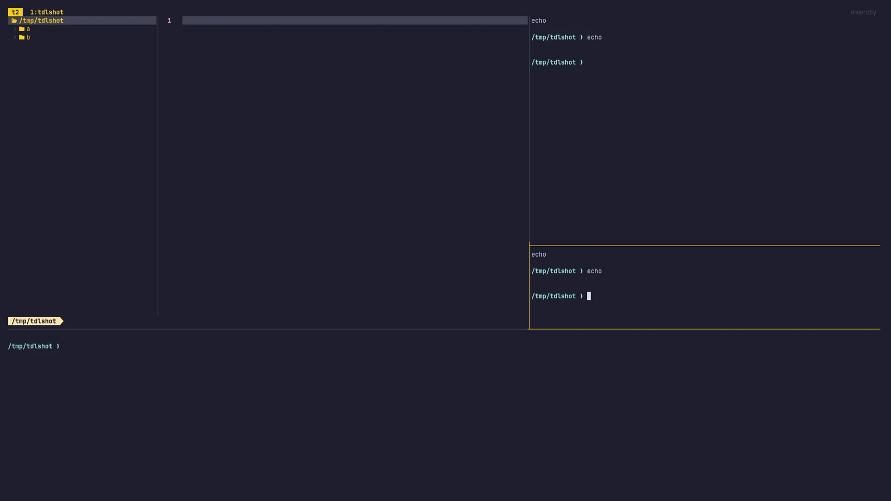
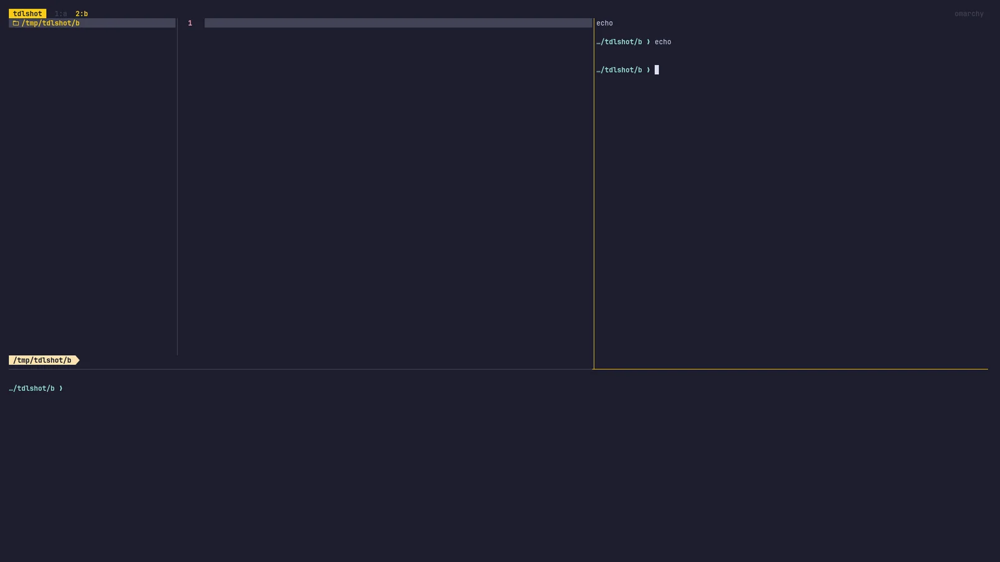
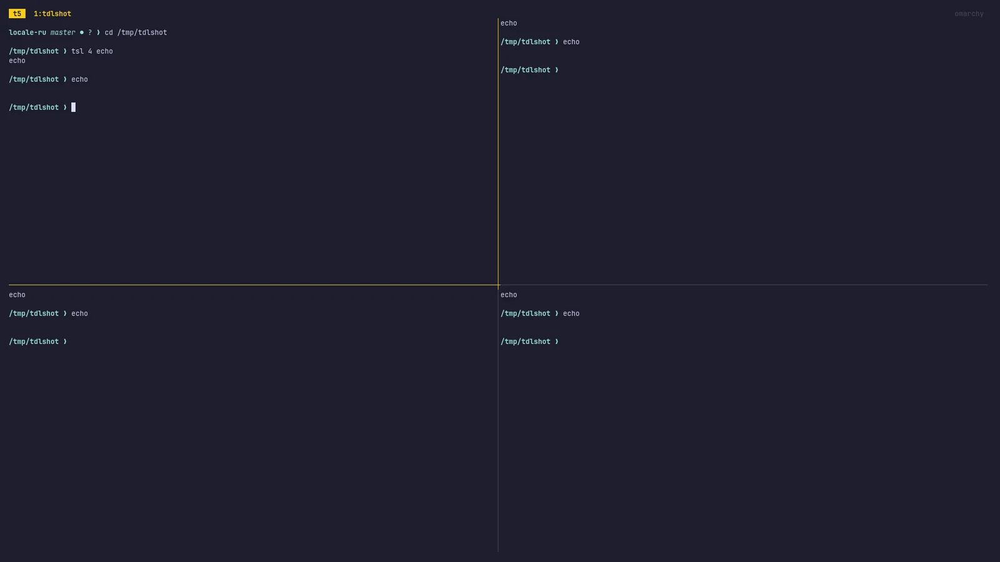

# Терминал

[Foot](https://codeberg.org/dnkl/foot) — терминал Omarchy по умолчанию. Он быстрый, лёгкий и совместим даже со старыми компьютерами. Однако он не поддерживает нативные вкладки или разделения.

Если вы используете Tmux, вас это может не волновать, но если нет, мы полностью поддерживаем также _Alacritty_, _Ghostty_ и _Kitty_ как варианты. Выберите предпочтение в _Установить > Terminal_ в меню Omarchy.

Новый терминал запускается через `Super + Return`. (Эта привязка автоматически укажет на любой терминал, установленный через _Установить > Terminal_, а переключаться между установленными терминалами можно в _Настройка > По умолчанию > Terminal_.)

## Tmux

Tmux предоставляет последовательный программируемый интерфейс для панелей, окон (они же вкладки) и возобновляемых сессий независимо от вашего терминала. Он даже работает на удалённых хостах, поэтому при SSH-подключении к серверу можно использовать тот же подход.

Новую сессию Tmux в свежем терминале запускают через `Super + Alt + Return`, а поскольку Tmux — постоянный процесс, сессию можно возобновить, даже если вы закроете этот терминал. Просто нажмите `Ctrl + Space` (называется префиксной клавишей), затем `s`, чтобы увидеть все активные сессии.

Omarchy поставляется с эргономично оптимизированной конфигурацией Tmux, в которой много привязок клавиш для изучения, поэтому держите [шпаргалку под рукой](07-hotkeys.md#tmux).

## Функции раскладки Tmux

Поскольку Tmux программируемый, мы можем использовать функции для создания раскладок. Omarchy поставляется с четырьмя различными функциями для распространённых раскладок разработчика.

`tdl [agent]` запускает трёхсторонний разделённый интерфейс, похожий на IDE, с `$EDITOR` слева, выбранным ИИ-агентом справа (например, `c` для opencode, `cx` для Claude или `codex` для OpenAI) и терминалом внизу.

Так что `tdl c` запустит это (или просто `ic`):

 

Также можно запустить второго агента через `tdl c cx` (opencode + claude) (или просто `icx`):

 

Есть также `tds`, которая запускает четырёхсторонний квадрат с редактором вверху слева, живым наблюдателем diff вверху справа, терминалом внизу слева и opencode внизу справа.

Эту конфигурацию раскладки также можно запустить для каждого подкаталога текущего каталога с помощью `tdlm [agent]`, затем перемещаться с помощью `alt + 1/2/3/4/5/...`:

 

Наконец, можно запустить рой агентов с помощью `tsl [panes] [command]`. Так что `tsl 4 c` даст четырёхстороннюю сетку агентов opencode:

 
