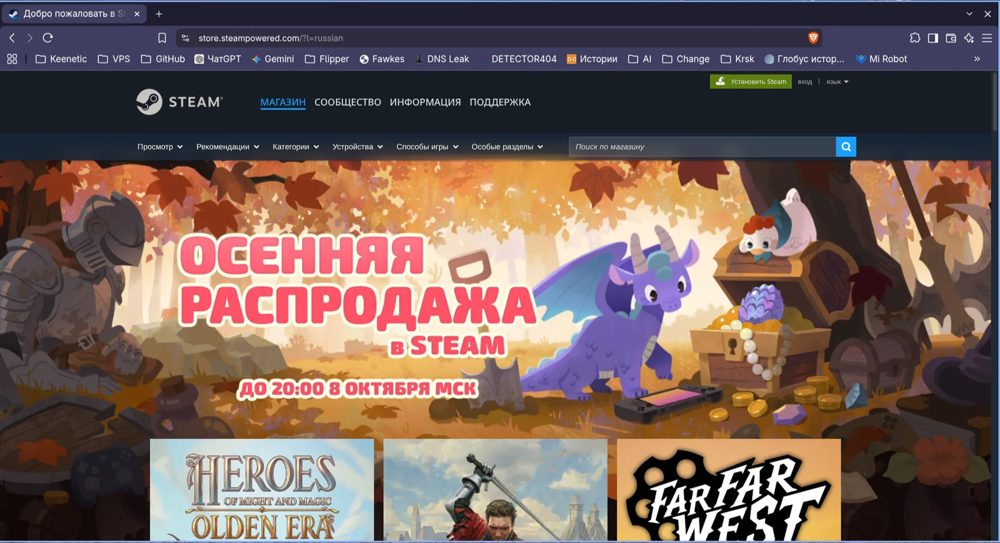
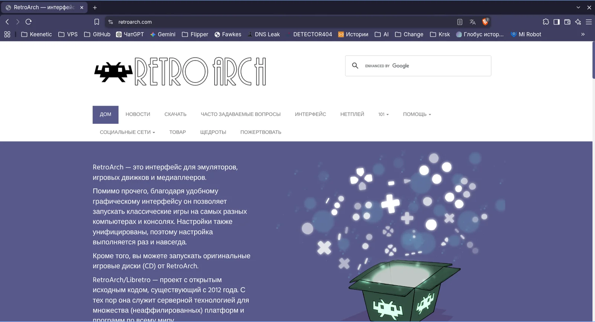
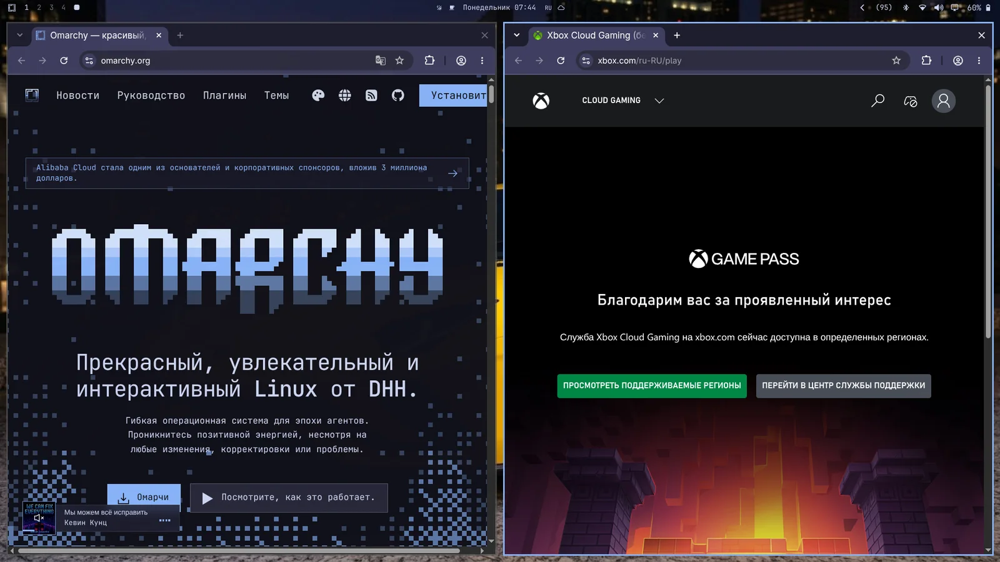
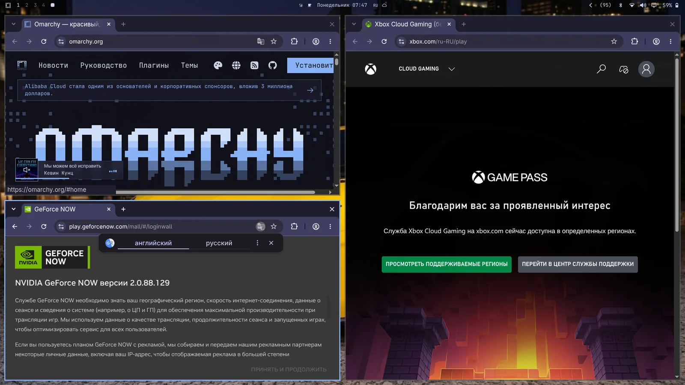
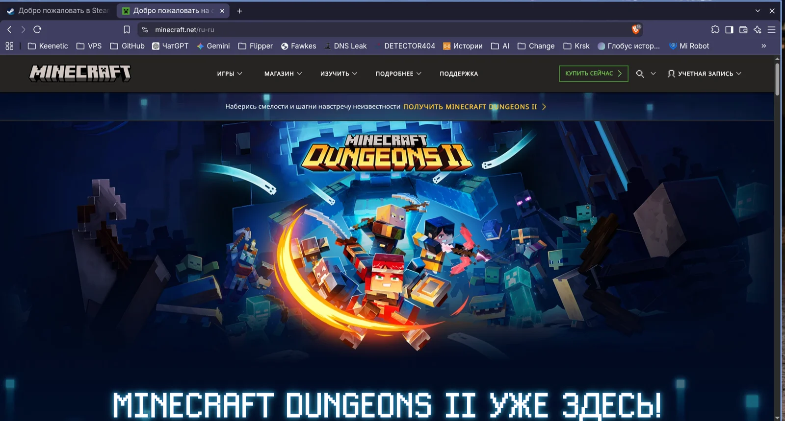
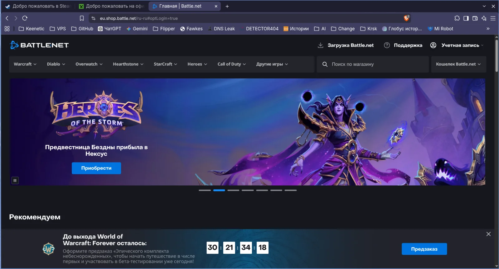

# Игры

Omarchy создан не только для _пРоИЗВоДИТеЛЬНоСТИ_ — он ещё и для развлечений, а что может быть веселее игр? В Omarchy входит целый набор игровых возможностей — Steam и RetroArch для нативных и ретро-игр, Battle.net, Lutris и Heroic для магазинов за пределами Steam, Moonlight для стриминга с ПК, Xbox Cloud Gaming + NVIDIA GeForce NOW для облачного гейминга, а также нестареющий Minecraft.

Благодаря невероятной работе Valve над [слоем совместимости Proton](https://en.wikipedia.org/wiki/Proton_(software)) сейчас на Linux доступны десятки тысяч современных игр. Ах да, а вы знали, что [Steam Deck](https://store.steampowered.com/steamdeck/) на самом деле работает на Arch!

Все установщики игр находятся в разделе _Install > Gaming_ меню Omarchy (`Super + Space`). Если вы когда-нибудь захотите отменить установку, используйте _Remove > Gaming_.

## Steam

Установите [Steam](https://store.steampowered.com/), выбрав _Install > Gaming > Steam_ в меню Omarchy (`Super + Space`).

После установки вы сможете запускать Steam через `Super + Space`.

Учтите, что Steam может запускаться 10-20 секунд и при этом никак визуально не показывать, что загружается.

 

## RetroArch

Установите [RetroArch](https://www.retroarch.com/), выбрав _Install > Gaming > RetroArch_ в меню Omarchy (`Super + Space`). Он поставляется с полным набором ядер libretro, так что охвачены все классические системы.

RetroArch полностью преднастроен с красивым шейдером CRT Royale для идеального ретро-вида.

Чтобы начать:

1. Поместите файлы BIOS в `~/Games/bios`, а ROM — в `~/Games/roms`.
2. Запустите RetroArch через `Super + Space`, введя `retro`.
3. Просканируйте каталог `~/Games/roms` — и можно играть.

Вы также можете дать любимой игре отдельную запись в лаунчере приложений с помощью _Install > Gaming > RetroArch Game Launcher_: так можно выбрать ядро и ROM и запускать игру напрямую через `Super + Space`.

 

## Xbox Cloud Gaming

Установите веб-приложение Xbox Cloud Gaming, выбрав _Install > Gaming > Xbox Cloud Gaming_ в меню Omarchy (`Super + Space`). Это «всего лишь» веб-приложение для сервиса, но оно быстро запускается и отлично работает в 1080p.

Если у вас уже есть Xbox Game Pass, это надёжный способ играть в Fortnite и другие игры, которые нельзя запустить нативно на Linux.

 

## NVIDIA GeForce Now

Установите облачный игровой сервис [NVIDIA GeForce NOW](https://www.nvidia.com/en-us/geforce-now/), выбрав _Install > Gaming > NVIDIA GeForce NOW_ в меню Omarchy (`Super + Space`). Ещё один отличный способ играть в игры, недоступные нативно на Linux.

 

## Minecraft

Установите Minecraft, выбрав _Install > Gaming > Minecraft_ в меню Omarchy (`Super + Space`).

Как и со Steam, учтите, что после входа или запуска следующий экран может появиться не сразу, и во время ожидания вы не получите никакой обратной связи.

 

## Контроллеры Xbox

Установите поддержку Bluetooth-контроллеров Xbox, выбрав _Install > Gaming > Xbox Controllers_ в меню Omarchy (`Super + Space`). Сопрягите контроллеры по Bluetooth (`Super + Ctrl + B`), и они будут работать во всех ваших играх. Это не нужно, если вы просто подключаете контроллер кабелем USB-C.

## Moonlight (стриминг игр с ПК)

Установите [клиент Moonlight](https://github.com/moonlight-stream/moonlight-qt), выбрав _Install > Gaming > Moonlight_ в меню Omarchy (`Super + Space`), и вы сможете стримить игры с ПК на Windows, на котором запущен [Sunshine](https://app.lizardbyte.dev/Sunshine/).

Если и машина с Omarchy, и удалённый игровой ПК подключены по кабелю, впечатления неотличимы от локальной игры. Выкрутите разрешение до нативного, установите частоту обновления 120Hz и максимальный битрейт — это лучший способ играть в соревновательные шутеры вроде Fortnite на Linux.

Вы также можете превратить машину с Omarchy в хост, выполнив `omarchy install service sunshine`: это установит Sunshine и откроет порты стриминга Moonlight для вашей LAN и Tailscale.

## Battle.net

Установите [Battle.net](https://eu.shop.battle.net/en-us), выбрав _Install > Gaming > Battle.net_ в меню Omarchy (`Super + Space`). Это даст вам такие игры, как Diablo, Starcraft и World of Warcraft, в виде отдельной установки, работающей под GE-Proton, — без необходимости в Steam, Lutris или Heroic.

 

## Lutris (игры для Windows)

Установите [Lutris](https://lutris.net/), выбрав _Install > Gaming > Lutris_ в меню Omarchy (`Super + Space`). Lutris — это способ играть в игры для Windows из магазинов вроде EA и Ubisoft Connect, у которых нет собственного установщика выше.

Установка проходит немного коряво, и временами кажется, что ничего не происходит, — просто наберитесь терпения, всё работает в фоновом режиме.

## Heroic Launcher (Epic Games)

Установите [Heroic Launcher](https://heroicgameslauncher.com/), выбрав _Install > Gaming > Heroic (Epic Games)_ в меню Omarchy (`Super + Space`). Heroic позволяет запускать игры Epic Games, например OddSparks, которые не зависят от античита, а также игры из GOG и Amazon Prime Gaming. К сожалению, это означает никакого Fortnite и никакого Rocket League — пока Tim Sweeney не придёт на Linux, ближе подобраться не получится.

Как и Lutris, он может казаться медленным и корявым при установке игр. Дайте ему время.
