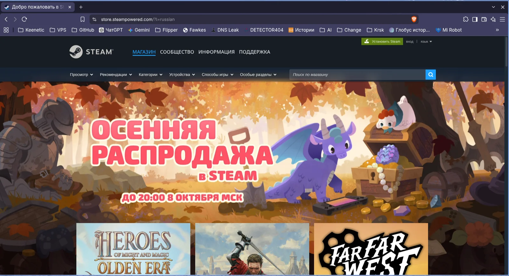
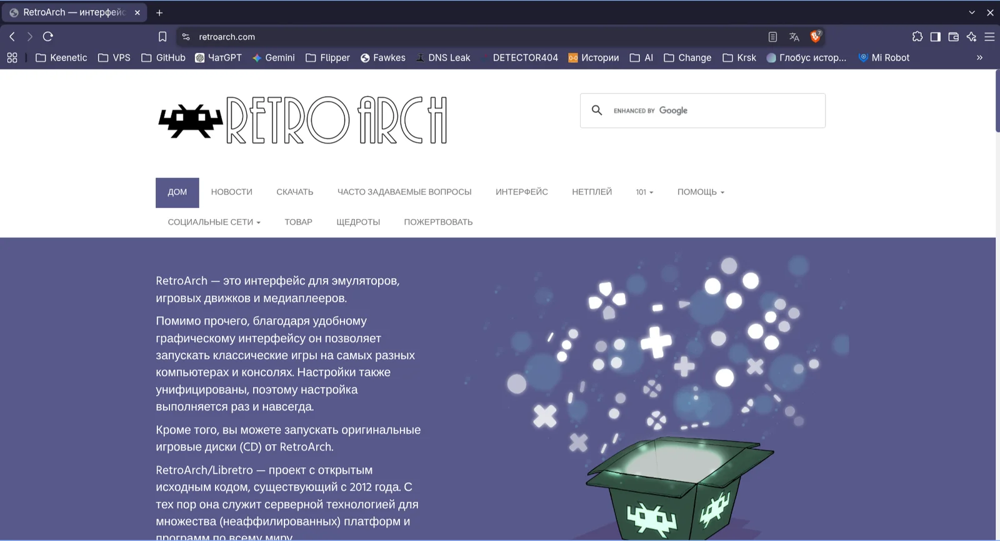
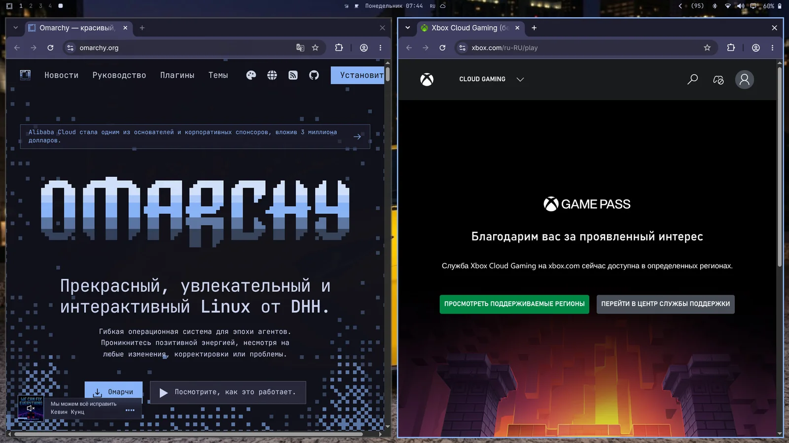
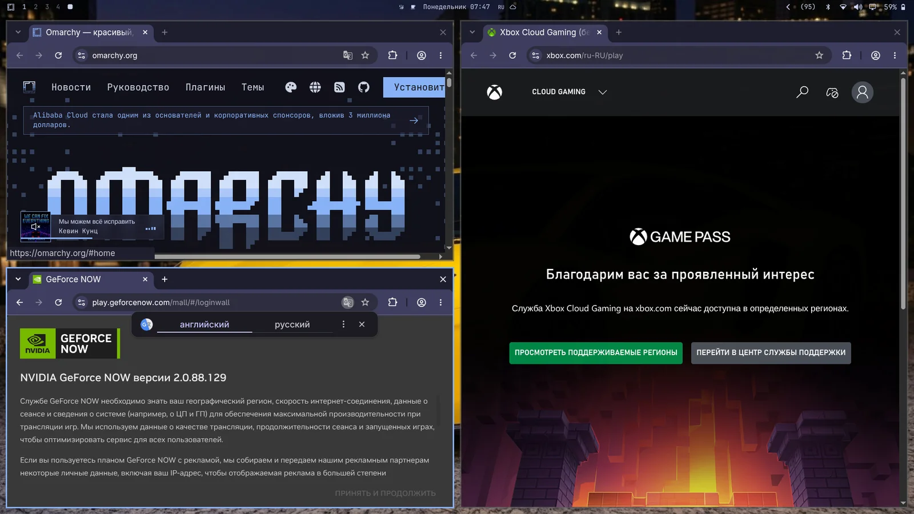
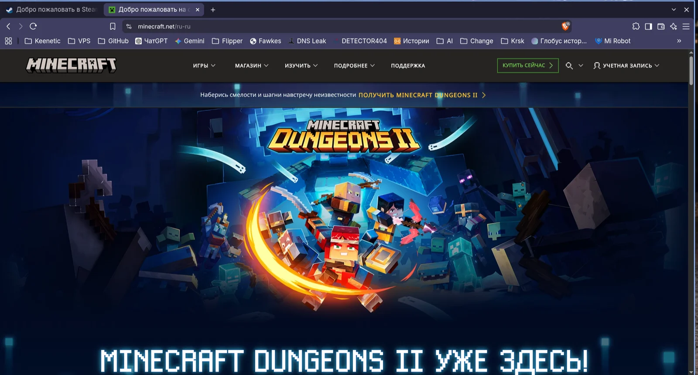
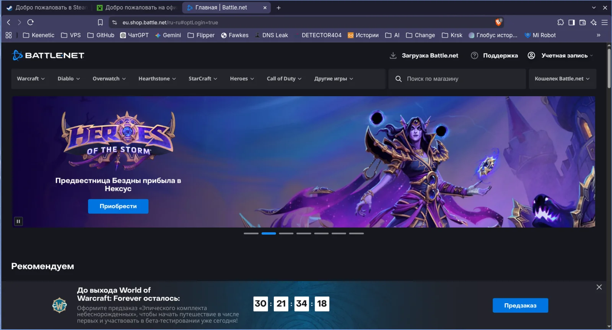

# Игры

Omarchy создан не только для _пРоДуКтИвНоСтИ_, но и для удовольствия, а что может быть веселее игр? Omarchy поставляется с целым набором игровых вариантов — Steam и RetroArch для нативной и ретро-игры, Battle.net, Lutris и Heroic для магазинов вне Steam, Moonlight для потоковой передачи с PC, Xbox Cloud Gaming + NVIDIA GeForce NOW для облака, плюс вечнозелёный Minecraft.

Благодаря невероятной работе Valve над [слоем совместимости Proton](https://en.wikipedia.org/wiki/Proton_(software)), на Linux теперь есть десятки тысяч играбельных современных игр. Ах да, а вы знали, что [Steam Deck](https://store.steampowered.com/steamdeck/) на самом деле работает на Arch!

Все установщики игр живут в меню Omarchy в разделе _Установить > Gaming_ (`Super + Space`). Если вы захотите отменить какой-то из них, используйте _Удалить > Gaming_.

## Steam

Установите [Steam](https://store.steampowered.com/), выбрав _Установить > Gaming > Steam_ в меню Omarchy (`Super + Space`).

После установки вы сможете запускать Steam сочетанием `Super + Space`.

Учтите, что Steam может запускаться 10–20 секунд и не даёт никакой визуальной обратной связи о том, что он загружается.

 

## RetroArch

Установите [RetroArch](https://www.retroarch.com/), выбрав _Установить > Gaming > RetroArch_ в меню Omarchy (`Super + Space`). Он поставляется с полным набором ядер libretro, так что все классические системы покрыты.

RetroArch полностью преднастроен с красивым шейдером CRT Royale для идеального ретро-вида.

Чтобы начать:

1. Поместите файлы BIOS в `~/Games/bios`, а ROM — в `~/Games/roms`.
2. Запустите RetroArch сочетанием `Super + Space` и вводом `retro`.
3. Просканируйте каталог `~/Games/roms`, и вы готовы играть.

Вы также можете дать любимой игре собственную запись в средстве запуска приложений с помощью _Установить > Gaming > RetroArch Game Launcher_, который позволяет выбрать ядро и ROM и прыгнуть прямо в игру из `Super + Space`.

 

## Xbox Cloud Gaming

Установите веб-приложение Xbox Cloud Gaming, выбрав _Установить > Gaming > Xbox Cloud Gaming_ в меню Omarchy (`Super + Space`). Это «просто» веб-приложение для сервиса, но оно быстро запускается и отлично работает в 1080p.

Если у вас уже есть Xbox Game Pass, это надёжный способ играть в Fortnite и другие игры, которые нельзя запустить на Linux нативно.

 

## NVIDIA GeForce NOW

Установите сервис облачных игр [NVIDIA GeForce NOW](https://www.nvidia.com/en-us/geforce-now/), выбрав _Установить > Gaming > NVIDIA GeForce NOW_ в меню Omarchy (`Super + Space`). Ещё один отличный способ играть в игры, недоступные на Linux нативно.

 

## Minecraft

Установите Minecraft, выбрав _Установить > Gaming > Minecraft_ в меню Omarchy (`Super + Space`).

Как и со Steam, учтите, что после входа или запуска может пройти некоторое время, прежде чем появится следующий экран, и вы не получите никакой обратной связи, пока ждёте.

 

## Контроллеры Xbox

Установите поддержку Bluetooth-контроллеров Xbox, выбрав _Установить > Gaming > Xbox Controllers_ в меню Omarchy (`Super + Space`). Выполните сопряжение контроллеров через Bluetooth (`Super + Ctrl + B`), и они заработают во всех ваших играх. Это не нужно, если вы просто подключаете контроллер кабелем USB-C.

## Moonlight (Потоковая передача игр с PC)

[Клиент Moonlight](https://github.com/moonlight-stream/moonlight-qt) предустановлен в Omarchy, так что вы можете сразу транслировать игры с Windows PC, на котором работает [Sunshine](https://app.lizardbyte.dev/Sunshine/). Запустите Moonlight через `Super + Space`.

Если и ваш компьютер с Omarchy, и удалённый игровой PC подключены кабелем, опыт неотличим от локальной игры. Поднимите разрешение до нативного, задайте частоту обновления 120 Гц и выкрутите битрейт на максимум — это лучший способ играть в соревновательные шутеры вроде Fortnite на Linux.

Вы также можете превратить компьютер с Omarchy в хост, выполнив `omarchy install service sunshine`, что установит Sunshine и откроет порты потоковой передачи Moonlight для вашей LAN и Tailscale.

## Battle.net

Установите [Battle.net](https://eu.shop.battle.net/en-us), выбрав _Установить > Gaming > Battle.net_ в меню Omarchy (`Super + Space`). Это даёт вам такие игры, как Diablo, Starcraft и World of Warcraft, как отдельную установку, работающую под GE-Proton, — без Steam, Lutris или Heroic.

 

## Lutris (игры для Windows)

Установите [Lutris](https://lutris.net/), выбрав _Установить > Gaming > Lutris_ в меню Omarchy (`Super + Space`). Lutris — это способ играть в игры для Windows из магазинов вроде EA и Ubisoft Connect, у которых нет собственного установщика выше.

Установка немного кривовата и временами выглядит так, будто ничего не происходит, — просто наберитесь терпения, она работает в фоне.

## Heroic Launcher (Epic Games)

Установите [Heroic Launcher](https://heroicgameslauncher.com/), выбрав _Установить > Gaming > Heroic (Epic Games)_ в меню Omarchy (`Super + Space`). Heroic позволяет запускать игры Epic Games, такие как OddSparks, которые не зависят от античита, — плюс игры из GOG и Amazon Prime Gaming. К сожалению, это означает никакого Fortnite и никакого Rocket League — пока Tim Sweeney не придёт на Linux, ближе не подобраться.

Как и Lutris, при установке игр он может казаться медленным и кривоватым. Дайте ему время.
