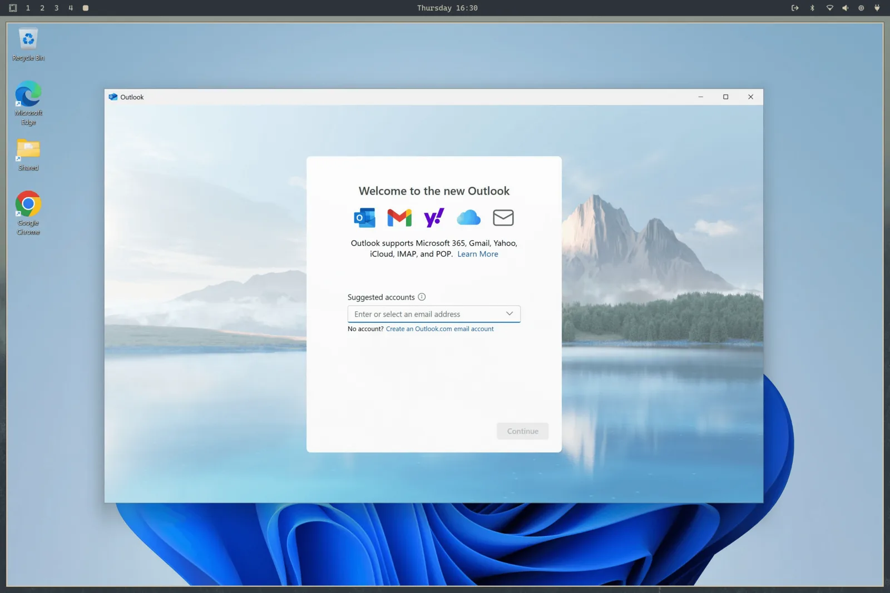

# Виртуальная машина Windows

Omarchy предлагает простой способ запускать Windows через виртуальную машину на Docker. Установить её можно через _Установить > Windows_ в меню Omarchy (`Super + Space`).

Для этого вашему компьютеру нужна виртуализация KVM, которая есть у большинства, — но иногда она отключена в BIOS, и установщик сообщит вам, если это так. Вам также понадобится место на диске: сколько вы отдадите Windows, плюс около 10 ГБ на сам образ.

Установщик спросит, сколько RAM, сколько ядер CPU и сколько диска отдать (64 ГБ или больше — разумный минимум), затем имя пользователя и пароль Windows. Оставьте их пустыми — и получите `docker` / `admin`. Скачивание занимает время — 10–15 минут это нормально — и за прогрессом можно следить в браузере по адресу `http://127.0.0.1:8006`. Перед открытием консоли браузер запросит те же имя пользователя и пароль.

 

## Использование

После установки запустите _Windows_ из средства запуска приложений. Это запустит виртуальную машину, если она ещё не работает, и подключит вас по RDP на весь экран. При холодном старте дайте ей 15–30 секунд.

Сессия RDP несёт звук, ваш микрофон и общий буфер обмена, так что копирование текста между Linux и Windows просто работает. Разрешение следует за вашим окном, а Omarchy пробрасывает масштабирование дисплея, так что на экране HiDPI это не размытое месиво.

Когда вы закрываете окно RDP, виртуальная машина автоматически выключается. Если вы предпочитаете оставить её работающей — скажем, у вас там что-то работает, — запустите её вместо этого командой `omarchy windows vm launch --keep-alive`.

Остальные элементы управления находятся в той же команде:

```bash
omarchy windows vm status    # is it running?
omarchy windows vm stop      # shut it down
omarchy windows vm launch    # start and connect
```

## Общий доступ к файлам

Каталог `~/Windows` в вашем домашнем каталоге автоматически расшаривается с виртуальной машиной. Кладите туда файлы, если хотите, чтобы они были доступны Windows. У виртуальной машины нет доступа ни к какой другой части вашей файловой системы, так что вы в безопасности от любой гадости на стороне Windows. Её собственный виртуальный диск доступен по адресу `~/.windows`.

Эти знакомые домашние пути остаются на своих собственных файловых системах. Они также могут быть символическими ссылками на каталоги, которыми вы владеете, что полезно, когда виртуальный диск живёт на накопителе побольше. Установщик измеряет свободное место на файловой системе, которая на самом деле содержит `~/.windows`, а не обязательно на той, что содержит ваш домашний каталог.

Держите диск и общие пути как отдельные, не перекрывающиеся каталоги. Удаление намеренно опустошает каталог диска, но сохраняет общий каталог. Непосредственно перед удалением Omarchy выполняет ограниченную проверку вложенности и отказывается что-либо удалять, если эта проверка истекает по тайм-ауту или не может доказать, что два дерева отдельны.

Перед запуском виртуальной машины Omarchy открывает и закрепляет эти два каталога, а затем примонтирует точные inode каталогов на приватные пользовательские якоря под `/var/lib/omarchy/windows/mounts`. Docker видит только эти якоря, защищённые root. Это сохраняет пользовательские расположения диска, одновременно не позволяя другому процессу, работающему от вашего имени, подменить проверенный путь до того, как привилегированный контейнер его употребит. Существующие каталоги диска и общего доступа при миграции ужесточаются до режима `0700`, чтобы другие локальные учётные записи не могли просматривать их содержимое.

Порты виртуальной машины привязаны только к localhost, так что ничто в вашей сети не может достичь компьютера Windows. Веб-консоль также требует настроенные имя пользователя и пароль Windows, не позволяя другой локальной учётной записи управлять виртуальной машиной через порт 8006.

## Ограничения и лицензирование

Проброса GPU в этой конфигурации нет, так что для игр или видеомонтажа она не подходит. Это отличный способ запускать Microsoft Office или что-то ещё, что вам абсолютно необходимо.

Устанавливаемая версия — Windows 11 Pro, неактивированная. Для использования закрытых функций вам понадобится собственный лицензионный ключ.

Если этот компьютер поставлялся с Windows, ключ OEM всё ещё находится в прошивке даже после установки Omarchy. Выведите его командой `omarchy windows key`. Этот ключ привязан к этому компьютеру — он активирует Windows, переустановленную на этом оборудовании, но обычно не активирует виртуальную машину.

Вы можете позже изменить распределение ресурсов, повторно запустив `omarchy-windows-vm install`, что перепишет конфигурацию виртуальной машины по вашим ответам. Сам файл compose теперь живёт по адресу `/var/lib/omarchy/windows/docker-compose.yml` и принадлежит root — это сделано намеренно, чтобы процесс, работающий от вашего имени, не мог переписать его и заставить привилегированный подъём примонтировать весь ваш диск в контейнер. Если нужно отредактировать его вручную (например, чтобы примонтировать USB-устройство), редактируйте его через `sudo` и посмотрите все варианты в [проекте Dockur Windows](https://github.com/dockur/windows).

Чтобы избавиться от всего этого, используйте _Удалить > Windows_ в меню Omarchy. Это удалит диск виртуальной машины и все её данные, так что сначала убедитесь, что всё, что вам дорого, убрано из `~/Windows`.
