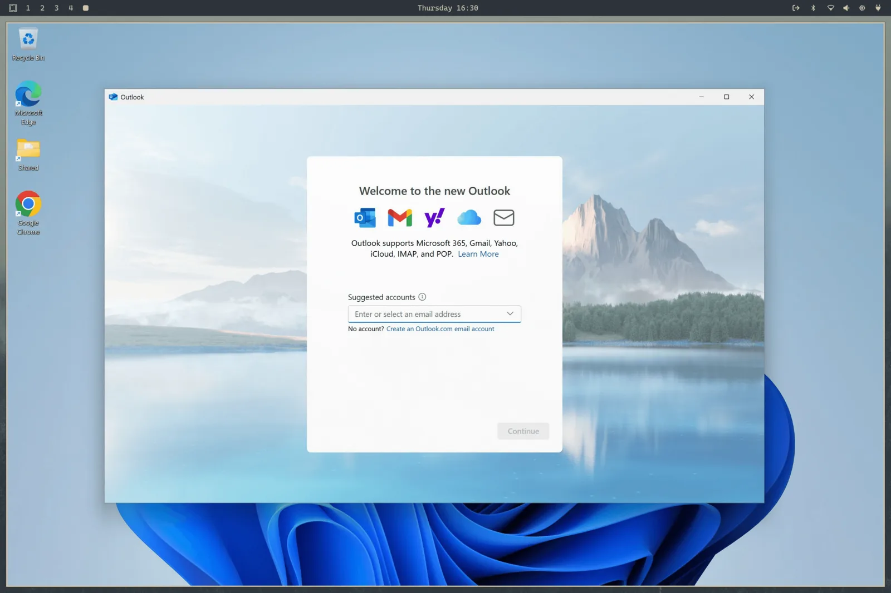

# Windows VM

Omarchy предлагает простой способ запускать Windows через Docker VM на машинах x86_64. Установить её можно через _Install > Windows_ в меню Omarchy (`Super + Space`).

Вашей машине для этого нужна виртуализация KVM, которая есть у большинства — но иногда она отключена в BIOS, и установщик сообщит вам, если это так. Понадобится и место на диске: столько, сколько вы отдадите Windows, плюс около 10GB для самого образа.

Установщик спросит, сколько оперативной памяти, сколько ядер CPU и сколько места на диске выделить (разумный минимум — 64GB или больше), а затем имя пользователя и пароль для Windows. Оставьте их пустыми — и получите `docker` / `admin`. Скачивание займёт некоторое время — 10-15 минут это нормально — а следить за прогрессом можно в браузере по адресу `http://127.0.0.1:8006`. Перед открытием консоли браузер запросит те же имя пользователя и пароль.

 

## Использование

После установки запускайте _Windows_ из средства запуска приложений. Это запустит VM, если она ещё не запущена, и подключит вас по RDP на весь экран. Дайте ей 15-30 секунд на холодный старт.

Сессия RDP передаёт звук, ваш микрофон и общий буфер обмена, поэтому копирование текста между Linux и Windows просто работает. Разрешение подстраивается под ваше окно, а Omarchy пробрасывает масштабирование вашего дисплея, поэтому на HiDPI-экране не будет размытой каши.

Когда вы закроете окно RDP, VM автоматически завершит работу. Если вы предпочитаете оставить её запущенной — скажем, у вас там что-то работает — запускайте её вместо этого с помощью `omarchy windows vm launch --keep-alive`.

Остальные команды управления находятся на той же команде:

```bash
omarchy windows vm status    # is it running?
omarchy windows vm stop      # shut it down
omarchy windows vm launch    # start and connect
```

## Обмен файлами

Каталог `~/Windows` в вашем домашнем каталоге автоматически предоставляется в общий доступ VM. Кладите туда файлы, если хотите, чтобы они были доступны Windows. У VM нет доступа ни к какой другой части вашей файловой системы, поэтому вы в безопасности от любой гадости на стороне Windows. Её собственный виртуальный диск доступен по пути `~/.windows`.

Эти знакомые домашние пути остаются на своих собственных файловых системах. Они также могут быть символическими ссылками на принадлежащие вам каталоги, что полезно, когда виртуальный диск находится на диске большего объёма. Установщик измеряет свободное место на файловой системе, которая фактически содержит `~/.windows`, а не обязательно на файловой системе, содержащей ваш домашний каталог.

Держите пути диска и общего каталога как отдельные, не пересекающиеся каталоги. Удаление намеренно очищает каталог диска, но сохраняет общий каталог. Непосредственно перед удалением Omarchy выполняет ограниченную проверку вложенности и отказывается что-либо удалять, если эта проверка истекает по времени или не может доказать, что эти два дерева отдельны друг от друга.

Перед запуском VM Omarchy открывает и закрепляет эти два каталога, а затем примонтирует через bind-mount точные inode каталогов на приватные пользовательские якоря ниже `/var/lib/omarchy/windows/mounts`. Docker видит только эти защищённые root якоря. Это сохраняет пользовательские расположения диска и при этом не даёт другому процессу, запущенному от вашего имени, подменить проверенный путь до того, как его использует привилегированный контейнер. Существующим каталогам диска и общего каталога во время миграции ужесточается режим до `0700`, чтобы другие локальные учётные записи не могли просматривать их содержимое.

Порты VM привязаны только к localhost, поэтому ничто в вашей сети не может получить доступ к машине Windows. Веб-консоль также требует настроенные имя пользователя и пароль Windows, что не даёт другой локальной учётной записи управлять VM через порт 8006.

## Ограничения и лицензирование

В этой конфигурации нет проброса GPU, поэтому она не подходит для игр или видеомонтажа. Это отличный способ запускать Microsoft Office или что-либо ещё, что вам совершенно необходимо.

Устанавливаемая версия — Windows 11 Pro, неактивированная. Для использования функций, требующих активации, вам понадобится собственный лицензионный ключ.

Если этот компьютер поставлялся с Windows, ключ OEM всё ещё находится в прошивке даже после установки Omarchy. Выведите его с помощью `omarchy windows key`. Этот ключ привязан к этой машине — он активирует Windows, переустановленную на этом оборудовании, но обычно не активирует VM.

Выделение ресурсов можно изменить позже, запустив в терминале `omarchy windows vm install`: это перезапишет конфигурацию VM на основе ваших ответов. Сам файл compose теперь находится по пути `/var/lib/omarchy/windows/docker-compose.yml` и принадлежит root — это сделано намеренно, чтобы процесс, запущенный от вашего имени, не мог перезаписать его и заставить привилегированный запуск примонтировать весь ваш диск в контейнер. Если вам нужно отредактировать его вручную (например, чтобы примонтировать устройство USB), редактируйте его с помощью `sudo` и смотрите все параметры в [проекте Dockur Windows](https://github.com/dockur/windows).

Чтобы избавиться от всего этого, используйте _Remove > Windows_ в меню Omarchy. Это удалит диск VM в `~/.windows` и всё, что установлено внутри Windows, поэтому сначала скопируйте из VM всё, что вам нужно. Ваша общая папка `~/Windows` останется нетронутой.
