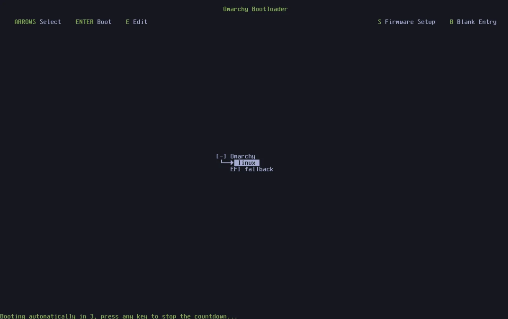

# Обновления

Omarchy и ваши пакеты поддерживаются в актуальном состоянии через _Update > Omarchy_ в меню Omarchy (`Super + Space`).

Сам Omarchy устанавливается как обычные пакеты pacman из [Omarchy Package Repository](https://github.com/omacom-io/omarchy-pkgs), поэтому обновление устанавливает [последний релиз Omarchy](https://github.com/omacom/omarchy/releases), выполняет все ожидающие миграции, чтобы привести вашу систему в соответствие с новейшей версией, и обновляет все системные пакеты из [Omarchy Arch Mirror](https://github.com/omacom-io/omarchy-mirror) и [AUR](https://aur.archlinux.org/) (если вы установили какие-либо пакеты AUR).

Когда выходят новые релизы, справа от ваших часов появится значок со стрелкой по кругу. Нажмите на него, и процесс обновления запустится.

### Четыре канала

Omarchy обновляется по четырем каналам: stable, RC, edge и dev. Новые установки начинают с канала stable, который отслеживает [официальные релизы](https://github.com/omacom/omarchy/releases/), а также [стабильное зеркало Omarchy Arch](https://github.com/omacom-io/omarchy-mirror), которое отстает от новейшего на один месяц, чтобы мы могли отловить любые новые несовместимости, требующие изменений конфигурации, до того, как они создадут людям проблемы.

Но если вы хотите помогать выявлять эти потенциальные проблемы, можете использовать канал edge. Так ваши пакеты Omarchy будут отслеживать новейшие сборки для разработки, и вы сможете обновляться до новейших пакетов Arch, как только они появятся. Делать это стоит, только если вы опытный пользователь Linux и знаете, как восстановить систему, у которой возникли проблемы.

Перед каждым новым крупным релизом мы будем проводить финальную проверку на канале RC. Если вам интересно помочь с финальной полировкой, приходите потусоваться в #omarchy-release-candidates в Discord.

Наконец, есть канал dev, который связывает Omarchy напрямую с git-копией исходного кода в `~/omarchy` в сочетании с пакетами edge. Использовать этот канал стоит, только если вы опытный пользователь Linux, работаете непосредственно над Omarchy и готовы мириться с поломками.

Переключаться между каналами можно через _Update > Channel_ в меню Omarchy (или командой `omarchy channel set <stable|rc|edge|dev>` в терминале, а `omarchy channel current` покажет, где вы находитесь).

### Переключение ядер

Omarchy загружается со своим собственным ядром `linux-omarchy`, но вы можете держать рядом с ним другие установленные ядра, например стандартное ядро `linux` из Arch или экспериментальную сборку, которую вы тестируете. Когда установлено больше одного ядра, _Update > Kernel_ в меню Omarchy перечислит их с галочкой рядом с тем, которое загружается по умолчанию. Выберите другое, введите пароль один раз, и после следующей перезагрузки система загрузится с ним. Остальные ядра останутся в меню загрузки, так что вы по-прежнему сможете выбрать одно из них вручную, если новое ядро по умолчанию доставит вам неприятностей. В терминале `omarchy kernel` показывает текущее ядро по умолчанию, `omarchy kernel list` — что установлено, а `omarchy kernel set <kernel>` переключает ядро.

### Обновления прошивки

Не только ваши пакеты устаревают. Многие ноутбуки и периферийные устройства поставляют прошивки BIOS, SSD и док-станций через Linux Vendor Firmware Service, и _Update > Firmware_ в меню Omarchy загрузит и установит все, что ожидает ваше оборудование. При первом запуске будет установлен `fwupd`. Многие прошивки можно записать только во время перезагрузки, так что не удивляйтесь, если вас попросят о ней.

Когда вам нужно изменить настройку в самом BIOS, удерживайте `Alt` в системном меню (`Super + Escape`), и _Reboot_ превратится в _Reboot to BIOS_, что перезагрузит систему сразу в настройки прошивки, без необходимости ловить нужную клавишу при загрузке. Из терминала это делается командой `omarchy system firmware`.

### Предупреждение о прямых обновлениях через pacman/yay

Если вы уже знакомы с Arch, у вас может возникнуть соблазн просто запустить `pacman -Syu` или `yay -Syu` самому, но если вы так сделаете, вы пропустите снимок, миграции и обновления конфигурации, которые Omarchy выполняет вместе с новыми пакетами. Именно поэтому Omarchy фактически остановит прямое обновление системы и укажет вам вместо этого на `omarchy update`. (Если вы действительно знаете, что делаете, защита подскажет, как обойти ее для одной транзакции.)

### Откат неудачных обновлений

Если после выполнения обновления у вас когда-либо возникнет проблема, вы можете откатить систему к снимку, сделанному перед обновлением. Просто перезагрузитесь и выберите в меню загрузки снимок, сделанный до того, как вы начали обновление.

Если ваши файлы конфигурации каким-то образом оказались повреждены, вы также можете выполнить переустановку Omarchy с помощью `omarchy reinstall` в терминале. Это переустановит все пакеты Omarchy по умолчанию, переведет вас на stable (edge на Apple Silicon), понизит версии всех слишком новых пакетов и сбросит все файлы конфигурации. Учтите, что при этом все ваши пользовательские изменения в конфигурациях Omarchy по умолчанию будут перезаписаны!
