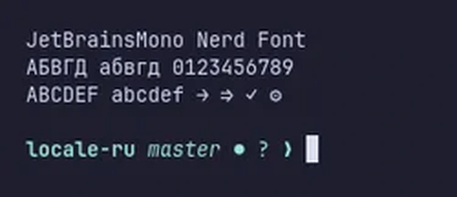

# Шрифты

Omarchy по умолчанию использует JetBrainsMono Nerd Font и как терминальный, и как системный шрифт.

 

Изменить это можно через меню _Оформление > Шрифт_ в меню Omarchy (`Super + Space`). Это задаёт моноширинный шрифт везде: в терминале, в панели и во всём остальном, что его запрашивает.

Другие популярные шрифты для программирования можно установить через _Установка > Стиль > Шрифт_ в меню Omarchy: Cascadia Mono, Meslo LG Mono, Fira Code, Victor Code, Bitstream Vera Mono и Iosevka — все в один клик, в их версиях Nerd Font, чтобы глифы в панели и терминале продолжали работать. После установки одного из них выберите его в _Оформление > Шрифт_.

## Китайский, японский и корейский

У китайского, японского и корейского много общих иероглифов, но некоторые из них они рисуют по-разному, поэтому один и тот же иероглиф одному читателю кажется правильным, а другому — чужим. Выбор одного из этих языков в _Настройка > Язык_ или его метода ввода задаёт соответствующие формы. Чтобы выбрать их самостоятельно, выполните в терминале `omarchy font cjk jp`, `kr`, `sc`, `tc` (Тайвань) или `hk` (Гонконг); `omarchy font cjk default` возвращает системный выбор, то есть японские формы. Текст, который веб-страница или документ помечает собственным языком, и весь рабочий стол, пока он на одном из этих языков, сохраняет формы этого языка.
