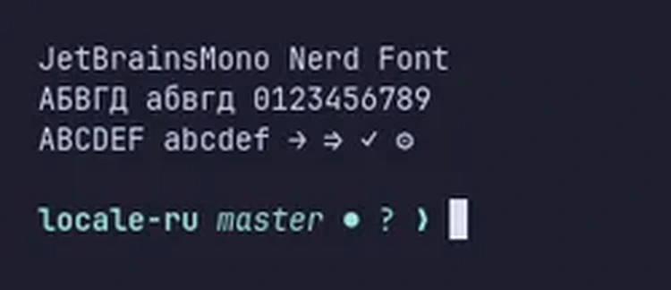

# Шрифты

По умолчанию Omarchy использует JetBrainsMono Nerd Font и как терминальный, и как системный шрифт.

 

Изменить его можно через меню _Оформление > Шрифт_ в меню Omarchy (`Super + Space`). Так задаётся моноширинный шрифт везде: в терминале, в панели и во всём остальном, что его запрашивает.

Другие популярные шрифты для программирования можно установить через _Установка > Стиль > Шрифт_ в меню Omarchy: Cascadia Mono, Meslo LG Mono, Fira Code, Victor Code, Bitstream Vera Mono и Iosevka — все в один клик, в версиях Nerd Font, чтобы глифы в панели и терминале продолжали работать. Установка одного из них также переключает на него всю систему, а вернуться обратно можно в любой момент через _Оформление > Шрифт_.

## Китайский, японский и корейский

В китайском, японском и корейском много общих иероглифов, но некоторые из них рисуются по-разному, поэтому один и тот же иероглиф для одного читателя выглядит правильно, а для другого — чужеродно. Выбор одного из этих языков в _Настройка > Регион > Язык_ или его метода ввода устанавливает соответствующие формы. Чтобы выбрать их самостоятельно, выполните в терминале `omarchy font cjk jp`, `kr`, `sc`, `tc` (Тайвань) или `hk` (Гонконг); `omarchy font cjk default` возвращает системный вариант, то есть японские формы. Текст, для которого веб-страница или документ указывает собственный язык, и весь рабочий стол, пока он на одном из этих языков, сохраняет формы этого языка.
