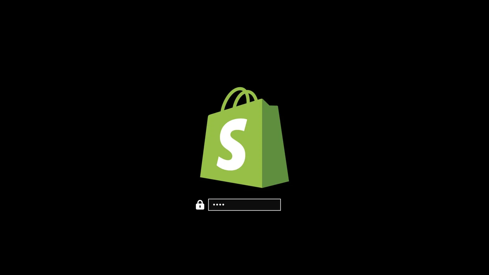
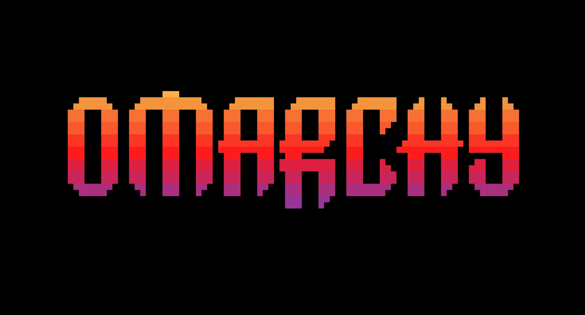

# Брендинг

Omarchy позволяет установить логотип вашей компании или личное изображение для разблокировки при загрузке, заставки и экрана «О программе».

### Разблокировка при загрузке

Вы можете использовать `omarchy plymouth preview`, чтобы посмотреть, как будут выглядеть ваш собственный логотип и цвета. Команда принимает цвет фона, цвет текста, png с логотипом и путь для изображения предпросмотра:

```
omarchy plymouth preview '#1d2021' '#ebdbb2' logo.png preview.png
```

Затем примените настройку командой `omarchy plymouth set '#1d2021' '#ebdbb2' logo.png`, которая также задаст те же цвета и логотип для экрана входа SDDM. Если захотите всё вернуть обратно, можете использовать `omarchy plymouth reset`.

 

### Заставка

Вы можете изменить логотип, используемый для заставки, в разделе _Внешний вид > Брендинг > Заставка_. Это ASCII-логотип, поэтому вы можете редактировать текст напрямую, но вы также можете передать ему изображение png или svg, и мы преобразуем его в ASCII. Выглядит довольно круто.

 

В этом меню три пункта:

- **Изменить текст** открывает `~/.config/omarchy/branding/screensaver.txt` в вашем редакторе. Наберите или вставьте всё, что хотите — ASCII-арт, ваше имя, грубое слово. Сохраните и выйдите, и заставка сразу же запустится, чтобы вы могли её увидеть.
- **Установить из изображения** открывает выбор файла для png или svg, преобразует его в ASCII и показывает вам результат. Логотипы с чётким силуэтом работают гораздо лучше, чем фотографии.
- **Восстановить по умолчанию** возвращает логотип Omarchy обратно.

### Экран «О программе»

Те же три варианта находятся в разделе _Внешний вид > Брендинг > О программе_ для экрана _О программе_, который вы получаете из меню Omarchy, и они работают идентично — файл называется `~/.config/omarchy/branding/about.txt`, и окно «О программе» появляется после каждого изменения. Арт для экрана «О программе» преобразуется в меньший размер, чем для заставки, поскольку он должен помещаться в окно, а не заполнять весь ваш дисплей.

Пока окно открыто, полоса яркого белого света каждые несколько секунд проходит по диагонали через арт, а затем снова оставляет его неподвижным. Ваш собственный арт тоже её получит, при условии, что каждый символ в нём шириной в один столбец — а всё, что создаёт функция _Установить из изображения_, именно такое. Арт, построенный из эмодзи или символов двойной ширины, вместо этого остаётся неподвижным, и экран тоже, если вы используете собственный конфиг fastfetch: неподвижный логотип в этих случаях — это анимация, которая держится в стороне, а не даёт сбой, поскольку скольжение блика по ним поместило бы остальную часть строки в неправильное место.

 

### Самостоятельное преобразование изображений

Обе опции _Установить из изображения_ просто вызывают `omarchy transcode ascii`, которую вы можете запустить напрямую, если хотите контролировать преобразование:

```
omarchy transcode ascii ~/logo.svg ~/.config/omarchy/branding/screensaver.txt --width 100
```

Она принимает `--width` и `--height` в столбцах и строках терминала, `--mode` — либо `braille` (по умолчанию, и гораздо тоньше), либо `block`, `--threshold` в процентах для определения, какие пиксели считаются частью логотипа, и `--invert` для случаев, когда ваш логотип светлый на тёмном фоне. Если преобразование получается пятном, обычно нужно крутить именно порог.

### Слова вместо логотипа

`omarchy ascii` рисует текст шрифтом Delta Corps Priest 1, FIGlet-шрифтом, которым нарисован сам словесный знак Omarchy, поэтому заставка может что-то говорить, а не показывать картинку:

```
omarchy ascii "Back in five" > ~/.config/omarchy/branding/screensaver.txt
```

Она принимает текст в качестве аргументов или читает его из pipe, когда аргументы не переданы. Шрифт содержит только буквы и пробелы — он был нарисован без цифр и знаков препинания — поэтому всё остальное отбрасывается и упоминается в stderr, а не тихо проглатывается.
