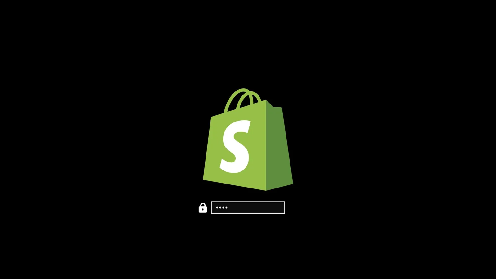
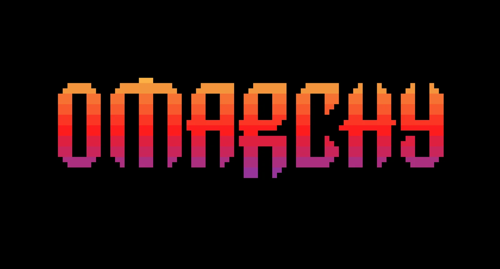
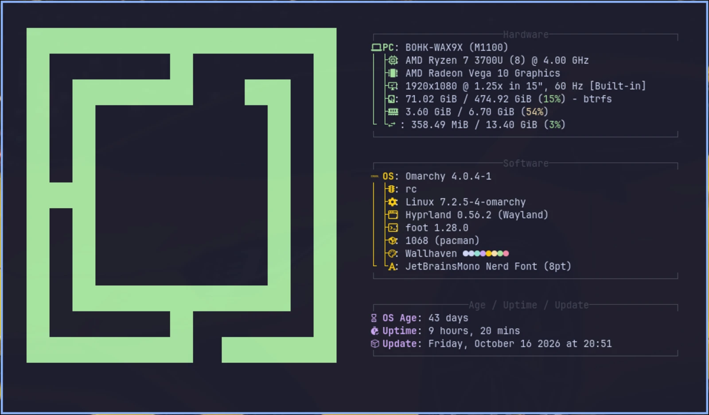

# Брендинг

Omarchy позволяет установить логотип вашей компании или личное изображение для разблокировки при загрузке, хранителя экрана и экрана «О программе».

### Разблокировка при загрузке

Вы можете использовать `omarchy plymouth preview`, чтобы увидеть, как будут выглядеть ваш собственный логотип и цвета. Команда принимает цвет фона, цвет текста, png с логотипом и путь для изображения предпросмотра:

```
omarchy plymouth preview '#1d2021' '#ebdbb2' logo.png preview.png
```

Затем примените настройки с помощью `omarchy plymouth set '#1d2021' '#ebdbb2' logo.png`, что также задаст те же цвета и логотип для экрана входа SDDM. Если вы хотите отменить изменения, вы можете использовать `omarchy plymouth reset`.

 

### Хранитель экрана

Вы можете изменить логотип, используемый для хранителя экрана, в разделе _Внешний вид > Брендинг > Хранитель экрана_. Это ASCII-логотип, поэтому вы можете редактировать текст напрямую, но вы также можете передать ему изображение png или svg, и мы преобразуем его в ASCII. Выглядит довольно круто.

 

В этом меню есть три пункта:

- **Изменить текст** открывает `~/.config/omarchy/branding/screensaver.txt` в вашем редакторе. Введите или вставьте всё, что хотите — ASCII-арт, ваше имя, грубое слово. Сохраните и выйдите, и хранитель экрана сразу же запустится, чтобы вы могли его увидеть.
- **Установить из изображения** открывает окно выбора файла для png или svg, преобразует его в ASCII и показывает вам результат. Логотипы с чётким силуэтом работают гораздо лучше, чем фотографии.
- **Восстановить по умолчанию** возвращает логотип Omarchy.

### Экран «О программе»

Те же три параметра находятся в разделе _Внешний вид > Брендинг > О программе_ для экрана _О программе_, который вы открываете из меню Omarchy, и работают они одинаково — файл называется `~/.config/omarchy/branding/about.txt`, и окно «О программе» появляется после каждого изменения. Изображение для экрана «О программе» преобразуется в меньший размер, чем изображение хранителя экрана, поскольку оно должно помещаться в окно, а не заполнять весь ваш дисплей.

Пока окно открыто, зелёный блик каждые несколько секунд наклонно проходит по изображению, а затем снова оставляет его неподвижным. Ваше собственное изображение тоже его получает, если каждый символ в нём занимает одну колонку в ширину — любое изображение, созданное параметром _Установить из изображения_, именно такое. Изображение, построенное из emoji или символов двойной ширины, вместо этого остаётся неподвижным, и экран тоже остаётся неподвижным, если вы используете собственную конфигурацию fastfetch: неподвижный логотип в этих случаях означает, что анимация держится в стороне, а не что она не работает, поскольку сдвиг блика по ним поместил бы остаток строки в неправильное место.

 

### Самостоятельное преобразование изображений

Оба параметра _Установить из изображения_ просто вызывают `omarchy transcode ascii`, который вы можете запустить напрямую, если хотите контролировать преобразование:

```
omarchy transcode ascii ~/logo.svg ~/.config/omarchy/branding/screensaver.txt --width 100
```

Он принимает `--width` и `--height` в колонках и строках терминала, `--mode` со значением `braille` (по умолчанию, и гораздо детальнее) или `block`, процент `--threshold` для определения, какие пиксели считаются частью логотипа, и `--invert` для случаев, когда ваш логотип светлый на тёмном фоне. Если преобразование получается пятном, обычно нужно крутить именно threshold.

### Слова вместо логотипа

`omarchy ascii` рисует текст шрифтом Delta Corps Priest 1, FIGlet-шрифтом, которым нарисован сам словесный знак Omarchy, поэтому хранитель экрана может что-то говорить, а не показывать картинку:

```
omarchy ascii "Back in five" > ~/.config/omarchy/branding/screensaver.txt
```

Он принимает текст в качестве аргументов или читает его из канала, когда аргументы не заданы. Шрифт содержит только буквы и пробелы — он был нарисован без цифр и знаков препинания — поэтому всё остальное отбрасывается и указывается в stderr, а не тихо проглатывается.
