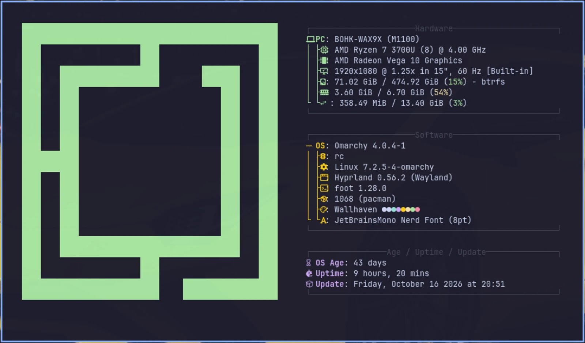

# Брендинг

Omarchy позволяет задать логотип вашей компании или личное изображение как для заставки, так и для экрана «О программе».

### Заставка

Логотип, используемый для заставки, можно изменить в разделе _Внешний вид > Брендинг > Заставка_. Это ASCII-логотип, так что текст можно править напрямую, но можно также скормить ему изображение png или svg, и мы преобразуем его в ASCII. Выглядит довольно круто.

 

В этом меню три пункта:

- **Изменить текст** открывает `~/.config/omarchy/branding/screensaver.txt` в вашем редакторе. Печатайте или вставляйте что угодно — ASCII-арт, ваше имя, грубое слово. Сохраните и выйдите, и заставка сразу запустится, чтобы вы могли на неё посмотреть.
- **Установить из изображения** открывает выбор файла для png или svg, преобразует его в ASCII и показывает вам результат. Логотипы с чётким силуэтом работают куда лучше, чем фотографии.
- **Восстановить значение по умолчанию** возвращает логотип Omarchy на место.

### Экран «О программе»

Те же три варианта находятся в разделе _Внешний вид > Брендинг > О программе_ для экрана _О программе_, который открывается из меню Omarchy, и работают они точно так же — файл называется `~/.config/omarchy/branding/about.txt`, а окно «О программе» появляется после каждого изменения. Изображение для экрана «О программе» преобразуется в меньший размер, чем для заставки, поскольку оно должно помещаться в окно, а не заполнять весь ваш дисплей.

Пока окно открыто, полоса яркого белого света каждые несколько секунд наклонно проходит по изображению, а затем снова оставляет его неподвижным. Ваше собственное изображение тоже её получает, если каждый символ в нём занимает одну колонку в ширину — а всё, что создаёт _Установить из изображения_, именно такое. Изображение, собранное из эмодзи или символов двойной ширины, вместо этого остаётся неподвижным, как и экран, если у вас есть собственный конфиг fastfetch: неподвижный логотип в этих случаях — это анимация, которая держится в стороне, а не даёт сбой, поскольку скольжение блика по ним поместило бы остаток строки не в то место.

 

### Преобразование изображений самостоятельно

Оба варианта _Установить из изображения_ просто вызывают `omarchy transcode ascii`, которую можно запустить напрямую, если вы хотите контролировать преобразование:

```
omarchy transcode ascii ~/logo.svg ~/.config/omarchy/branding/screensaver.txt --width 100
```

Она принимает `--width` и `--height` в колонках и строках терминала, `--mode` со значением `braille` (по умолчанию и намного более детальный) или `block`, процент `--threshold` для определения, какие пиксели считать частью логотипа, и `--invert` на случай, когда ваш логотип светлый на тёмном фоне. Если преобразование выходит сплошным пятном, обычно крутить нужно именно порог.

### Слова вместо логотипа

`omarchy ascii` рисует текст шрифтом Delta Corps Priest 1 — шрифтом FIGlet, которым нарисован сам словесный знак Omarchy, — так что заставка может что-то говорить, а не показывать картинку:

```
omarchy ascii "Back in five" > ~/.config/omarchy/branding/screensaver.txt
```

Она принимает текст в качестве аргументов или читает его из канала, когда аргументов не дано. Шрифт содержит только буквы и пробелы — он был нарисован без цифр и знаков препинания, — поэтому всё остальное отбрасывается и называется в stderr, а не проглатывается молча.
