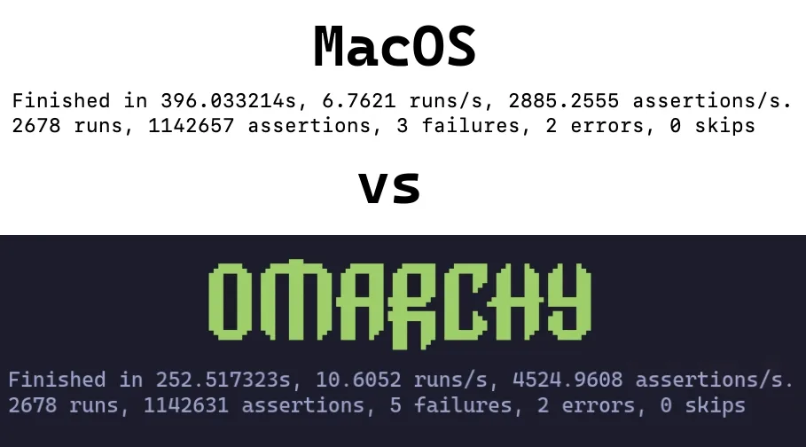

# Поддержка Mac

## Omarchy for Apple Silicon

Omarchy for Apple Silicon — это официальное решение Omacom, впервые выпущенное с Omarchy 4.5. Оно устанавливается рядом с macOS, и вы выбираете между двумя системами при запуске Mac.

Получили уведомление об Omarchy Mac? Перейдите к разделу [Переход с Omarchy Mac](#coming-from-omarchy-mac).

Оно работает на этих Mac:

| Mac | Чипы |
| --- | --- |
| MacBook Air | M1, M2, M3 |
| MacBook Pro | M1, M1 Pro, M1 Max, M2, M2 Pro, M2 Max, M3, M3 Pro, M3 Max |
| MacBook Neo | A18 Pro |
| Mac mini | M1, M2, M2 Pro |
| Mac Studio | M1 Max, M1 Ultra, M2 Max, M2 Ultra |
| iMac | M1, M3 |
| Mac Pro | M2 Ultra |

Mac с M4 и новее пока не поддерживаются. Поддержка M4 тестируется на канале edge и появится следующей. Установщик проверяет ваш Mac, прежде чем что-либо менять.

На любом Mac с Apple Silicon, включая M4 и новее, вы можете запустить Omarchy в виртуальной машине с помощью [Try Omarchy](https://github.com/omacom/try-omarchy).

### Что понадобится

- macOS 15 Sequoia или новее и учётная запись администратора
- Свободное место на диске для Omarchy. Установщик предлагает размер и позволяет его изменить.
- Резервная копия вашего Mac, питание и подключение к интернету. При установке загружается несколько гигабайт.

### Установка

Установка выполняется из macOS. Установите Omarchy Installer с помощью [Homebrew](https://brew.sh):

```sh
brew install omacom/mac/omarchy
```

Или загрузите новейший Omarchy Installer со [страницы релизов](https://github.com/omacom/omarchy-mac-installer/releases) и откройте его.

Установщик проверяет ваш Mac, показывает план и освобождает место для Omarchy, сжимая раздел macOS. macOS остаётся на диске, и USB-накопитель не нужен. Когда первый этап завершён, он проведёт вас через завершение настройки в macOS Recovery: выключите компьютер, удерживайте кнопку питания, пока не появится "Loading startup options", выберите Omarchy и выполните следующие шаги.

При первой загрузке Omarchy запрашивает пароль, который шифрует его диск. Ключа восстановления нет: если вы забудете пароль, ваши файлы Omarchy восстановить нельзя.

Чтобы позже переключаться между Omarchy и macOS, выключите компьютер, затем удерживайте кнопку питания, пока не появятся варианты загрузки, и выберите один из них.

### Переход с Omarchy Mac

Omarchy Mac теперь входит в Omarchy for Apple Silicon, и каждый Mac, на котором он работал, поддерживается. Ваша текущая установка продолжает работать, а её системные пакеты по-прежнему обновляются, но обновлений Omarchy она больше не получает. Никакого крайнего срока и обновления на месте нет: вы делаете резервную копию, удаляете старую установку, устанавливаете с нуля и восстанавливаете данные. Шаги со 2 по 5 выполняются в macOS, поэтому откройте эту страницу на телефоне, прежде чем перезагружаться.

1. **Сделайте резервную копию из Omarchy, вне Mac.** Удаление старой установки стирает её, а macOS не может прочитать диск Omarchy. Скопируйте домашнюю папку на внешний диск или другой компьютер, включая ключи SSH и GPG, профили браузера и незапушенную работу. Сохраните список пакетов с помощью `pacman -Qqe > ~/packages.txt`. Сделайте также резервную копию macOS, поскольку и удаление, и установка изменяют размер её диска.
2. **Запустите Mac в macOS.** Выключите компьютер, удерживайте кнопку питания, пока не появятся варианты загрузки, и выберите macOS.
3. **Установите Omarchy Installer**, как показано в разделе [Установка](#installing).
4. **Удалите старую установку.** Откройте Omarchy Installer и выберите Installation > Remove Omarchy. Он показывает, что удалит, и возвращает пространство macOS. Если он не распознает вашу установку, он остановится, не меняя диск. Обращайтесь за помощью в [Discord](https://discord.gg/tXFUdasqhY), а не удаляйте разделы вручную — это может стереть macOS.
5. **Установите Omarchy for Apple Silicon** с помощью установщика.
6. **Восстановите файлы.** Возвращайте настройки по частям, а не копируйте весь `~/.config` поверх новых значений по умолчанию, поскольку старые настройки могут их переопределить.

### Полезно знать

- На MacBook с M1 и M2 выводите компьютер из сна, открывая крышку или нажимая кнопку питания.
- Вопросы или проблемы: спрашивайте в нашем [Discord](https://discord.gg/tXFUdasqhY).

[README установщика](https://github.com/omacom/omarchy-mac-installer#readme) охватывает каналы релизов, обновление установщика и удаление Omarchy.

## Mac с Intel

В простом тесте нам удалось добиться прироста производительности на 36% на MacBook Pro 2019 года, просто установив Omarchy.

 

### Установка Omarchy на Mac

Omarchy пока поддерживает только вариант, когда она является **единственной** установленной ОС. Во время установки диск будет очищен, и MacOS больше не будет загружаться.

Вы по-прежнему сможете восстановить её позже через Internet Recovery, если захотите.

В этой части будем считать, что вы уже изучили [Начало работы](02-getting-started.md) и ваш USB-накопитель готов. Если нет, сделайте это сейчас.

#### Отключение Secure Boot

Необходимо отключить Secure Boot от Apple, чтобы загрузиться с загрузочного USB, а также с самой ОС. Чтобы отключить его, выполните следующее:

1. Выключите Mac
2. Включите его и _сразу же_ нажмите и удерживайте Command-R, пока не появится экран загрузки
3. Выберите пользователя и введите пароль, если будет запрошено
4. На экране восстановления выберите **Utilities > Startup Security Utility** в строке меню
5. Введите пароль при запросе аутентификации
6. Выберите "No Security" среди вариантов Secure Boot
7. Выберите "Allow booting from external or removable media" среди вариантов External Boot

#### Начало установки

1. Вставьте USB-накопитель
2. Перезагрузите Mac и _сразу же_ нажмите и удерживайте Option, пока не появится экран устройств загрузки
3. Выберите оранжевое устройство EFI Boot
4. Продолжите [установку как обычно](02-getting-started.md)

Установщик обнаруживает оборудование Mac и автоматически применяет нужные исправления: драйверы и прошивку Broadcom Wi-Fi, драйвер камеры FaceTime HD на машинах с Broadcom 1570 (её прошивка загружается от Apple, как только Mac выходит в сеть, поскольку установщик работает офлайн), драйвер клавиатуры SPI на моделях MacBook, которым он нужен, и исправление приостановки NVMe для тех же моделей.

### Известные ограничения

Участники сообщества постоянно работают над решениями этих проблем, поэтому если они являются проблемой для вас, присоединяйтесь к #omarchy-on-other в нашем [Discord](https://discord.gg/tXFUdasqhY) и посмотрите, есть ли какие-либо актуальные методы их решения.

#### Камера FaceTime HD

Драйвер камеры вешает машину, если он загружен, когда Mac уходит в гибернацию, поэтому он предварительно выгружается. Его нельзя выгрузить, пока приложение держит камеру открытой, поэтому гибернация отменяется с уведомлением, в котором названо приложение: закройте его и выполните гибернацию снова. Это включает автоматическую гибернацию при критическом заряде батареи, а также suspend-then-hibernate, которая отклоняется до приостановки. Обычная приостановка отклоняется самим драйвером, пока камера открыта, без уведомления.

Прошивка камеры загружается от Apple, поэтому камера работает только после того, как Mac побывал в сети. Загрузка начинается при загрузке системы и повторяется каждые 15 минут, пока проблема связана с сетью; если файл Apple изменился, она останавливается и ждёт обновления Omarchy. Если камера не появляется, `journalctl -u facetimehd-firmware-fetcher` объяснит почему, `sudo systemctl restart facetimehd-firmware-fetcher` попробует снова, а перезагрузка загрузит драйвер, если загрузка завершилась, но камеры всё ещё нет.

#### Устройства с чипом T1

Чип Apple T1 был представлен в конце 2016 года и использовался исключительно в моделях MacBook Pro первого поколения с Touch Bar.
- MacBook Pro 13-дюймовый (2016, два порта Thunderbolt 3) – Модель: A1706
- MacBook Pro 13-дюймовый (2016, четыре порта Thunderbolt 3) – Модель: A1708
- MacBook Pro 15-дюймовый (2016) – Модель: A1707

#### Известные проблемы

- Touch Bar не работает
- Звук не работает

#### Устройства с чипом T2

Чип безопасности Apple T2 был представлен в 2017 году. Чип T2 был снят с производства с переходом на Apple silicon (чипы серии M), начавшимся в 2020 году.

- iMac Pro (2017) – Модель: A1862
- MacBook Pro 13-дюймовый (2018, четыре порта Thunderbolt 3) – Модель: A1989
- MacBook Pro 15-дюймовый (2018) – Модель: A1990
- MacBook Air (Retina, 13-дюймовый, 2018) – Модель: A1932
- Mac mini (2018) – Модель: A1998
- MacBook Pro 13-дюймовый (2019, два порта Thunderbolt 3) – Модель: A2159
- MacBook Pro 13-дюймовый (2019, четыре порта Thunderbolt 3) – Модель: A2178
- MacBook Pro 15-дюймовый (2019) – Модель: A1990
- iMac (Retina 5K, 27-дюймовый, 2020) – Модель: A2115 (iMac20,1 и iMac20,2)
- MacBook Pro 13-дюймовый (2020, два порта Thunderbolt 3) – Модель: A2265
- MacBook Pro 15-дюймовый (2020) – Модель: A1990

На этих моделях установщик автоматически настраивает пропатченное ядро `linux-t2`, конфигурацию звука T2, прошивку Broadcom Wi-Fi/Bluetooth от Apple и управление вентиляторами через `t2fanrd`. Touch Bar работает на встроенной в ядро поддержке в стиле Boot Camp.

#### iMac Retina 5K (2017)

27-дюймовый iMac 2017 года не имеет чипа T2, поэтому установщик настраивает его как другие Mac с Intel.

- iMac (Retina 5K, 27-дюймовый, 2017) – Модель: A1419

#### Известные проблемы

- Дисплей не работает в родном разрешении 5120×2880: панель состоит из двух плиток, а стандартный драйвер включает только одну
- Звук не работает
- Регулировка яркости не даёт эффекта
- Сон вешает машину; восстановить её может только выключение и повторное включение питания

Патчер сообщества для этой модели исправляет дисплей, звук и яркость: [omarchy-imac18-3](https://github.com/ahmadtv/omarchy-imac18-3).
