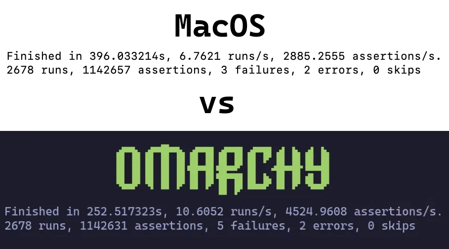

# Поддержка Mac

В Omarchy есть встроенная поддержка **Intel Macs**. На данный момент есть несколько известных ограничений, но если вы о них знаете и вас это устраивает; вы можете вдохнуть новую жизнь в свои старые Mac, установив Omarchy.

Обратите внимание: установка на Mac с чипами M-series на данный момент напрямую не поддерживается. Подробнее о текущем состоянии можно узнать в #omarchy-on-other в нашем [Discord](https://discord.gg/tXFUdasqhY).

В простом тесте нам удалось добиться прироста производительности на 36% на MacBook Pro 2019 года просто за счёт установки Omarchy.

 

### Установка Omarchy на Mac

Omarchy пока поддерживает установку только в качестве **единственной** ОС. Во время установки диск будет полностью очищен, и MacOS больше не будет загружаться.

Позже вы всё равно сможете восстановить её через Internet Recovery, если захотите.

В этом разделе мы исходим из того, что вы уже изучили [Начало работы](02-getting-started.md) и подготовили USB-накопитель. Если нет, сделайте это сейчас.

#### Отключение Secure Boot

Необходимо отключить Apple Secure Boot, чтобы загрузиться с загрузочного USB-накопителя, а также саму ОС. Чтобы отключить его, выполните следующее:

1. Выключите Mac
2. Включите его и _сразу же_ нажмите и удерживайте Command-R, пока не появится экран загрузки
3. Выберите своего пользователя и введите пароль, если будет запрошен
4. На экране восстановления выберите **Utilities > Startup Security Utility** в строке меню
5. Введите пароль при запросе аутентификации
6. Выберите «No Security» среди параметров Secure Boot
7. Выберите «Allow booting from external or removable media» среди параметров External Boot

#### Начало установки

1. Вставьте USB-накопитель
2. Перезагрузите Mac и _сразу же_ нажмите и удерживайте Option, пока не появится экран с загрузочными устройствами
3. Выберите оранжевое устройство EFI Boot
4. Продолжите [установку как обычно](02-getting-started.md)

Установщик определяет оборудование Mac и автоматически применяет необходимые исправления: драйверы и прошивку Broadcom Wi-Fi, драйвер SPI-клавиатуры на моделях MacBook, которым он нужен, и исправление приостановки NVMe для тех же моделей.

### Известные ограничения

Участники сообщества постоянно работают над решениями этих проблем, поэтому если они для вас критичны, присоединяйтесь к #omarchy-on-other в нашем [Discord](https://discord.gg/tXFUdasqhY) и посмотрите, есть ли актуальные способы их устранения.

#### Устройства с чипом T1

Чип Apple T1 был представлен в конце 2016 года и использовался исключительно в моделях MacBook Pro первого поколения с Touch Bar.
- MacBook Pro 13-inch (2016, два порта Thunderbolt 3) – Модель: A1706
- MacBook Pro 13-inch (2016, четыре порта Thunderbolt 3) – Модель: A1708
- MacBook Pro 15-inch (2016) – Модель: A1707

#### Известные проблемы

- Touch Bar не работает
- Звук не работает

#### Устройства с чипом T2

Чип безопасности Apple T2 был представлен в 2017 году. От чипа T2 отказались с переходом на Apple silicon (чипы M-series), начавшимся в 2020 году.

- iMac Pro (2017) – Модель: A1862
- MacBook Pro 13-inch (2018, четыре порта Thunderbolt 3) – Модель: A1989
- MacBook Pro 15-inch (2018) – Модель: A1990
- MacBook Air (Retina, 13-inch, 2018) – Модель: A1932
- Mac mini (2018) – Модель: A1998
- MacBook Pro 13-inch (2019, два порта Thunderbolt 3) – Модель: A2159
- MacBook Pro 13-inch (2019, четыре порта Thunderbolt 3) – Модель: A2178
- MacBook Pro 15-inch (2019) – Модель: A1990
- iMac (Retina 5K, 27-inch, 2020) – Модель: A2115 (iMac20,1 и iMac20,2)
- MacBook Pro 13-inch (2020, два порта Thunderbolt 3) – Модель: A2265
- MacBook Pro 15-inch (2020) – Модель: A1990

На этих моделях установщик автоматически настраивает пропатченное ядро `linux-t2`, конфигурацию звука T2, прошивку Apple Broadcom Wi-Fi/Bluetooth и управление вентиляторами через `t2fanrd`. Touch Bar работает на встроенной в ядро поддержке в стиле Boot Camp.

#### iMac Retina 5K (2017)

У 27-дюймового iMac 2017 года нет чипа T2, поэтому установщик настраивает его как другие Intel Macs.

- iMac (Retina 5K, 27-inch, 2017) – Модель: A1419

#### Известные проблемы

- Дисплей не работает в родном разрешении 5120×2880: панель состоит из двух тайлов, а штатный драйвер включает только один
- Звук не работает
- Регулировка яркости не даёт эффекта
- Режим сна зависает машину; восстановить её можно только выключением и включением питания

Патчер от сообщества для этой модели исправляет дисплей, звук и яркость: [omarchy-imac18-3](https://github.com/ahmadtv/omarchy-imac18-3).
