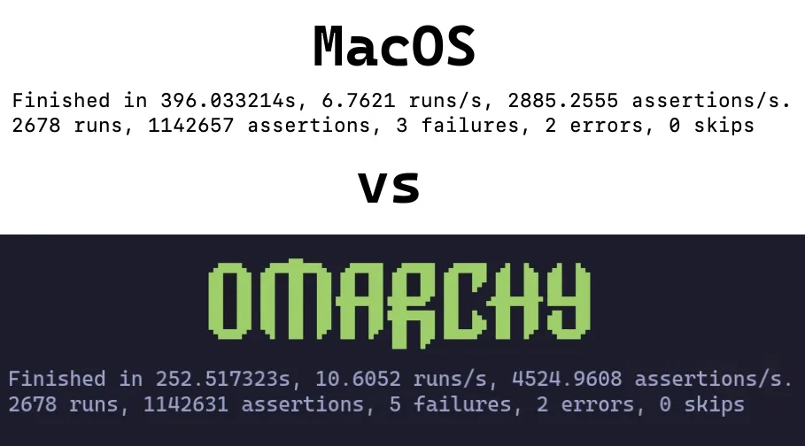

# Поддержка Mac

В Omarchy встроена поддержка **Mac с процессорами Intel**. На данный момент есть пара известных ограничений, но если вы о них знаете и они вас устраивают, вы можете вдохнуть новую жизнь в свои старые Mac, установив Omarchy.

Обратите внимание: установка на Mac с чипами серии M в настоящее время напрямую не поддерживается. Подробнее о состоянии дел можно узнать в канале #omarchy-on-other в нашем [Discord](https://discord.gg/tXFUdasqhY).

В простом тесте мы добились прироста производительности на 36% на MacBook Pro 2019 года просто за счёт установки Omarchy.

 

### Установка Omarchy на Mac

Omarchy пока поддерживает только вариант, когда она является **единственной** установленной ОС. Во время установки диск будет очищен, и MacOS больше не будет загружаться.

Позже её всё равно можно восстановить через Internet Recovery, если захотите.

В этой части мы исходим из того, что вы уже изучили [Начало работы](02-getting-started.md) и ваш USB-накопитель готов. Если нет — сделайте это сейчас.

#### Отключение Secure Boot

Чтобы загрузиться с загрузочного USB, а также загрузить ОС, необходимо отключить Secure Boot от Apple. Чтобы отключить его, выполните следующее:

1. Выключите Mac
2. Включите его и _сразу же_ нажмите и удерживайте Command-R, пока не появится экран загрузки
3. Выберите своего пользователя и введите пароль, если появится запрос
4. На экране восстановления выберите **Utilities > Startup Security Utility** в строке меню
5. Введите пароль при запросе аутентификации
6. Выберите «No Security» среди вариантов Secure Boot
7. Выберите «Allow booting from external or removable media» среди вариантов External Boot

#### Начало установки

1. Вставьте USB-накопитель
2. Перезагрузите Mac и _сразу же_ нажмите и удерживайте Option, пока не появится экран загрузочных устройств
3. Выберите оранжевое устройство EFI Boot
4. Продолжите [установку как обычно](02-getting-started.md)

Установщик определяет оборудование Mac и автоматически применяет нужные исправления: драйверы и прошивки Broadcom Wi-Fi, драйвер клавиатуры SPI на моделях MacBook, которым он нужен, и исправление сна NVMe для тех же моделей.

### Известные ограничения

Члены сообщества постоянно работают над решениями этих проблем, поэтому, если они для вас критичны, заходите в #omarchy-on-other в нашем [Discord](https://discord.gg/tXFUdasqhY) и смотрите, нет ли актуальных способов их решения.

#### Устройства с чипом T1

Чип Apple T1 был представлен в конце 2016 года и использовался исключительно в моделях MacBook Pro первого поколения с Touch Bar.
- MacBook Pro 13-inch (2016, two Thunderbolt 3 ports) – Model: A1706
- MacBook Pro 13-inch (2016, four Thunderbolt 3 ports) – Model: A1708
- MacBook Pro 15-inch (2016) – Model: A1707

#### Известные проблемы

- Touch Bar не работает
- Звук не работает

#### Устройства с чипом T2

Чип безопасности Apple T2 был представлен в 2017 году. Производство чипа T2 было прекращено с переходом на Apple silicon (чипы серии M), начавшимся в 2020 году.

- iMac Pro (2017) – Model: A1862
- MacBook Pro 13-inch (2018, four Thunderbolt 3 ports) – Model: A1989
- MacBook Pro 15-inch (2018) – Model: A1990
- MacBook Air (Retina, 13-inch, 2018) – Model: A1932
- Mac mini (2018) – Model: A1998
- MacBook Pro 13-inch (2019, two Thunderbolt 3 ports) – Model: A2159
- MacBook Pro 13-inch (2019, four Thunderbolt 3 ports) – Model: A2178
- MacBook Pro 15-inch (2019) – Model: A1990
- iMac (Retina 5K, 27-inch, 2020) – Model: A2115 (iMac20,1 and iMac20,2)
- MacBook Pro 13-inch (2020, two Thunderbolt 3 ports) – Model: A2265
- MacBook Pro 15-inch (2020) – Model: A1990

На этих моделях установщик автоматически настраивает пропатченное ядро `linux-t2`, конфигурацию звука T2, прошивки Apple Broadcom Wi-Fi/Bluetooth и управление вентиляторами через `t2fanrd`. Touch Bar работает на встроенной в ядро поддержке в стиле Boot Camp.
