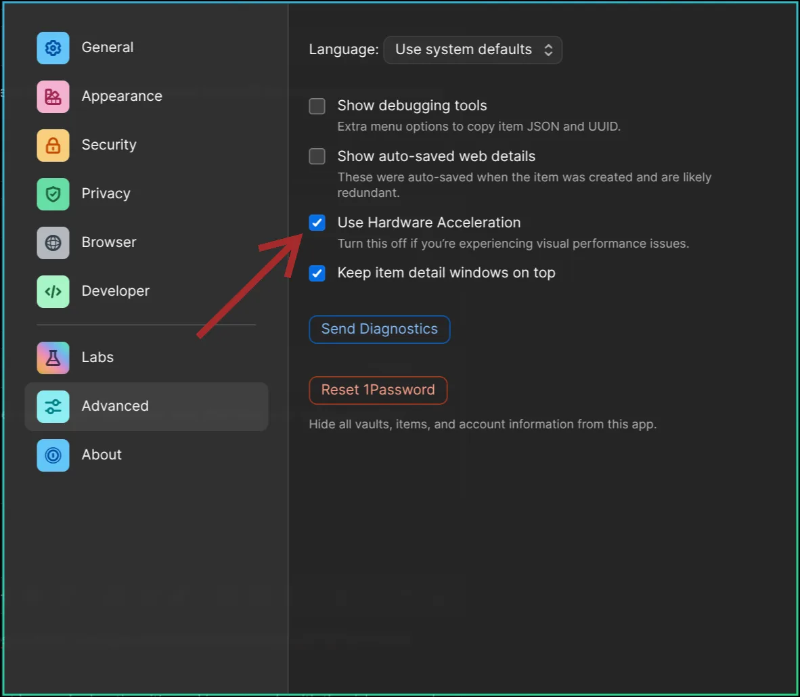

# Устранение неполадок

### Я сломал свою систему обновлением!

Сначала попробуйте [откатить свою систему](47-system-snapshots.md) на версию до недавнего обновления. Если это не сработает, используйте `omarchy-debug`, чтобы поделиться своей проблемой в #omarchy-help в Discord. А если и это не поможет, вы можете переустановить конфигурации и пакеты по умолчанию с помощью `omarchy-reinstall`.

### Почему некоторые приложения такие большие на моём дисплее?

Omarchy предполагает дисплей с высоким разрешением 2x, поэтому устанавливает `GDK_SCALE` в значение 2, пока вы не выберете масштаб на панели мониторов. Если у вас дисплей 1x, а приложения GTK или X11 получаются слишком большими, выберите для него 1x на панели мониторов или добавьте `hl.env("GDK_SCALE", "1")` в `~/.config/hypr/monitors.lua` (а затем перезапустите любое приложение, которое оказалось слишком большим). См. [руководство по мониторам](33-monitors.md).

В Spotify вы можете использовать `Ctrl + Minus`, чтобы уменьшить интерфейс (и `Ctrl + Plus`, чтобы сделать его больше).

### Почему все мои сочетания клавиш с Super перестали работать?

На некоторых ноутбуках ASUS ROG и TUF `Fn + Super` — это сочетание, которое легко не заметить, оно переключает прошивную блокировку клавиши Windows (предназначенную для игр, чтобы вы случайно не вышли из игры). Ничто на экране не говорит о том, что это произошло. Пока блокировка включена, Super вообще ничего не выдаёт — поэтому каждое сочетание Omarchy, использующее Super, просто перестаёт работать, и кажется, что сломался Hyprland.

Нажмите `Fn + Super` один раз, прежде чем копаться в `~/.config/hypr/`, а если это не вернёт Super, нажмите его ещё раз, чтобы не оставить блокировку включённой. Это не Fn-lock, который меняет только то, что делает ряд F-клавиш.

### У меня только что перестали работать Wi-Fi, Bluetooth, аудио или тачпад

Прежде чем перезагружаться, попробуйте перезапустить только проблемную подсистему. В _Update > Hardware_ в меню Omarchy есть Wi-Fi, Bluetooth, Audio и Trackpad, и перезапуск одной из них устраняет большинство ситуаций «это работало пять минут назад» — гарнитура Bluetooth, которая не хочет переподключаться, тачпад, переставший работать после suspend, звук, пропавший, когда вы отключили монитор.

### Почему мои внешние колонки не играют?

Вероятно, потому что они не установлены как основное устройство вывода. Щёлкните значок динамика в правой части панели, и откроется всплывающее окно громкости, где вы можете выбрать устройство вывода (и также настраивать громкость для отдельных приложений).

### Динамики моего ноутбука звучат как-то не так

На некоторых ноутбуках Omarchy автоматически применяет настройку динамиков, которая корректирует частотную характеристику встроенных динамиков. `omarchy audio tuning status` покажет, активна ли такая настройка на вашей машине, а `omarchy audio tuning off` отключит её, если вы предпочитаете слышать динамики без обработки.

### Почему я не могу войти или использовать sudo со своим паролем?

Вы, вероятно, десять раз ввели его неправильно и оказались заблокированы. Блокировка снимается сама через две минуты. Если вы не можете ждать, и это происходит на экране блокировки, вы можете нажать `CTRL + ALT + F2`, чтобы запустить новый TTY, где вы можете войти как root, а затем выполнить `faillock --reset --user [your-username]`. Это сбросит блокировку, и можно продолжать.

### Мой пароль принимается, но я возвращаюсь на экран входа

Сломанный файл окружения сеанса может помешать запуску рабочего стола, даже когда ваш пароль правильный. Это особенно стоит проверить после редактирования `~/.config/uwsm/env.d/`.

Нажмите `Ctrl + Alt + F2`, войдите под своим обычным именем пользователя и паролем и просмотрите пользовательский журнал текущей загрузки:

```bash
journalctl --user -b -t uwsm_env-preloader --no-pager
```

Ищите ошибку с именем одного из ваших файлов окружения, например `bad substitution`, прямо перед сообщением о том, что метка вывода env не найдена. Уберите этот файл из `env.d`, прежде чем пытаться войти снова. Например, если ошибка называет `99-custom`:

```bash
mkdir -p ~/.config/uwsm/disabled
mv -i ~/.config/uwsm/env.d/99-custom ~/.config/uwsm/disabled/
```

UWSM пропускает файл с синтаксической ошибкой, но фатальная ошибка, которая проявляется только во время выполнения файла, например `bad substitution`, всё равно может помешать запуску рабочего стола. Откат с помощью системного снимка не исправит эти файлы, потому что `/home` не откатывается.

Когда сможете войти, исправьте сохранённую копию, прежде чем возвращать её обратно. `sh -n` ловит синтаксические ошибки, не выполняя файл, но не может поймать каждую ошибку, возникающую при его подключении. Держите рабочий терминал открытым, пока тестируете изменения.

### Почему у меня не появляются запросы авторизации 1Password для 1Password SSH Agent / CLI?

Это может происходить по 2 причинам:

Чтобы появлялся расширенный запрос подтверждения, Settings > Advanced > Use Hardware Acceleration должно быть включено. _Примечание: Чтобы это начало работать, требуется перезагрузка._

 

Или если вы не запускали 1Password с момента загрузки системы, запрос не появится.
