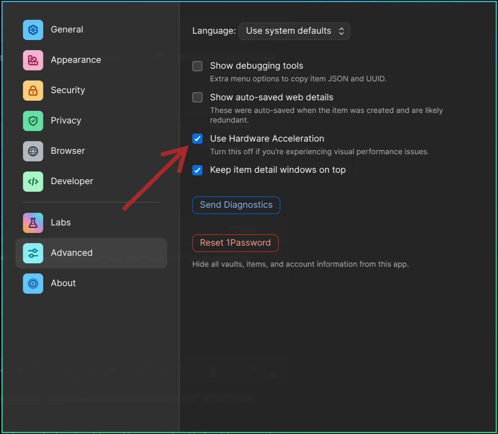

# Устранение неполадок

### Я сломал систему обновлением!

Сначала попробуйте [откатить систему](47-system-snapshots.md) к версии до недавнего обновления. Если это не поможет, используйте `omarchy-debug`, чтобы поделиться своей проблемой в канале #omarchy-help в Discord. А если и это не поможет, вы можете переустановить конфигурации и пакеты по умолчанию командой `omarchy-reinstall`.

### Почему некоторые приложения такие большие на моём дисплее?

Omarchy рассчитывает на дисплей высокого разрешения с масштабом 2x, для чего в `~/.config/hypr/monitors.lua` нужно задать `GDK_SCALE` равным 2. Но если у вас дисплей 1x, вы можете изменить `local omarchy_gdk_scale = 2` на 1 (а затем перезапустить любое oversized-приложение). См. [руководство по мониторам](33-monitors.md).

В Spotify можно использовать `Ctrl + Minus`, чтобы уменьшить интерфейс (и `Ctrl + Plus`, чтобы увеличить его).

### У меня просто перестали работать Wi-Fi, Bluetooth, звук или тачпад

Прежде чем перезагружаться, попробуйте перезапустить только виновную подсистему. В _Обновление > Оборудование_ в меню Omarchy есть Wi-Fi, Bluetooth, Аудио и Тачпад, и перезапуск одного из них решает большинство ситуаций «пять минут назад работало» — гарнитура Bluetooth, которая не переподключается, тачпад, переставший работать после сна, звук, пропавший, когда вы отключили монитор.

### Почему мои внешние колонки не играют?

Вероятно, потому что они не заданы как основной вывод. Щёлкните по значку динамика в правой части панели, и откроется всплывающее окно громкости, где можно выбрать устройство вывода (а также микшировать громкость по приложениям).

### Колонки моего ноутбука звучат странно

На некоторых ноутбуках Omarchy автоматически применяет настройку колонок, корректирующую частотную характеристику встроенных динамиков. `omarchy audio tuning status` говорит, активна ли такая настройка на вашей машине, а `omarchy audio tuning off` отключает её, если хотите слышать динамики как есть.

### Почему я не могу войти или использовать sudo со своим паролем?

Вы, вероятно, слишком много раз ввели его неправильно и оказались заблокированы. Если это происходит на экране блокировки, нажмите `CTRL + ALT + F2`, чтобы открыть новый TTY, где можно войти как root, а затем выполните `faillock --reset --user [your-username]`. Это сбросит блокировку, и всё будет в порядке.

### Почему не появляются запросы авторизации 1Password для 1Password SSH Agent / CLI?

Это может происходить по 2 причинам:

Для появления расширенного окна подтверждения в Settings > Advanced > Use Hardware Acceleration должно быть включено аппаратное ускорение. _Примечание: для этого требуется перезагрузка._

 

Или если вы не запускали 1Password с момента загрузки, запрос не появится.
