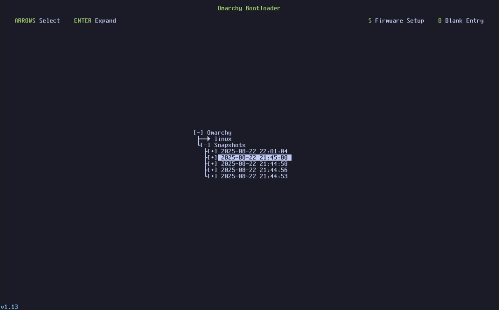
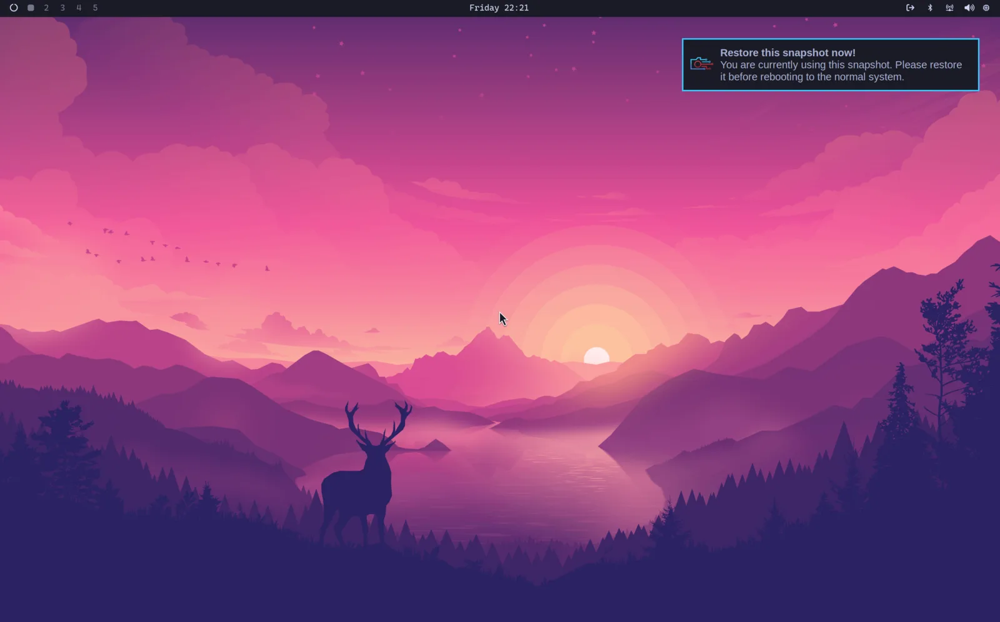

# Снимки системы

Мы автоматически создаём снимки при каждом обновлении Omarchy, но если вы хотите создать собственный, вы можете использовать `omarchy-snapshot create`.

Чтобы загрузиться из снимка и восстановить его, вы выбираете его в загрузчике Limine. (Если сейчас вы загружаетесь сразу на экран расшифровки Omarchy, сначала вам нужно будет выбрать Limine в качестве варианта загрузки через BIOS).

На этом экране выберите снимок, из которого вы хотите загрузиться, ориентируясь на дату и версию. Версию Omarchy на момент создания снимка можно увидеть в левом нижнем углу.

 

Когда вы окажетесь внутри, появится всплывающее уведомление о том, что вы находитесь в загружаемом снимке, и если вы нажмёте на него, начнётся процесс восстановления. Кроме того, вы можете использовать `omarchy-snapshot restore`.

 

Это восстановит вашу корневую файловую систему, но не ваш `/home`. Поэтому это подходит для отката неудачного обновления системы, но не для восстановления потерянных личных файлов.

Это также означает, что ваш каталог `~/.config` останется как есть. Поэтому, если вы откатываетесь к более ранней версии библиотеки или приложения, которое хранит файлы конфигурации в новом формате, вам придётся разбираться с этим вручную.

То же самое касается собственной записи Omarchy о том, какие миграции уже были выполнены: она находится в вашем домашнем каталоге, поэтому переживёт восстановление. Миграции, которые были выполнены после создания снимка, останутся отмеченными как выполненные, даже несмотря на то, что внесённые ими изменения в корневую файловую систему были отменены, и при следующем `omarchy update` они не будут выполнены снова. Поэтому, если после восстановления вы снова обновитесь и что-то, что было настроено более ранним обновлением, по-прежнему будет отсутствовать, скорее всего, причина именно в этом.

_Примечание: Эта функция доступна только на установках, использующих загрузчик Limine, который является загрузчиком по умолчанию с Omarchy 2.0. Она недоступна, если вы используете GRUB или systemd-boot._

### Пропуск меню загрузки

Если вы никогда не трогаете меню загрузки и просто хотите, чтобы машина сразу переходила к экрану расшифровки, запустите _Setup > Direct Boot_ в меню Omarchy. Это добавит запись EFI, указывающую напрямую на Omarchy, поэтому прошивка загрузит её, не останавливаясь на Limine.

Компромисс здесь тот же, что упоминался в начале: при включённой прямой загрузке для доступа к снимку сначала нужно выбрать Limine в меню загрузки BIOS. Запустите _Setup > Direct Boot_ ещё раз, чтобы удалить запись и вернуться к загрузке через Limine. Некоторые прошивки плохо воспринимают пользовательские записи EFI, поэтому установка отказывается выполняться на прошивках American Megatrends и Apple.
