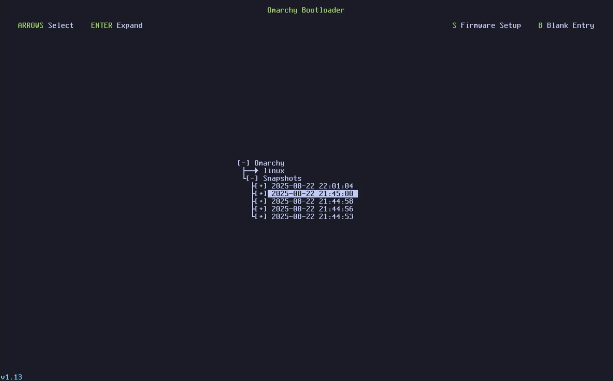
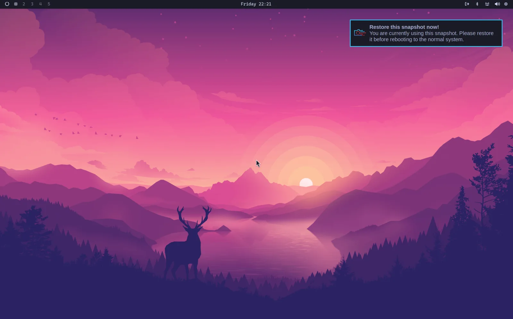

# Снимки системы

Мы автоматически создаём снимки при каждом обновлении Omarchy, но если вы хотите создать собственный, используйте `omarchy-snapshot create`.

Как загрузиться из снимка и восстановить его, зависит от загрузчика, с которого запускается ваша машина. Новые установки UEFI используют systemd-boot; старые установки и машины с BIOS используют Limine. `omarchy-boot-backend` подскажет, какой у вас.

## С systemd-boot

Выберите _Система > Снимки_ в меню Omarchy и выберите снимок, в который хотите загрузиться. Машина один раз перезагрузится в него. Или удерживайте Space при запуске машины, чтобы увидеть меню загрузки, где каждый снимок указан от новейшего к старейшему вместе с его версией Omarchy и датой.

Снимок загружается с временным слоем поверх, поэтому им можно пользоваться как обычно, но всё, что вы измените, исчезнет при следующей перезагрузке. Чтобы сохранить его, сделайте его своей системой: нажмите на уведомление, которое появляется при входе, выберите _Система > Снимки > Восстановить этот снимок_ или выполните `omarchy-snapshot restore`. Восстановление происходит во время перезагрузки машины. Система, какой она была до этого, остаётся в меню загрузки как _До восстановления_, а `omarchy-snapshot restore backup` возвращает её обратно.

Из терминала:

- `omarchy-snapshot list` перечисляет снимки, в которые можно загрузиться;
- `omarchy-snapshot boot 12` один раз перезагружается в снимок 12;
- `omarchy-snapshot restore 12` делает снимок 12 системой при следующей перезагрузке, а `omarchy-snapshot restore --cancel` отменяет это решение до этой перезагрузки.

## С Limine

Чтобы загрузиться из снимка и восстановить его, вы выбираете его в загрузчике Limine. Меню загрузки по умолчанию скрыто, поэтому нажмите любую клавишу, как только Limine запустится, чтобы вызвать его.

С этого экрана выберите снимок, в который хотите загрузиться, по дате и версии. Версию Omarchy на момент создания снимка можно увидеть в левом нижнем углу.

 

Когда вы окажетесь внутри, появится уведомление о том, что вы находитесь в загружаемом снимке, и, если вы нажмёте на него, начнётся процесс восстановления. Или же вы можете использовать `omarchy-snapshot restore`.

 

## Что охватывает восстановление

Восстановление возвращает вашу корневую файловую систему, но не ваш `/home`. Поэтому оно подходит для отката сломанного обновления системы, но не для восстановления потерянных личных файлов.

Это также означает, что ваш каталог `~/.config` остаётся как есть. Поэтому, если вы откатываетесь к более ранней версии библиотеки или приложения, которое хранит файлы конфигурации в новом формате, вам придётся разбираться с этим вручную.

То же самое касается собственной записи Omarchy о том, какие миграции уже были выполнены: она живёт в вашем домашнем каталоге, поэтому переживает восстановление. Миграции, которые были выполнены после создания снимка, остаются отмеченными как выполненные, хотя изменения, которые они внесли в корневую файловую систему, были откатаны, и следующее `omarchy update` не выполнит их снова. Поэтому, если вы обновитесь снова после восстановления и чего-то, что настроило более раннее обновление, по-прежнему не хватает, вероятная причина именно в этом.
