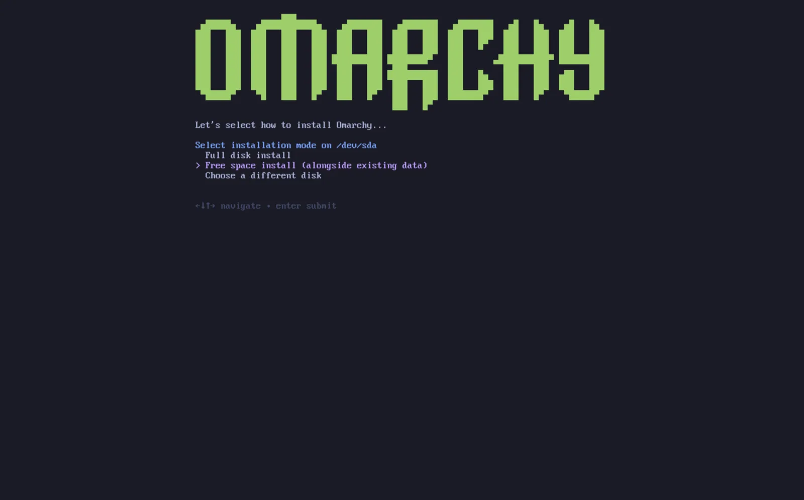
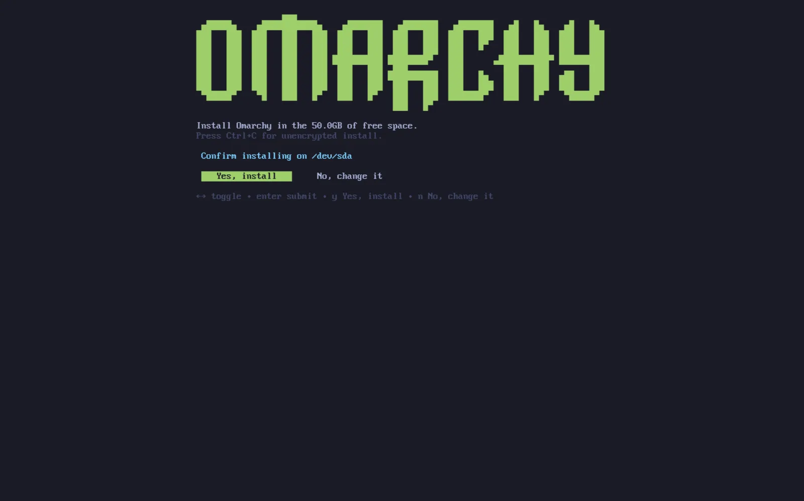

# Установка с двойной загрузкой

Вы можете установить Omarchy на один раздел рядом с Windows или другими установленными системами.

При этом методе установки раздел по умолчанию по-прежнему шифруется с помощью LUKS, поэтому фактически он ничем не отличается от установки на весь диск и просто требует свободного места на диске.

## Освобождение места в Windows

Чтобы установить систему рядом с Windows, введите `disk management` в меню «Пуск» и выберите вариант **Create and format hard disk partitions**.

 

Найдите нужный раздел, щёлкните по нему правой кнопкой мыши и выберите **Shrink Volume**.

 Введите размер, на который вы хотите сжать том. Учтите, что это будет размер вашей будущей установки Omarchy, включая загрузочный раздел.

 

Когда вы закончите, вы должны увидеть примерно такую картину, где раздел на 50GB — это место, куда мы в этом примере будем устанавливать Omarchy.

 

## Установка Omarchy

Процесс установки Omarchy фактически такой же, как обычно. После выбора диска вам будет предложен вариант **Free space install**. Выберите этот вариант, чтобы не стереть весь диск целиком.

 

Подтвердите, что всё выглядит правильно, и дождитесь завершения установки, как обычно. Здесь же вы можете выбрать установку без шифрования (не рекомендуется), как и при установке на весь диск.
 

## Добавление других установленных систем в загрузчик

Когда вы завершите установку Omarchy, вы заметите, что теперь загрузчиком по умолчанию стал Limine. С его помощью вы также можете добавить в Limine варианты для других ваших установленных систем, например Windows.

Чтобы добавить другие операционные системы, запустите `limine-scan` и следуйте подсказкам, чтобы добавить нужные пункты в вашу конфигурацию Limine. Меню загрузки по умолчанию скрыто и запускает Omarchy через одну секунду. Чтобы выбрать Windows или другой пункт, нажмите любую клавишу сразу, как только Limine запустится; когда появится меню, используйте клавиши со стрелками, чтобы выбрать пункт, и нажмите Enter. Если Omarchy запустится раньше, чем вы нажмёте клавишу, перезагрузитесь и попробуйте снова.

## Bitlocker

Важно отметить, что этот метод установки несовместим с Bitlocker, поскольку он шифрует весь диск, а не только раздел. Если вы столкнётесь с ошибкой о том, что Bitlocker включён, загрузитесь в Windows, перейдите в **Settings -> Privacy & Security -> Device encryption** и отключите Bitlocker. Расшифровка диска может занять некоторое время.

 
