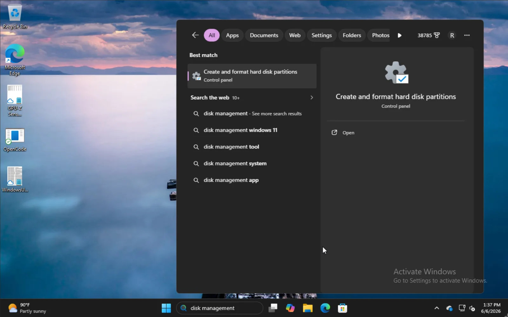
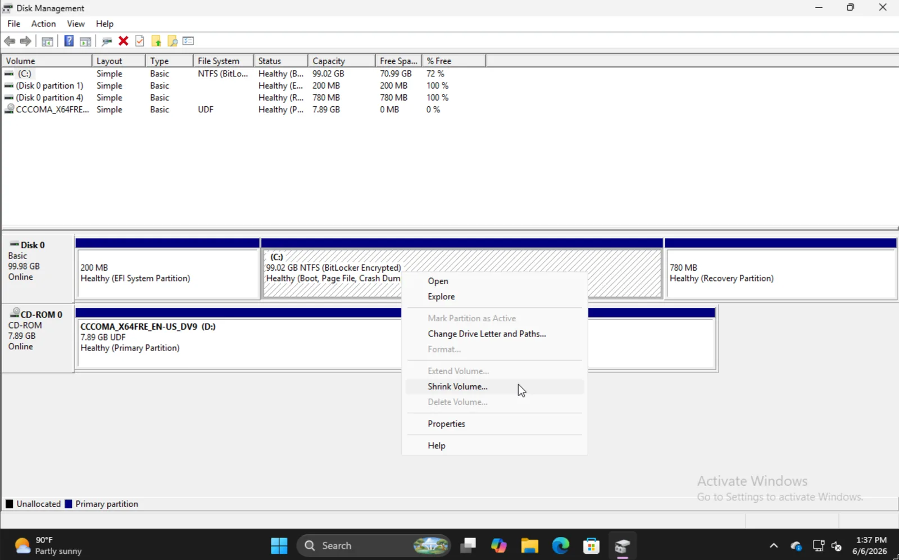
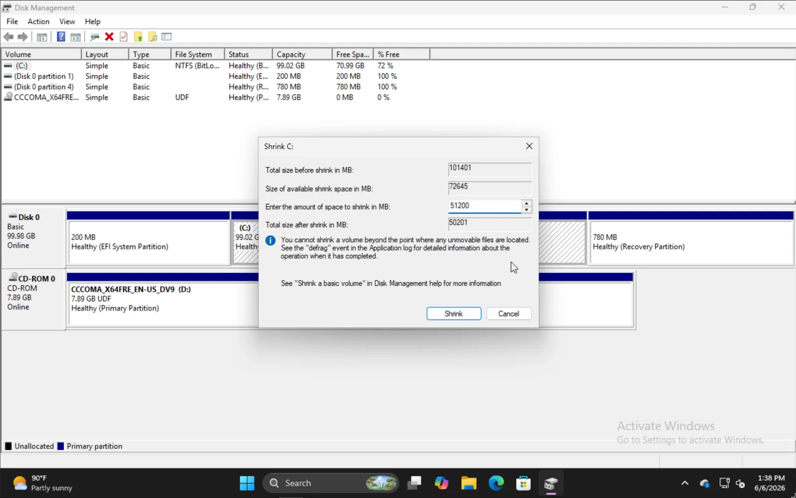
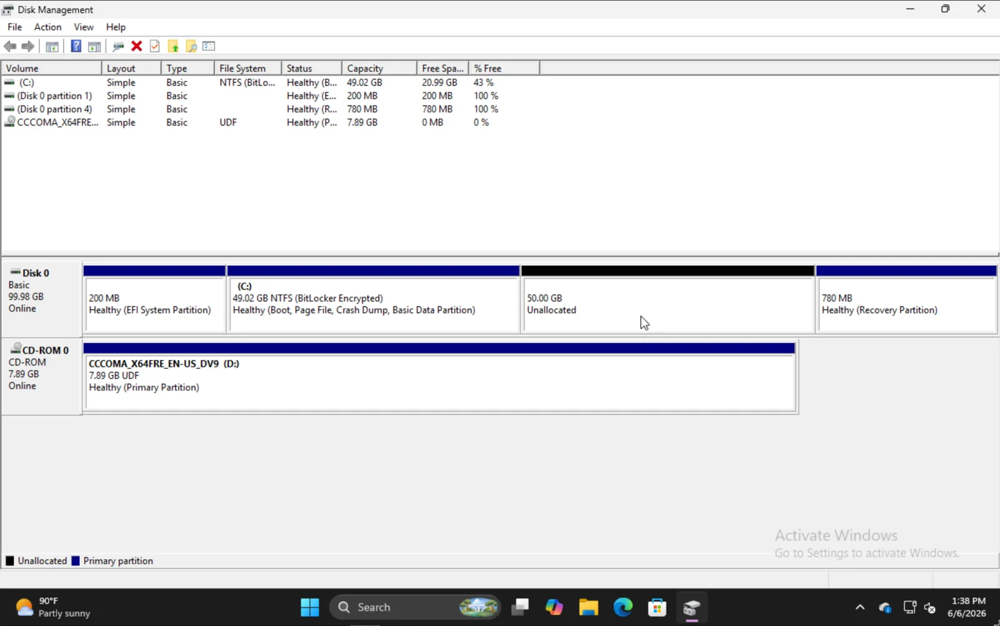
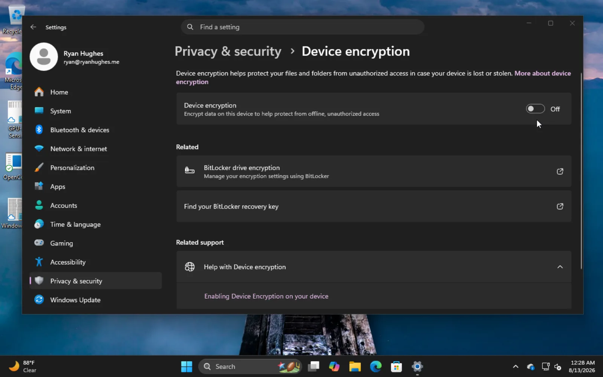

# Установка с двойной загрузкой

Omarchy можно установить на один раздел рядом с Windows или другими установленными системами.

При этом способе установки раздел по умолчанию по-прежнему шифруется с помощью LUKS, так что фактически он ничем не отличается от установки на весь диск и просто требует свободного места на диске.

## Освобождение места в Windows

Чтобы установить систему рядом с Windows, введите `disk management` в меню «Пуск» и выберите пункт **Создание и форматирование разделов жёсткого диска**.

 

Найдите подходящий раздел, щёлкните по нему правой кнопкой мыши и выберите **Сжать том**.

 Введите размер, на который нужно сжать том. Учтите, что это будет размер вашей будущей установки Omarchy, включая загрузочный раздел.

 

Когда вы закончите, вы должны увидеть примерно такую картину, где раздел на 50 ГБ — это место, куда мы установим Omarchy в этом примере.

 

## Установка Omarchy

Процесс установки Omarchy фактически такой же, как обычно. После того как вы выберете диск, вам будет предложена опция **Установка в свободное место**. Выберите эту опцию, чтобы не стереть весь диск.

 

Убедитесь, что всё выглядит правильно, и дождитесь завершения установки, как обычно. На этом этапе вы также можете выбрать установку без шифрования (не рекомендуется), как и при установке на весь диск.
 

## Добавление других установленных систем в загрузчик

Когда вы завершите установку Omarchy, вы заметите, что теперь загрузчиком по умолчанию является Limine. С его помощью вы также можете добавить в Limine пункты для других установленных систем, например Windows.

Чтобы добавить другие операционные системы, запустите `limine-scan` и следуйте подсказкам, чтобы добавить нужные записи в вашу конфигурацию Limine. Меню загрузки по умолчанию скрыто, и Omarchy запускается через одну секунду. Чтобы выбрать Windows или другой пункт, нажмите любую клавишу сразу после запуска Limine; когда появится меню, с помощью клавиш со стрелками выберите пункт и нажмите Enter. Если Omarchy запустится раньше, чем вы нажмёте клавишу, перезагрузитесь и попробуйте снова.

## Bitlocker

Важно отметить, что этот способ установки несовместим с Bitlocker, поскольку он шифрует весь диск целиком, а не только раздел. Если вы столкнётесь с ошибкой о том, что Bitlocker включён, загрузитесь в Windows, перейдите в **Параметры -> Конфиденциальность и безопасность -> Шифрование устройства** и отключите Bitlocker. Расшифровка диска может занять некоторое время.

 

## Переустановка Windows

Если этот компьютер поставлялся с Windows, её ключ продукта хранится в прошивке. Запустите `omarchy windows key`, чтобы вывести его, чтобы вы могли снова активировать Windows, если когда-нибудь переустановите её на этой машине.
