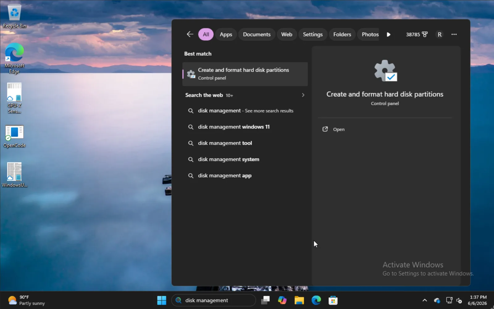
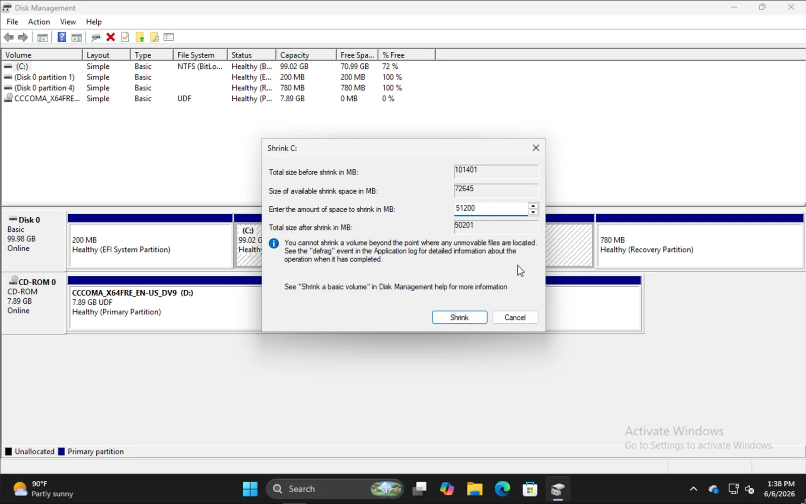
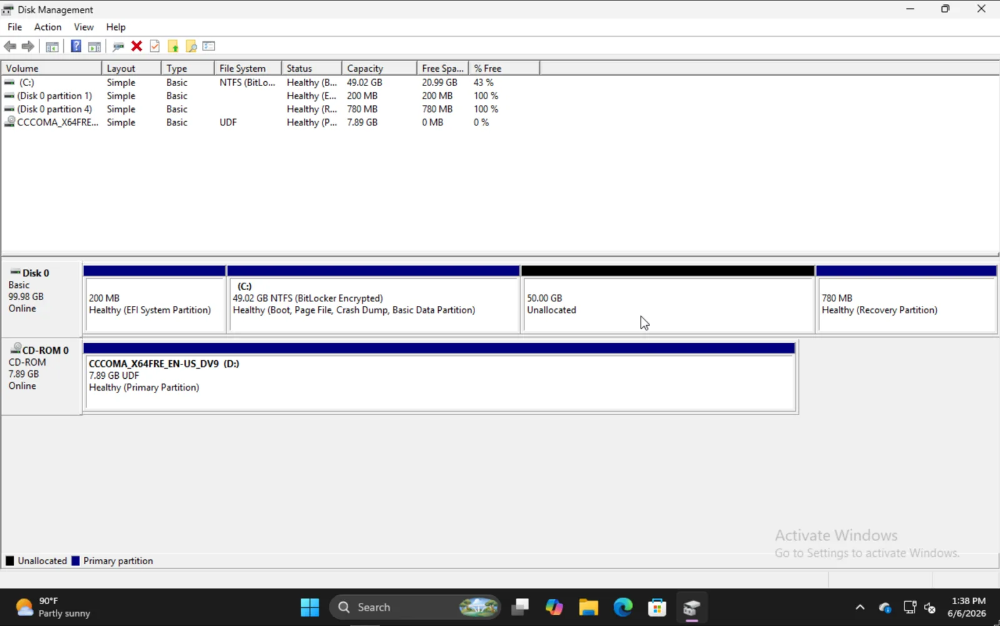
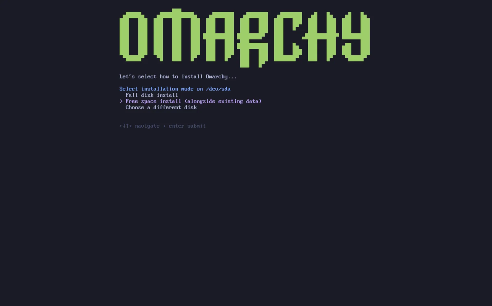
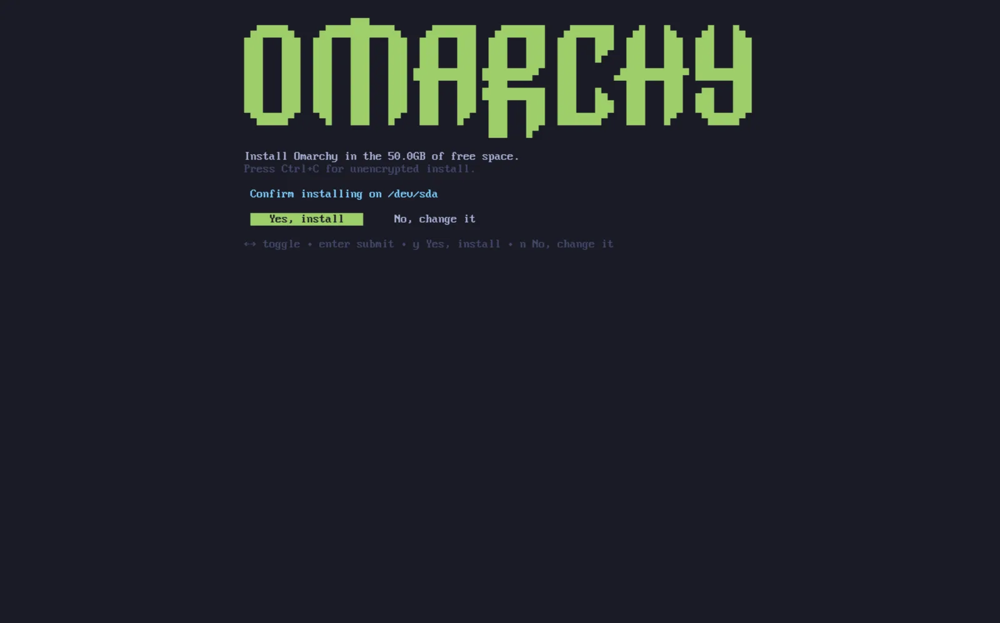

# Установка с двойной загрузкой

Вы можете установить Omarchy в единственный раздел рядом с Windows или другими установками.

Этот метод установки по-прежнему по умолчанию включает шифрование LUKS для раздела, поэтому фактически он ничем не отличается от установки на весь диск и просто требует свободного места на диске.

## Освобождение места в Windows

Чтобы установить рядом с Windows, введите `disk management` в меню «Пуск» и выберите вариант **Create and format hard disk partitions**.

 

Найдите подходящий раздел, щёлкните правой кнопкой и выберите **Shrink Volume**.

 Введите размер, на который хотите сжать том. Обратите внимание: это будет размер вашей будущей установки Omarchy, включая загрузочный раздел.

 

Когда закончите, вы должны увидеть что-то вроде этого, где секция в 50GB — это место, куда мы в этом примере установим Omarchy.

 

## Установка Omarchy

Процесс установки Omarchy фактически такой же, как обычно. После выбора диска вам будет предложен вариант **Free space install**. Выберите этот вариант, чтобы не стереть весь диск.

 

Подтвердите, что всё выглядит хорошо, и дождитесь завершения установки как обычно. Здесь же можно выбрать установку без шифрования (не рекомендуется), как и при установке на весь диск.
 

## Добавление других установок в загрузчик

Когда вы завершите установку Omarchy, вы заметите, что теперь загрузчиком по умолчанию является Limine. С ним вы также можете добавить в Limine варианты для других установок, например Windows.

Для этого запустите `limine-scan` и следуйте подсказкам, чтобы добавить нужные пункты в конфигурацию limine. Тогда при загрузке вы увидите обычные варианты Omarchy, а также Windows Boot Manager или другие.

## Bitlocker

Важно отметить, что этот метод установки несовместим с Bitlocker, поскольку он шифрует весь диск, а не только раздел. Если вы столкнётесь с ошибкой о том, что Bitlocker включён, загрузитесь в Windows, перейдите в **Settings -> Privacy & Security -> Device encryption** и отключите Bitlocker. Расшифровка диска может занять некоторое время.

 
