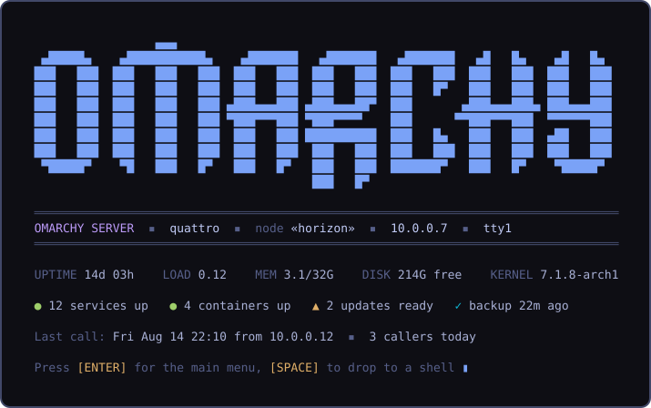
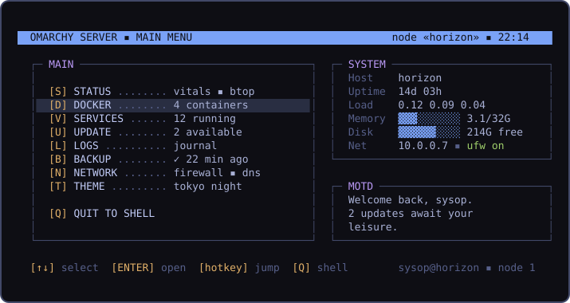
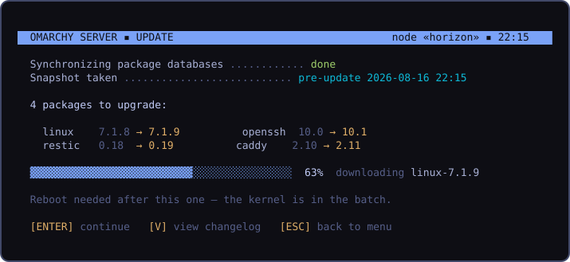

# Plan: Omarchy Server — a headless edition with a BBS front door

Revision 2. Delivery plan based on the existing server design, the upstream implementation PRs, and the slim-installer requirement. Implementation status must be verified against the commits and build artifacts below; a proposed feature is not a completed feature.

## Goal and decisions

Ship a separate, small Omarchy Server installer and a headless installed system, with the existing terminal identity and administration tools. Preserve Omarchy's single source tree, supported platform names, package signatures, and update pipeline. A server selection inside the desktop ISO alone does not satisfy the download-size requirement.

- Build a separate server ISO whose live environment, target image, and offline package mirror contain only the server dependency closure and required installer tools.
- Keep the Arch base for this implementation. Predictable administration, explicit maintenance windows, and tested recovery are the objectives borrowed from CentOS, Oracle Linux, and Debian servers. Enterprise Linux ABI compatibility and a multi-year security-support commitment are separate projects and are not promised here.
- Keep the BBS splash and menu, with a direct shell escape and per-user opt-out. The greeting must never interfere with automation or become an authentication boundary.
- Require console authentication even on encrypted servers. Remote disk unlock authenticates the unlock operation; it does not authorize a separate console user.
- Make container engines, development runtimes, extra editors, and specialist services optional when producing the slim base. Preserve the upstream curated tools as an optional package selection, with menu entries that explain how to install a missing optional tool. Do not silently remove tools from the current manifest before the optional installation path exists.

## Sources and existing work

The original goal issue or discussion still needs its exact link confirmed. Until it is linked and checked, this plan uses the committed [original design](https://github.com/omacom/omarchy/commit/f32ebbdb730c4e8fe11e4046cef4267e466264ea), the sources below, and the operator's explicit slim/headless requirements. This is an outstanding traceability item, not a claim that a particular issue was found.

| Source | Reuse | Remaining work or conflicting behavior |
| --- | --- | --- |
| [omarchy #11289](https://github.com/omacom/omarchy/pull/11289), runtime | Edition predicates, package selection, greeting, splash, menu, ANSI palette, install gates | Reconcile with current runtime; replace console autologin; verify updates without a desktop |
| [omarchy #10952](https://github.com/omacom/omarchy/pull/10952), Phase 1 starter | Greeting guards and retained/dropped package audit | Incorporate useful behavior once; do not stack a second competing edition implementation |
| [sysrex/omarchy #3](https://github.com/sysrex/omarchy/pull/3), head `b2ec8c3` reviewed | Integration of both runtime approaches and remote-unlock command | Correct review findings 1–7; boot validation remains outstanding |
| [omarchy-iso #175](https://github.com/omacom/omarchy-iso/pull/175) | Edition configuration, target marker, installer orchestration, SSH enablement | Combined ISO does not meet the slim requirement; remove server autologin; replace its no-key password-SSH fallback with explicit secure enrollment |
| [omarchy-pkgs #397](https://github.com/omacom/omarchy-pkgs/pull/397) | Published package recipe for lazyjournal | Confirm availability for the released server architectures and channels; it can land independently |
| Local `origin/cursor/server-iso-build`, commit `d10f5d0ea` | Reproducible starting point for a test ISO workflow and installer patch | Its image package list explicitly unions desktop and server packages. `--label server` changes naming, not image contents. Pin all build inputs and replace that union before using it as a slim release build |

Read [backup](backup.md), [dots](dots.md), and [remote](remote.md) as adjacent plans. A backup placeholder in the menu is not a backup implementation; Tailscale after boot cannot unlock an encrypted root before boot.

## Problem

Omarchy's taste — opinionated defaults, a curated TUI toolbox, one-command updates with snapshots, themes everywhere — stops at the desktop. There is no story for the second machine most Omarchy users have: the home-lab box, the VPS, the closet server running Docker. Ubuntu has Server; Arch has a wiki and an afternoon of yak-shaving. People who want "Omarchy for servers" today either drag the entire Hyprland/GUI stack onto a headless machine or hand-strip it and lose the update pipeline.

And every server distro greets you the same dreary way: `Last login: ...` and a blinking cursor. A machine you *dial into* deserves a front door with character. Omarchy Server boots to a console, runs over SSH, and greets an interactive login like an old-school BBS: ANSI wordmark, node status, callers today, and a hotkey home menu that opens into the TUIs Omarchy already ships. The aesthetic isn't decoration bolted on — terminal-first is the whole product, so the terminal experience *is* the identity.

## Shape

A second edition built from this same repo — not a fork, not a mode toggle:

- No Hyprland, no Quickshell, no GUI packages. Boots to a getty on the console; SSH is the primary access and is on from first boot (key-only).
- A curated server package set: the existing CLI (`omarchy ...`), the TUI toolbox (btop, lazygit, lazydocker, lazyjournal), Docker + compose, ufw, snapper snapshots, the same update/migration pipeline. The backup plan (`plans/backup.md`) applies minus the shell panel; the dots plan (`plans/dots.md`) gets its best use case — syncing your configs between desktop and server.
- The BBS layer: a themed pre-login `/etc/issue`, a login splash, and a home menu (`omarchy-server-menu`) that works like a BBS door system — pick an entry, the tool takes the full screen, quitting it drops you back at the menu. `[Q]` is always a real shell.

## Rejected approaches

- **A fork repo**: permanent drift; every bin/ fix would need double maintenance. The dots plan's reasoning against wrapping third-party tools applies to wrapping ourselves.
- **A web admin panel** (Cockpit and friends): a second attack surface listening on a port, a second UI toolkit to theme, and not Omarchy's soul. The terminal is the product; SSH is the transport we already secured.
- **"Server mode" toggle on an installed desktop**: uninstalling a GUI stack in place is a migration minefield in both directions. Edition is chosen at install time; changing your mind is a reinstall (dots + backup make that cheap).
- **A compiled TUI framework** (bubbletea, ratatui) for the menu: a new toolchain for v1's needs. The repo's idiom is bash + gum, which is already themeable and already everywhere; revisit only if the menu outgrows it.
- **archinstall server profile**: Omarchy has its own installer and offline mirror; the edition is a package-set and provisioning variant of that pipeline, not a different installer.

## What it looks like

Mockups, generated from the repo's own `logo.txt` wordmark and the tokyo-night `colors.toml` — every theme restyles all three screens.

The login splash — pre-menu, both on the console and over SSH:

The home menu — hotkeys on the left, live vitals and MOTD on the right; every entry opens an existing Omarchy TUI or command as a full-screen "door" and returns here on exit:

A door in action — `[U]` runs the standard `omarchy-update` pipeline, snapshot first, in BBS dress:

## Design

### Edition mechanics

- The installer writes the edition (e.g. `/etc/omarchy-edition`), read by a new `omarchy-edition` helper with quiet predicates in the `hw-` tradition (`omarchy-edition-server`, exit-code interface) so scripts and migrations can gate.
- `install/omarchy-server.packages` is a hand-curated subset of `omarchy-base.packages` — subtraction, not a parallel list that drifts: keep the CLI, TUIs, docker, networking, security, and theming plumbing; drop compositor, shell, GUI apps, audio/bluetooth/printing stacks, fonts beyond the console.
- Migrations and refresh commands that touch GUI surfaces gate on edition; everything else (pacman, snapper, CLI, themes' terminal side) runs identically. One update pipeline, two editions.

### First boot

The existing provisioning flow, server flavor: hostname, user, then SSH public-key enrollment using the existing setup helper or supplied unattended keys, ufw enabled with rate-limited SSH, password authentication off, optional Tailscale, optional static IP. Require a valid key before advertising unattended remote access. If no key is provided during an interactive install, offer enrollment through the authenticated local console; do not silently expose password SSH. The machine is reachable and safe before the first login greeting ever renders. Both encrypted and unencrypted servers keep the console login prompt.

### The BBS front door

- **Pre-login**: a themed `/etc/issue` — compact logo, hostname, IP — so even the getty says who's answering.
- **Greeting**: interactive login shells (tty or ssh-with-pty only — never scp/sftp/rsync/exec sessions, never non-interactive shells, never inside tmux attach) run the splash: wordmark, edition/host/node line, vitals, service/container/update/backup counts, last call and callers today (from wtmp), then ENTER for the menu or any other key for a shell. `omarchy server greet <splash|menu|off>` sets whether login lands on the splash, jumps straight to the menu, or skips it all — per-user state, instant to change, and the greeting must never block a slow machine's login (vitals gather with a hard timeout; the menu renders with stale counts rather than making you wait).
- **Menu**: `omarchy-server-menu`, bash + gum. Entries route to what already exists — Status → btop, Docker → lazydocker, Services → a gum-driven systemctl list, Update → `omarchy-update`, Logs → lazyjournal, Backup → the backup plan's CLI status/actions, Network → ufw + interface status, Theme → `omarchy-theme-set`, Quit → shell. The menu is a launcher with a status pane, not a reimplementation of any tool.
- **Flavor, tasteful and default-on**: node number (session count), callers today, sysop framing, MOTD from `~/.config/omarchy/motd`. All output degrades to ASCII-and-16-colors when `TERM=linux` or the terminal can't do better; the art never breaks a dumb terminal.

### Theming

`themes/*/colors.toml` already defines everything the three screens need. A small bridge renders a theme into ANSI/truecolor escape palettes consumed by the splash, menu, and issue file; `omarchy-theme-set` on server applies the terminal-side targets it already knows (btop, starship, bat) plus the BBS palette. Switching themes restyles the whole front door — the mockups above are just tokyo-night.

### Relationship to the other plans

- **backup**: same engine, CLI, timer, and state file; the panel's job is done by the menu's Backup entry and the splash's status line. The plan's systemd user units run fine in a lingering or logged-in server session; server enables lingering so timers fire without an interactive login.
- **dots**: push your desktop's configs, pull them on the server — the multi-machine sync design's second machine is exactly this box.

## Rollout

### 1. Repair the runtime integration

Bring PR #3 onto current `quattro` once, preserving later shared changes. Work in isolated child workspaces and integrate reviewed commits into a dedicated branch. Do not publish or merge upstream as part of local repair.

| Review finding | Required result | Verification |
| --- | --- | --- |
| 1. Missing setup leaves | Remove the nonexistent powerprofiles and user/git calls; preserve the existing first-run git setup | Setup traverses the real orchestration without a missing script or duplicate account prompt |
| 2. Console autologin | Server provisioning leaves normal getty authentication and handles the earlier Omarchy autologin drop-in safely | Encrypted and unencrypted server provisioning; desktop login behavior preserved |
| 3. Unlock authorized-key location | Install keys where the selected mkinitcpio-dropbear package actually reads them | Inspect the generated initramfs for its authorized keys and Dropbear executable |
| 4. Unsafe unlock test | All test mutations are confined to scratch paths, with unsafe destinations rejected | Run unprivileged; ensure the fake privilege helper cannot reach host `/etc`, boot files, or services |
| 5. Unlock listening port | Configure a supported launch interface for the exact packaged Dropbear hook and report the actual port | Verify generated boot configuration, then connect to that port in the VM |
| 6. Static unlock network | Validate inputs and generate network configuration accepted by the actual initramfs networking tool | DHCP and static address/netmask/interface/gateway tests; malformed input rejected before writes |
| 7. Menu disk reading | Use compatible GNU df options and display the parsed free-space reading | Exercise the real parser and GNU df; inspect menu on a VM console |

Keep production test-path overrides out of privileged commands where an isolated fixture can exercise the same logic safely. Check the actual package hooks, Limine command-line source, configuration ordering, and platform boot boundary rather than assuming Debian initramfs paths apply to Arch.

Exit: findings 1–7 have reviewed fixes and focused checks. This gate proves runtime repairs, not an installable server release or working network unlock on hardware.

### 2. Remove desktop dependencies at the package boundary

Owner: coordinated work in `omarchy-pkgs` and this runtime repository. Do this before claiming any server package-list audit proves headlessness.

The [current omarchy recipe](https://github.com/omacom/omarchy-pkgs/blob/master/pkgbuilds/omarchy/PKGBUILD) directly depends on Hyprland, Quickshell, uwsm, SDDM, the Hyprland portal, audio/session components, the desktop font, and theme intro videos. The [settings recipe](https://github.com/omacom/omarchy-pkgs/blob/master/pkgbuilds/omarchy-settings/PKGBUILD) also depends on Plymouth and installs desktop defaults. A server list that omits those names cannot override package dependency resolution.

- Separate shared runtime and boot/security defaults from desktop dependencies and assets. Preserve the existing desktop package's dependency guarantees; choose the smallest compatible package split after auditing owned files, hooks, exact-version pins, and stable/dev transitions.
- Make the server package transaction select the shared/server packages directly. Check dependencies transitively and inspect package scriptlets and user-service enablement, including `/etc/skel` defaults.
- Audit setup and platform lists: leave required console, storage, networking, and platform boot support intact; gate desktop-only Vulkan, camera, audio, and compositor behavior at its shared owner where possible. Respect the repository's platform parity rules.
- Retain package signatures and coherent runtime/settings versions. Build against the same repository snapshot the release will use.

Exit: a clean package transaction and first boot contain no compositor, display manager, browser, desktop portal/session stack, or theme-video package, including transitive dependencies. The optional tools selection installs successfully without requiring the desktop.

### 3. Build a separate slim server installer

Owner: `omarchy-iso`, using #175 and the local test-build branch as implementation references. Dependencies: runtime repair and package split.

- Introduce an edition build input that changes the live root, target root, and offline mirror together. A filename label or target marker is insufficient. Set the target marker before any package/default selection or setup step reads it.
- Keep the installer text-based, with serial-console access, DHCP, configured static networking, signed packages, and an unattended configuration path. Reuse the existing installer orchestration.
- Provide a small online image first, then a separate offline server image if offline installation is required. Both produce the same selected server installation; neither carries the desktop package closure.
- Pin runtime, installer, package recipes, and repository snapshot identities in build provenance. Record checksums, package versions, package payload sizes, and final artifact size.
- Fix the companion ISO's independent getty-autologin path as well as runtime provisioning. Require SSH keys for unattended remote access and test the firewall alongside sshd enablement.

Proposed engineering budgets, to be confirmed by the first measured build:

| Measurement | Initial target and accounting |
| --- | --- |
| Online installer download | At most 1 GiB; measure the actual ISO artifact, including firmware and installer payload |
| Installed slim root | At most 2 GiB used after installation and cache cleanup, excluding the separate ESP and optional tools/data; report ESP usage separately |
| Offline installer | Establish a measured baseline for the complete server dependency closure and set its release ceiling before publishing; never reuse the combined desktop image |
| Idle memory | Record service set, guest RAM, and measured usage on the reference VM; establish a ceiling from that baseline |

These are targets, not current measurements. If required firmware or a supported boot chain exceeds a target, publish the size breakdown and revise the budget explicitly; do not remove required hardware support to make the number pass.

Exit: the build produces the separate artifact, publishes its measurements, and installs the selected server set. A QEMU installation proves actual behavior, rather than the filename or manifest alone.

### 4. Make remote operation and updates dependable

Owner: runtime, installer, and release maintainers. Dependencies: a bootable slim image.

- Verify SSH and networking before any interactive login on normal and deferred provisioning paths. Configure persistent network credentials at system scope. Ensure a missing desktop session cannot hold up the network or service startup.
- Reuse the existing stable/RC mirror templates, update lock, package transaction, migration ordering, Snapper integration, and boot lifecycle dispatch. The [mirror project already supports staged snapshots](https://github.com/omacom/omarchy-mirror); do not build another update mechanism.
- Audit the whole update path in a headless session: desktop restart guards alone are insufficient. Include package hooks, theme changes, user migrations, service restarts, tool updates, and privilege prompts. Provide explicit maintenance/reboot behavior and retain useful logs after SSH disconnects.
- Review `omarchy-update-requires-free-space`, which currently requires 10 GiB free, against the server installation and disk-sizing policy. Derive any replacement from package download/staging space, boot-image rebuilds, and snapshot retention; do not globally disable the guard or equate a small root payload with a tiny supported disk.
- Use a canary server before fleet rollout. Define who promotes security fixes, the expected response time, and how an emergency fix enters the stable snapshot without leaving a partial upgrade. Snapshot staging does not itself provide an enterprise security-support guarantee.
- Keep remote LUKS unlock opt-in. Test a cold encrypted boot from another machine, key rejection, supported network configuration, selected port, stable host identity, local fallback, disable/rebuild, and unlock after a kernel update. Honor platform-specific boot ownership and reject unsupported setups before changing boot files.
- Treat root snapshots and application backups separately. Define retention and disk pressure behavior; test restoring a service and its persistent data onto a fresh server. Add timers that operate without an interactive login when the backup engine is available.

Exit: install → SSH → update → reboot → SSH works without visiting the console, except an explicitly chosen local disk unlock. Recovery succeeds after a failed update and a fresh-server data restore. Keep a local/BMC/serial recovery path documented.

### 5. Release validation and documentation

Use the existing CLI and focused shell tests, with full logs retained. Extend existing tests only for real regressions. Read the relevant acceptance/visual-verification guides before running VM-driven checks; do not drive tests against the active desktop or add experimental oligarchy tests.

| Scenario | Required evidence |
| --- | --- |
| Fresh server install | Text and unattended paths; marker, package closure, authenticated console, SSH key login, firewall rules, persistent network |
| Encrypted remote reboot | Separate client reaches initramfs, rejects unauthorized key, unlocks root, then reaches ordinary sshd; console still requires authentication |
| Update and recovery | Stable-channel update, migration, kernel rebuild, reboot, SSH reconnect, interrupted transaction recovery, snapshot recovery |
| Automation | Real SSH command, scp, sftp, rsync, tmux, non-login shell, and dumb-terminal cases remain usable and protocol-clean |
| Terminal presentation | Console and SSH PTY; narrow terminal, ASCII fallback, menu tool return, theme, disk-space reading, immediate shell exit |
| Platform support | x86 and aarch64 VM smoke tests; record each hardware family's boot/network-unlock validation separately and keep unverified claims explicit |
| Desktop compatibility | Desktop package dependencies, provisioning, login, themes, and updates retain their existing behavior |
| Size and maintenance | Published artifact/root/ESP/cache measurements, package inventory, idle service/memory baseline, required disk headroom |

Publish user-facing installation, first-boot, SSH, encrypted reboot, update, backup/restore, and recovery instructions under `manual/`. Put package layout, edition gating, and build coordination under `docs/`. Keep implementation procedures in `agents/skills/`.

Release order: compatible shared/server packages → repaired runtime → installer using those exact packages → VM/hardware evidence → signed release artifacts and manual. A test artifact is not a supported production release.

## Open questions

1. Confirm the original goal issue/discussion link and reconcile any requirements beyond the existing design and this delivery plan.
2. Confirm the optional curated-tool selection and the final package split after measuring dependency and asset sizes.
3. Decide the offline-image release ceiling and minimum supported disk size from the measured build and safe update headroom.
4. Assign release/security ownership and publish the supported maintenance expectations before production use. A multi-year supported Debian/Oracle Linux variant requires a separate scoped proposal if that becomes a requirement.
5. Keep the original splash default and ASCII console fallback for the first release; revisit font additions and different SSH/console defaults only after the required installation and recovery paths pass.
