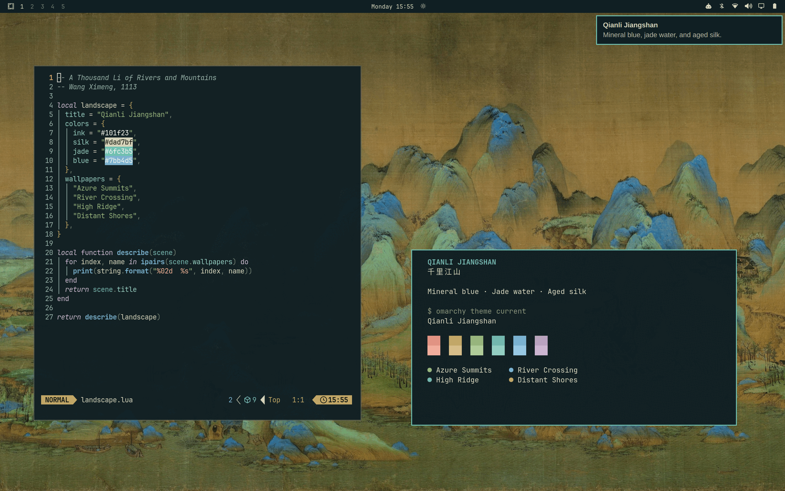

# Qianli Jiangshan · 千里江山

A dark Omarchy theme inspired by Wang Ximeng’s *A Thousand Li of Rivers and Mountains* (千里江山图, 1113). Mineral blue, jade green, aged silk, and ink carry the painting’s colors into the desktop.



## Palette

Ink-blue surfaces, warm text, and jade selections keep the landscape and applications in balance. Cinnabar, ochre, and muted violet distinguish diagnostics and terminal output.

| Role | Color | Inspiration |
| --- | --- | --- |
| Background | `#101f23` | Ink in the mountain folds |
| Foreground | `#dad7bf` | Light on aged silk |
| Accent | `#6fc3b5` | Jade-green water |
| Blue | `#7bb4d5` | Mineral-blue peaks |
| Green | `#98b77e` | Malachite slopes |
| Yellow | `#c5a868` | Warm ochre |
| Red | `#e39484` | Cinnabar seals |

The theme uses Omarchy’s native `colors.toml` templates for applications and the shell, with `Yaru-prussiangreen` icons. It requires no application-specific overrides.

The semantic hues are balanced in [OKLab](https://bottosson.github.io/posts/oklab/), following [OKSolar’s](https://meat.io/oksolar) approach to perceived lightness. Foreground text has 11.63:1 contrast against the background. Muted text has 7.45:1 contrast against the background and 5.01:1 against the selection background; syntax colors retain at least 4.58:1 over selections.

## Wallpapers

Four painting crops are included as 3840 × 2160 WebP images:

| Wallpaper | Composition |
| --- | --- |
| [Azure Summits](backgrounds/1-azure-summits.webp) | Layered mineral-blue mountains and sheltered valleys; the default |
| [River Crossing](backgrounds/2-river-crossing.webp) | A long bridge between mountains, with open silk above |
| [High Ridge](backgrounds/3-high-ridge.webp) | A soaring peak above green foothills |
| [Distant Shores](backgrounds/4-distant-shores.webp) | Quiet water and distant islands |

The crops preserve the artwork’s colors and proportions, with conversion to sRGB and Lanczos resampling. The source scans are 1600 pixels high; the wallpapers are upscaled to 4K output dimensions.

Select the theme with:

```bash
omarchy theme set qianli-jiangshan
```

Use `omarchy theme bg next` to cycle through the wallpapers.

## Artwork and license

**Wang Ximeng (王希孟), *A Thousand Li of Rivers and Mountains* (千里江山图), 1113.** Ink and color on silk, 51.3 × 1191.5 cm. Collection: The Palace Museum, Beijing.

The wallpapers derive from these Wikimedia Commons reproductions:

| Source | Rights statement | Wallpapers |
| --- | --- | --- |
| [Section 1][section-1], uploaded by Dale1 stolaf | CC0 1.0 | Azure Summits, River Crossing |
| [Section 1c][section-c], uploaded by Eugene a | Public-domain artwork / PD-Art reproduction | High Ridge |
| [Section 1e][section-e], uploaded by Eugene a | Public-domain artwork / PD-Art reproduction | Distant Shores |

The theme palette and documentation are available under the [MIT license](LICENSE). The historical artwork retains the rights statements above. This theme is not affiliated with The Palace Museum.

[section-1]: https://commons.wikimedia.org/wiki/File:A_Thousand_Li_of_Rivers_and_Mountains_Section_1.jpg
[section-c]: https://commons.wikimedia.org/wiki/File:1c_Wang_Ximeng._A_Thousand_Li_of_Rivers_and_Mountains._%2851,3x1191,5cm%291113._%28section%29_Palace_museum,_Beijing.jpg
[section-e]: https://commons.wikimedia.org/wiki/File:1e_Wang_Ximeng._A_Thousand_Li_of_Rivers_and_Mountains._%2851,3x1191,5cm%291113._%28section%29_Palace_museum,_Beijing.jpg
